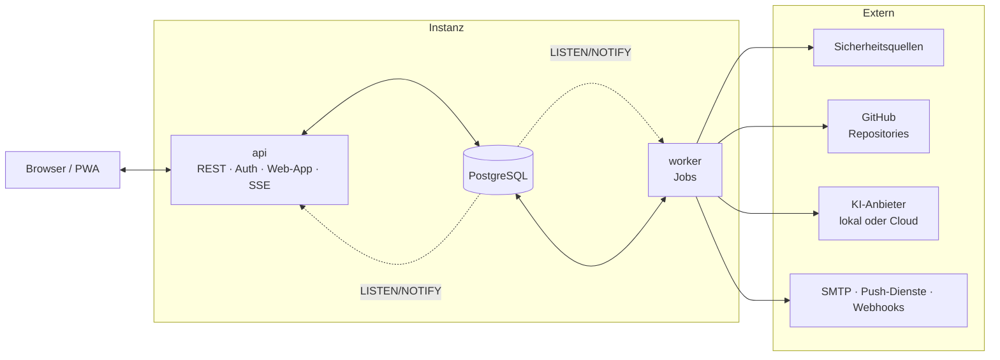
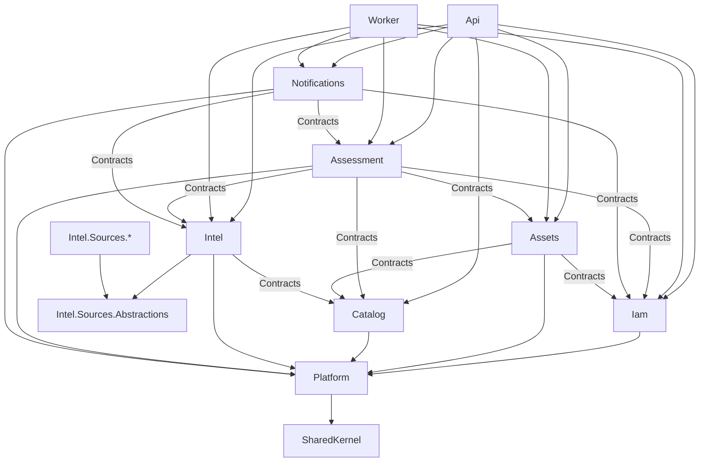
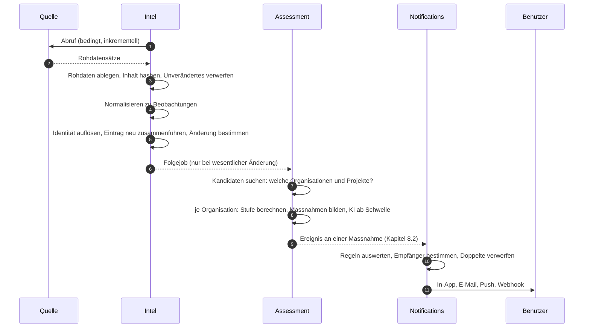

# 3 · Softwarearchitektur

## 3.1 Form: modularer Monolith mit separatem Worker

Eine Codebasis, eine Datenbank, ein Container-Image mit drei Rollen (dazu Hilfsbefehle wie `healthcheck`, `init-env`, `doctor` und die Wartungsbefehle, Kapitel 12.3):

| Prozess | Aufgabe | Skalierung |
|---|---|---|
| `api` | REST-API, Authentifizierung, Auslieferung der Web-App, Live-Ereignisse an den Browser | zustandslos, mehrere Instanzen möglich |
| `worker` | Quellen abfragen, normalisieren, zusammenführen, bewerten, benachrichtigen | mehrere Instanzen möglich, Koordination über Leases in der Datenbank |
| `migrate` | Datenbankschema aktualisieren, Stammdaten einspielen; läuft einmal pro Start und endet | genau eine Ausführung |

Beide dauerhaften Prozesse laden dieselben Module. Der Unterschied liegt nur darin, was sie starten: `api` die HTTP-Endpunkte, `worker` die Job-Verarbeitung. Microservices sind ausdrücklich nicht vorgesehen; die Modulgrenzen sind so gezogen, dass sich ein Modul später herauslösen liesse, ohne dass der Plan darauf angewiesen ist.



## 3.2 Module und Verantwortlichkeiten

Die acht geforderten Bereiche verteilen sich auf sieben Module und einen Host mit zwei Rollen. Quellenadapter liegen in eigenen Assemblies ausserhalb des Kerns.

| Modul | Verantwortet | Geforderter Bereich |
|---|---|---|
| **Intel.Sources.\*** | Je Quelle ein Adapter: abrufen, in Beobachtungen übersetzen. Kennt nur das Provider-SDK, weder Datenbank noch andere Module. | 1 Source Providers |
| **Intel** | Abrufsteuerung, Rohdatenablage, Normalisierung, Identitätsauflösung, Zusammenführung, Änderungshistorie, konsolidierte Einträge | 2 Ingestion & Normalization, 3 Correlation & Deduplication |
| **Assessment** | Kandidatensuche gegen Profile, Regelwerk für die Stufe, KI-Einschätzung, Befunde, Massnahmen und Meldungen mit Status | 4 Risk Assessment & AI Analysis |
| **Iam** | Benutzer, Anmeldung, MFA, Organisationen, Mitgliedschaften, Einladungen, Rollen | 5 Organization … |
| **Assets** | Projekte, Komponenten, Setup-Wizard-Zustand; Zugänge zu GitHub, Verknüpfung von Repositories, Einlesen und Abgleich der Abhängigkeiten, Vorschläge (Kapitel 16) | 5 … & Asset Management |
| **Catalog** | Technologie-Katalog: Produkte, Aliasse, Produktschlüssel, Versionsschemata | Grundlage für 3, 4 und 5 |
| **Notifications** | Regeln, Empfängerauflösung, Kanäle, Zustellung mit Wiederholung, Sammelnachrichten, In-App-Benachrichtigungen | 6 Notification Engine |
| **Platform** | Jobs und Zeitpläne, Mandantenkontext und Arbeitseinheit, Audit-Protokoll, Einstellungen, Geheimnisschutz, Telemetrie | Querschnitt |
| Host **Api** | Endpunkte aller Module, OpenAPI, Auslieferung der Web-App | 7 Backend API |
| **web/** | Angular-Anwendung | 8 Web Frontend |

### Abhängigkeitsregeln



1. Ein Modul greift auf ein anderes nur über dessen `Contracts`-Assembly zu: Abfrage-Schnittstellen, Datentransferobjekte, Integrationsereignisse. Alles andere ist `internal`.
2. Kein Modul liest oder schreibt Tabellen eines anderen Moduls. Jedes Modul besitzt ein eigenes Datenbankschema und einen eigenen `DbContext`.
3. Abhängigkeiten zeigen in eine Richtung: `Catalog` und `Iam` kennen niemanden. `Intel` kennt `Catalog`. `Assets` kennt `Catalog` und `Iam`. `Assessment` kennt `Intel`, `Assets`, `Catalog` und `Iam` (Einstellungen der Organisation). `Notifications` kennt `Assessment`, `Iam` (Mitgliederverzeichnis) und `Intel` (Warnungen ohne Kennung). Zyklen sind verboten.
4. Quellenadapter kennen ausschliesslich das Provider-SDK. Sie haben keinen Zugriff auf Datenbank, Mandantendaten oder andere Adapter.
5. Architekturtests im Build prüfen die Regeln 1 bis 4; ein Verstoss lässt den Build scheitern.

### Aufbau eines Moduls

Ein Projekt pro Modul plus ein Contracts-Projekt. Die klassische Vierteilung in Domain, Application, Infrastructure und Presentation als eigene Projekte würde bei sieben Modulen fast dreissig Projekte erzeugen; Ordner und `internal` leisten dasselbe mit weniger Reibung.

```
Modules/Assessment/
  Ardea.Assessment.Contracts/        öffentliche Schnittstellen, DTOs, Ereignisse
  Ardea.Assessment/
    Domain/          Entitäten, Wertobjekte, Regeln (keine Abhängigkeit auf EF oder HTTP)
    Features/        je Anwendungsfall ein Ordner: Handler, Validierung, Endpunkt
    Jobs/            Job-Handler
    Persistence/     DbContext, Konfiguration, Migrationen
    Module.cs        Registrierung: Dienste, Endpunkte, Jobs
```

Anwendungsfälle sind schlichte Handler-Klassen, die der Endpunkt direkt aufruft. Eine Mediator-Bibliothek kommt nicht zum Einsatz: Sie brächte eine Lizenzabhängigkeit (Kapitel 2) und eine Indirektion ohne Gegenwert.

## 3.3 Die Verarbeitungskette

Jeder Schritt ist ein idempotenter Job. Schritte sind über eingereihte Folgejobs entkoppelt: Ein Zustand und der Job, der auf ihn folgt, werden in derselben Transaktion geschrieben.



| Schritt | Job | Auslöser | Idempotenz über |
|---|---|---|---|
| Abruf | `SyncSource(sourceId)` | Fälligkeit der Quelle | Cursor der Quelle; Upsert auf (Quelle, externe ID) mit Inhalts-Hash |
| Normalisierung | `NormalizeRecords(batch)` | neue oder geänderte Rohdatensätze | eine Beobachtung je Rohdatensatz, die mit jeder Revision überschrieben wird; dieselbe Revision ergibt dieselbe Beobachtung |
| Zusammenführung | `CorrelateEntry(entryKey)` | neue Beobachtungen | Neuberechnung aus allen Beobachtungen; Revisionsnummer |
| Kandidatensuche | `MatchEntry(entryId)` | Eintrag wesentlich geändert | arbeitet immer auf dem aktuellen Stand; ein wartender Job je Eintrag |
| Repository einlesen | `IndexRepository(linkId)` | Verknüpfung fällig, neu verbunden oder «Jetzt einlesen» (Kapitel 16.2) | Commit-SHA; Abgleich über die Identität der Komponenten; ein wartender Job je Verknüpfung |
| Rückwärtssuche | `MatchProject(projectId)` | Profil geändert, von Hand oder durch ein Einlesen | arbeitet auf dem aktuellen Profil; ein wartender Job je Projekt |
| Bewertung | `AssessAlert(orgId, entryId)` | Kandidat gefunden | rechnet Regeln und Massnahmen aus dem aktuellen Stand; gleiche Eingabe ändert nichts |
| KI-Einschätzung | `EstimateAlert(orgId, alertId)` | Regelstufe ab Schwelle und Kontingent der Massnahme frei (Kapitel 7.5) | Fingerabdruck der Eingabe; gleiche Eingabe erzeugt keine neue Einschätzung |
| Benachrichtigung | `EvaluateRules(event)` → `Deliver(deliveryId)` | Ereignisse nach Kapitel 8.2 | Benachrichtigungsstand; Empfänger, Kanal und Ereignis zusammen eindeutig (Kapitel 8.4) |
| Sammelnachricht | `SendDigest(targetId, periodEnd)` | Zeitplan des Ziels | Ziel, Empfänger und Periodenende zusammen eindeutig |

Mehrere Quellen aktualisieren dieselbe Schwachstelle oft innerhalb von Minuten. `MatchEntry` wird deshalb mit einer kurzen Verzögerung eingereiht; solange ein Job für denselben Eintrag wartet, entsteht kein zweiter. Eine Welle von Änderungen löst so eine Bewertung aus, nicht fünf.

## 3.4 Jobs und Zeitsteuerung

Empfehlung (Bewertung der Alternativen in Kapitel 2.2): eine eigene Job-Tabelle in PostgreSQL statt einer Scheduler-Bibliothek. Die Gründe:

- **Transaktionale Einreihung.** Der Zustand «Eintrag geändert» und der Folgejob entstehen in einer Transaktion. Kein Fenster, in dem das eine ohne das andere existiert. Die Job-Tabelle ist damit zugleich die Outbox; ein eigener Verteiler entfällt.
- **Abrufsteuerung ist Fachzustand.** Wann eine Quelle wieder fällig ist, hängt von ihrem Verhalten ab. Das gehört in die Tabelle der Quelle, nicht in einen fremden Scheduler.
- **Eine Abhängigkeit weniger** bei einem Muster, das mit `FOR UPDATE SKIP LOCKED` gut verstanden ist.

Das ist kein Zehnzeiler, sondern ein kleines eigenes Teilsystem. Sein Umfang im MVP ist bewusst begrenzt:

```
platform.job
  id uuid, kind text, payload jsonb, coalesce_key text (nullable),
  run_at timestamptz, priority smallint (0 dringend, 1 normal, 2 Hintergrund),
  state: pending | running | succeeded | failed | dead,
  attempts int, max_attempts int, last_error text,
  lease_owner text, lease_until timestamptz, lease_token uuid, timeout_seconds int,
  org_id uuid (nullable, setzt den Mandantenkontext), trace_parent text,
  created_at, finished_at
```

| Funktion | Festlegung |
|---|---|
| Abholen | `… WHERE state = 'pending' AND run_at <= now() ORDER BY priority, run_at FOR UPDATE SKIP LOCKED LIMIT n`, danach Lease setzen |
| Lease | kurz (Vorgabe 30 Sekunden) und vom Worker erneuert, solange er lebt; jede Übernahme erhält ein eigenes Lease-Token, das jedes spätere Schreiben vorweist; ein Wächter gibt abgelaufene frei und zählt den Versuch. `timeout_seconds` begrenzt davon getrennt die Ausführung: Ein Job darüber wird abgebrochen und zählt als Fehlversuch. Beim Beenden holt der Worker keine neuen Jobs mehr, lässt laufende eine Frist lang fertig arbeiten und gibt die übrigen ohne Zählung des Versuchs zurück. |
| Wecken | `NOTIFY` beim Einreihen; ein langsamer Poll bleibt als Rückfallebene |
| Wiederholen | exponentiell mit Streuung; nach `max_attempts` Zustand `dead`, sichtbar in der Administration, von Hand wiederholbar |
| Zusammenfassen | höchstens ein wartender Job je `coalesce_key` (eindeutiger Teilindex über wartende Jobs); ein laufender oder erledigter Job blockiert keinen neuen |
| Begrenzen | Parallelität je Job-Art konfigurierbar; KI-Jobs und Abrufe je Quelle haben eigene Obergrenzen |
| Wiederkehrendes | `platform.schedule` mit Cron-Ausdruck und Zeitzone für Aufgaben der Instanz (Aufräumen, fällige Quellen und Sammelziele ermitteln); ein Leader (Advisory Lock) reiht fällige Läufe ein. Wann eine Quelle oder ein Sammelziel fällig ist, steht an der jeweiligen Zeile, nicht hier. |
| Aufräumen | erledigte Jobs nach 7 Tagen, aufgegebene nach 30 |

Verarbeitungsschritte und Zustellungen wiederholt das Job-System; einen zweiten Mechanismus gibt es dafür nicht. Abrufe sind die eine, bewusste Ausnahme: Der Job `SyncSource` hat einen einzigen Versuch. Schlägt er fehl, bestimmt die Quelle aus ihrer Fehlerserie den nächsten Termin (Kapitel 5.4), und der nächste Lauf setzt am letzten Haltepunkt an.

Der Baustein bleibt hinter `IJobQueue` und `IScheduler`. Sollte er sich als zu knapp erweisen, ist Quartz.NET die vorgesehene Ausweichlösung, ohne dass Module es merken.

## 3.5 Querschnitt

| Thema | Entscheidung |
|---|---|
| Mandantenkontext | `ITenantContext` wird pro Anfrage aus Route und Mitgliedschaft, pro Job aus `org_id` gesetzt. Ohne Kontext sind mandantenbezogene Daten nicht lesbar. Eine Arbeitseinheit ist genau eine Transaktion über alle beteiligten Module; Jobs mit Aussenkontakt bestehen aus mehreren Arbeitseinheiten (Kapitel 9.2). |
| IDs | UUID Version 7: zeitlich sortierbar, ohne zentrale Vergabe. Zusätzlich je Organisation eine kurze, fortlaufende Nummer für Massnahmen und Meldungen als Griff für Menschen. |
| Zeit | Durchgehend UTC in der Datenbank, `TimeProvider` im Code; Zeitzonen nur in Darstellung und Zeitplänen. |
| Fehler | Erwartbare Fehler als Ergebnis-Typ bis zum Endpunkt, dort Problem Details nach RFC 9457. Ausnahmen nur für Unerwartetes. |
| Validierung | An der API-Grenze; Fachregeln zusätzlich in der Domäne. |
| Konfiguration | Umgebungsvariablen mit Präfix `ARDEA_`, beim Start validiert; fehlerhafte Konfiguration beendet den Prozess mit klarer Meldung. |
| Telemetrie | Ein Trace von der Quelle bis zur Zustellung: Der Trace-Kontext reist im Job mit. |

## 3.6 Erweiterungspunkte

| Erweiterung | Schnittstelle | Aufwand für Neues |
|---|---|---|
| Quelle | `ISourceProvider` aus dem Provider-SDK (Kapitel 5) | eine Klasse, bei bekannten Formaten wenige Zeilen Konfiguration |
| Benachrichtigungskanal | `INotificationChannel` (Kapitel 8) | eine Klasse plus Einstellungsformular |
| KI-Anbieter | `IChatClient` aus Microsoft.Extensions.AI (Kapitel 7.8) | Konfiguration, kein Code bei OpenAI-kompatiblen Endpunkten |
| Versionsvergleich | `IVersionScheme` (Kapitel 6) | eine Klasse je Schema |
| Code-Plattform | `IRepositoryHost` (Kapitel 16.4): Zweigkopf, SBOM, Dateibaum, Datei | eine Klasse je Plattform; im MVP GitHub |
| Lockdatei oder Plattformdatei | `IManifestReader`, `IStackDetector` (Kapitel 16.3) | eine Klasse je Dateiart, Testfälle aus echten Dateien |
| Katalog | Stammdaten als versionierte Dateien im Repository | ein Eintrag mit Aliassen |

## 3.7 Wachstumspfad

1. **Mehr Last im Worker:** zweite Worker-Instanz starten. Leases verhindern Doppelarbeit; je Quelle läuft durch die Lease der Quelle höchstens ein Abruf. Ratenbegrenzungen je Host gelten im MVP je Worker-Prozess.
2. **Mehr Last in der API:** weitere API-Instanzen hinter einem Load Balancer. Live-Ereignisse verteilt PostgreSQL per `LISTEN/NOTIFY` an alle Instanzen.
3. **Grosse Datenmengen:** Partitionierung der Rohdaten nach Monat, Archivierung alter Revisionen, Lesereplikat für Suche.
4. **Erst danach** und nur mit konkretem Anlass: Herauslösen eines Moduls oder ein Message-Broker. Der Plan rechnet nicht damit.
