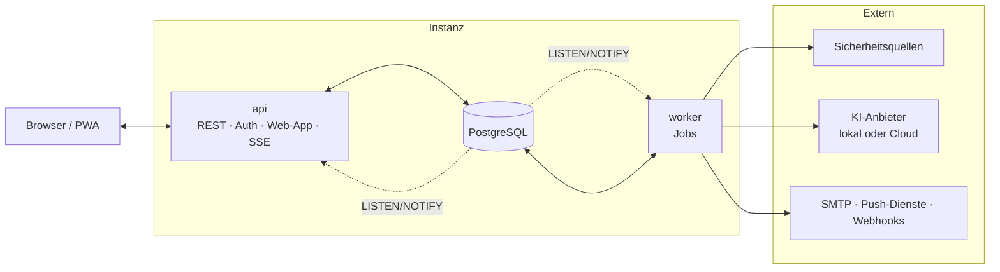
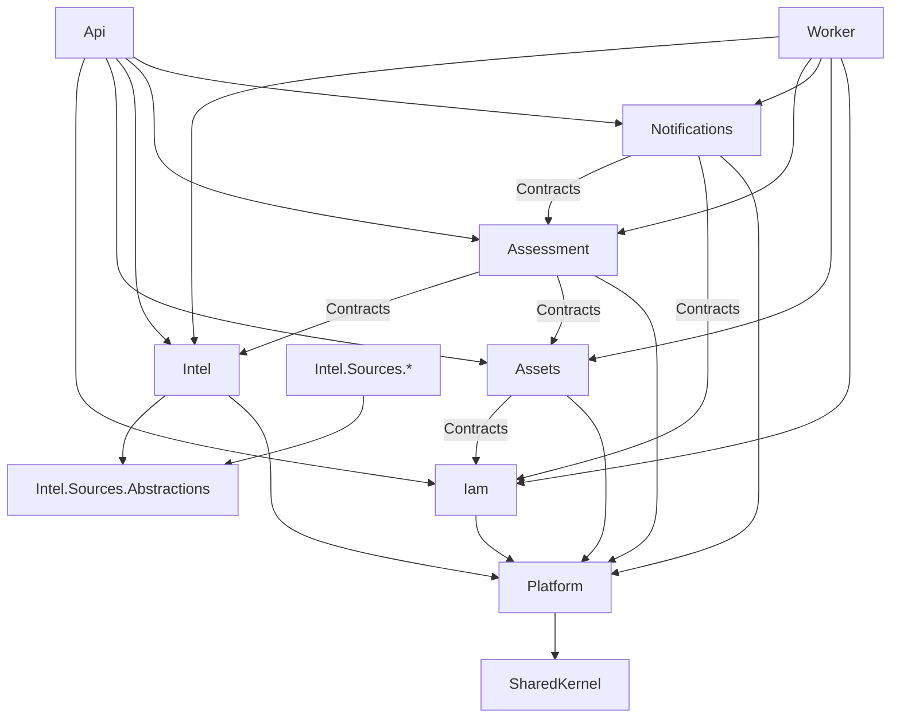
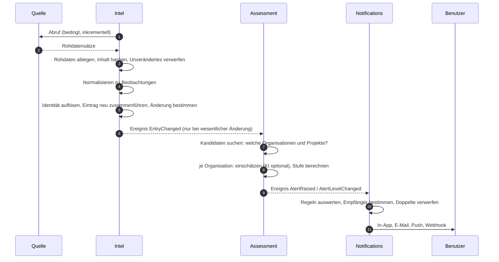

# 3 · Softwarearchitektur

## 3.1 Form: modularer Monolith mit separatem Worker

Eine Codebasis, eine Datenbank, ein Container-Image mit drei Startbefehlen:

| Prozess | Aufgabe | Skalierung |
|---|---|---|
| `api` | REST-API, Authentifizierung, Auslieferung der Web-App, Live-Ereignisse an den Browser | zustandslos, mehrere Instanzen möglich |
| `worker` | Quellen abfragen, normalisieren, zusammenführen, bewerten, benachrichtigen | mehrere Instanzen möglich, Koordination über Leases in der Datenbank |
| `migrate` | Datenbankschema aktualisieren, Stammdaten einspielen; läuft einmal pro Start und endet | genau eine Ausführung |

Beide dauerhaften Prozesse laden dieselben Module. Der Unterschied liegt nur darin, was sie starten: `api` die HTTP-Endpunkte, `worker` die Job-Verarbeitung. Microservices sind ausdrücklich nicht vorgesehen; die Modulgrenzen sind so gezogen, dass sich ein Modul später herauslösen liesse, ohne dass der Plan darauf angewiesen ist.



## 3.2 Module und Verantwortlichkeiten

Die acht geforderten Bereiche verteilen sich auf sechs Module und zwei Hosts. Quellenadapter liegen in eigenen Assemblies ausserhalb des Kerns.

| Modul | Verantwortet | Geforderter Bereich |
|---|---|---|
| **Intel.Sources.\*** | Je Quelle ein Adapter: abrufen, in Beobachtungen übersetzen. Kennt nur das Provider-SDK, weder Datenbank noch andere Module. | 1 Source Providers |
| **Intel** | Abrufsteuerung, Rohdatenablage, Normalisierung, Identitätsauflösung, Zusammenführung, Änderungshistorie, konsolidierte Einträge | 2 Ingestion & Normalization, 3 Correlation & Deduplication |
| **Assessment** | Kandidatensuche gegen Profile, KI-Einschätzung, Regelwerk für die Stufe, Meldungen und Befunde mit Status | 4 Risk Assessment & AI Analysis |
| **Iam** | Benutzer, Anmeldung, MFA, Organisationen, Mitgliedschaften, Einladungen, Rollen | 5 Organization … |
| **Assets** | Projekte, Komponenten, Technologie-Katalog, Setup-Wizard-Zustand | 5 … & Asset Management |
| **Notifications** | Regeln, Empfängerauflösung, Kanäle, Zustellung mit Wiederholung, Zusammenfassungen, In-App-Benachrichtigungen | 6 Notification Engine |
| **Platform** | Jobs und Outbox, Mandantenkontext, Audit-Protokoll, Einstellungen, Geheimnisschutz, Telemetrie | Querschnitt |
| Host **Api** | Endpunkte aller Module, OpenAPI, Auslieferung der Web-App | 7 Backend API |
| **web/** | Angular-Anwendung | 8 Web Frontend |

### Abhängigkeitsregeln



1. Ein Modul greift auf ein anderes nur über dessen `Contracts`-Assembly zu: Abfrage-Schnittstellen, Datentransferobjekte, Integrationsereignisse. Alles andere ist `internal`.
2. Kein Modul liest oder schreibt Tabellen eines anderen Moduls. Jedes Modul besitzt ein eigenes Datenbankschema und einen eigenen `DbContext`.
3. Abhängigkeiten zeigen in eine Richtung: `Intel` kennt niemanden, `Assessment` kennt `Intel` und `Assets`, `Notifications` kennt `Assessment` und `Iam`. Zyklen sind verboten.
4. Quellenadapter kennen ausschliesslich das Provider-SDK. Sie haben keinen Zugriff auf Datenbank, Mandantendaten oder andere Adapter.
5. Architekturtests im Build prüfen die Regeln 1 bis 4; ein Verstoss lässt den Build scheitern.

### Aufbau eines Moduls

Ein Projekt pro Modul plus ein Contracts-Projekt. Die klassische Vierteilung in Domain, Application, Infrastructure und Presentation als eigene Projekte würde bei sechs Modulen über zwanzig Projekte erzeugen; Ordner und `internal` leisten dasselbe mit weniger Reibung.

```
Modules/Assessment/
  CshAlert.Assessment.Contracts/     öffentliche Schnittstellen, DTOs, Ereignisse
  CshAlert.Assessment/
    Domain/          Entitäten, Wertobjekte, Regeln (keine Abhängigkeit auf EF oder HTTP)
    Features/        je Anwendungsfall ein Ordner: Handler, Validierung, Endpunkt
    Jobs/            Job-Handler
    Persistence/     DbContext, Konfiguration, Migrationen
    Module.cs        Registrierung: Dienste, Endpunkte, Jobs
```

Anwendungsfälle sind schlichte Handler-Klassen, die der Endpunkt direkt aufruft. Eine Mediator-Bibliothek kommt nicht zum Einsatz: Sie brächte eine Lizenzabhängigkeit (Kapitel 2) und eine Indirektion ohne Gegenwert.

## 3.3 Die Verarbeitungskette

Jede Stufe ist ein idempotenter Job. Stufen sind über die Outbox entkoppelt: Ein Zustand und das Ereignis darüber werden in derselben Transaktion geschrieben.



| Stufe | Job | Auslöser | Idempotenz über |
|---|---|---|---|
| Abruf | `SyncSource(sourceId)` | Fälligkeit der Quelle | Cursor der Quelle; Upsert auf (Quelle, externe ID) mit Inhalts-Hash |
| Normalisierung | `NormalizeRecords(batch)` | neue oder geänderte Rohdatensätze | Beobachtung je Rohdaten-Revision |
| Zusammenführung | `CorrelateEntry(entryKey)` | neue Beobachtungen | Neuberechnung aus allen Beobachtungen; Revisionsnummer |
| Kandidatensuche | `MatchEntry(entryId, revision)` | `EntryChanged` | Schlüssel (Eintrag, Revision) |
| Rückwärtssuche | `MatchProject(projectId)` | Profil geändert | Schlüssel (Projekt, Profilversion) |
| Einschätzung | `AssessAlert(orgId, entryId, revision)` | Kandidat gefunden | Schlüssel (Organisation, Eintrag, Revision, Profilversion) |
| Benachrichtigung | `EvaluateRules(alertEvent)` → `Deliver(deliveryId)` | `AlertRaised`, `AlertLevelChanged` | eindeutiger Zustellschlüssel (Kapitel 8) |
| Zusammenfassung | `SendDigest(ruleId, period)` | Zeitplan der Regel | Schlüssel (Regel, Periode) |

Mehrere Quellen aktualisieren dieselbe Schwachstelle oft innerhalb von Minuten. `MatchEntry` wird deshalb mit einer kurzen Verzögerung eingereiht und über seinen Schlüssel zusammengefasst, sodass eine Welle von Änderungen eine Einschätzung auslöst, nicht fünf.

## 3.4 Jobs, Outbox und Zeitsteuerung

Empfehlung (Bewertung der Alternativen in Kapitel 2): eine schlanke, eigene Job-Tabelle in PostgreSQL statt einer Scheduler-Bibliothek. Die drei Gründe:

- **Transaktionale Einreihung.** Der Zustand «Eintrag geändert» und der Folgejob entstehen in einer Transaktion. Kein Fenster, in dem das eine ohne das andere existiert.
- **Abrufsteuerung ist Fachzustand.** Wann eine Quelle wieder fällig ist, hängt von ihrem Verhalten ab: Intervall, Fehlerserie, `Retry-After`. Das gehört in die Tabelle der Quelle, nicht in einen fremden Scheduler.
- **Eine Abhängigkeit weniger** bei einem Muster, das mit `FOR UPDATE SKIP LOCKED` gut verstanden ist.

```
platform.job
  id uuid, kind text, payload jsonb, dedupe_key text unique (nullable),
  run_at timestamptz, priority smallint,
  state: pending | running | succeeded | failed | dead,
  attempts int, max_attempts int, last_error text,
  lease_owner text, lease_until timestamptz,
  org_id uuid (nullable, setzt den Mandantenkontext), trace_parent text,
  created_at, finished_at
```

- **Abholen:** `SELECT … WHERE state = 'pending' AND run_at <= now() ORDER BY priority, run_at FOR UPDATE SKIP LOCKED LIMIT n`, danach Lease setzen. Ein Wächter gibt abgelaufene Leases wieder frei.
- **Wecken:** `NOTIFY` beim Einreihen, damit der Worker nicht pollen muss; ein langsamer Poll bleibt als Rückfallebene.
- **Wiederholen:** exponentiell mit Streuung; nach `max_attempts` Zustand `dead`, sichtbar in der Administration, manuell wiederholbar.
- **Zusammenfassen:** Ein gesetzter `dedupe_key` verhindert einen zweiten wartenden Job gleicher Art.
- **Begrenzen:** Parallelität je Job-Art konfigurierbar; KI-Jobs und Abrufe je Quelle haben eigene Obergrenzen.
- **Wiederkehrendes:** Eine Tabelle `platform.schedule` mit Cron-Ausdruck und Zeitzone; ein Leader (Advisory Lock) reiht fällige Läufe mit Schlüssel (Zeitplan, Fälligkeit) ein.
- **Outbox:** `platform.outbox_message` wird in derselben Transaktion wie die Fachänderung geschrieben; ein Verteiler macht daraus Jobs für die abonnierenden Module. Empfänger sind idempotent.
- **Aufräumen:** Erfolgreiche Jobs werden nach 7 Tagen gelöscht, fehlgeschlagene nach 30.

Der Baustein bleibt hinter `IJobQueue` und `IScheduler`. Sollte er sich als zu knapp erweisen, lässt er sich durch eine Bibliothek ersetzen, ohne dass Module es merken.

## 3.5 Querschnitt

| Thema | Entscheidung |
|---|---|
| Mandantenkontext | `ITenantContext` wird pro Anfrage aus Route und Mitgliedschaft, pro Job aus `org_id` gesetzt. Ohne Kontext sind mandantenbezogene Daten nicht lesbar (Kapitel 9). |
| IDs | UUID Version 7: zeitlich sortierbar, ohne zentrale Vergabe. Zusätzlich je Organisation eine kurze, fortlaufende Meldungsnummer als Griff für Menschen. |
| Zeit | Durchgehend UTC in der Datenbank, `TimeProvider` im Code; Zeitzonen nur in Darstellung und Zeitplänen. |
| Fehler | Erwartbare Fehler als Ergebnis-Typ bis zum Endpunkt, dort Problem Details nach RFC 9457. Ausnahmen nur für Unerwartetes. |
| Validierung | An der API-Grenze; Fachregeln zusätzlich in der Domäne. |
| Konfiguration | Umgebungsvariablen mit Präfix `CSH_`, beim Start validiert; fehlerhafte Konfiguration beendet den Prozess mit klarer Meldung. |
| Telemetrie | Ein Trace von der Quelle bis zur Zustellung: Der Trace-Kontext reist im Job mit. |

## 3.6 Erweiterungspunkte

| Erweiterung | Schnittstelle | Aufwand für Neues |
|---|---|---|
| Quelle | `ISourceProvider` aus dem Provider-SDK (Kapitel 5) | eine Klasse, bei bekannten Formaten wenige Zeilen Konfiguration |
| Benachrichtigungskanal | `INotificationChannel` (Kapitel 8) | eine Klasse plus Einstellungsformular |
| KI-Anbieter | `IChatClient` aus Microsoft.Extensions.AI (Kapitel 7) | Konfiguration, kein Code bei OpenAI-kompatiblen Endpunkten |
| Versionsvergleich | `IVersionScheme` (Kapitel 6) | eine Klasse je Schema |
| Katalog | Stammdaten als versionierte Dateien im Repository | ein Eintrag mit Aliassen |

## 3.7 Wachstumspfad

1. **Mehr Last im Worker:** zweite Worker-Instanz starten. Leases verhindern Doppelarbeit, Obergrenzen je Quelle bleiben instanzübergreifend gültig, weil sie in der Datenbank liegen.
2. **Mehr Last in der API:** weitere API-Instanzen hinter einem Load Balancer. Live-Ereignisse verteilt PostgreSQL per `LISTEN/NOTIFY` an alle Instanzen.
3. **Grosse Datenmengen:** Partitionierung der Rohdaten nach Monat, Archivierung alter Revisionen, Lesereplikat für Suche.
4. **Erst danach** und nur mit konkretem Anlass: Herauslösen eines Moduls oder ein Message-Broker. Der Plan rechnet nicht damit.
