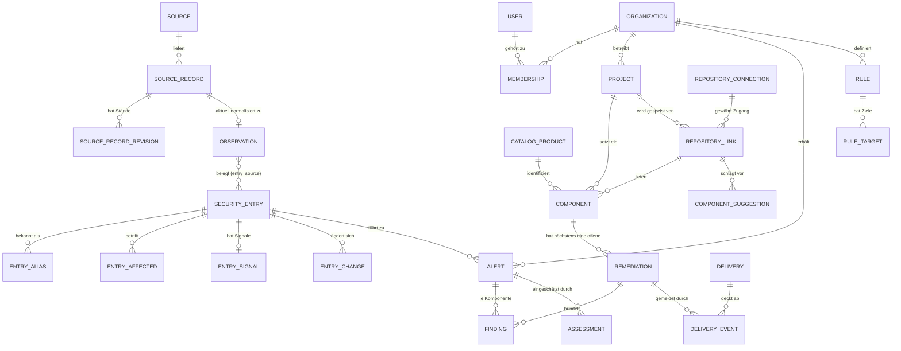

# 4 · Datenmodell

Eine PostgreSQL-Datenbank, ein Schema pro Modul. Tabellen- und Spaltennamen in `snake_case`, Zeitstempel als `timestamptz` in UTC, Primärschlüssel als UUID Version 7.

## 4.1 Drei Arten von Daten

Jede Tabelle gehört zu genau einer Art. Die Art bestimmt, wer sie lesen darf und welche Schutzregel in der Datenbank gilt (Kapitel 9.2).

| Art | Tabellen | Merkmal |
|---|---|---|
| **Global** | `intel.*`, `catalog.*`, `platform.job`, `platform.schedule`, `platform.setting` | Für alle Organisationen gleich. Die grosse Menge (Rohdaten, Einträge) liegt genau einmal vor. Einträge und Katalog liest jeder Angemeldete; die Tabellen in `platform` nur der Worker und der Instanz-Administrator. Jobs tragen in ihrer Nutzlast nur Kennungen, nie Inhalte. |
| **Organisation** | `iam.organization`, `iam.membership`, `iam.invitation`, `assets.*`, `assess.*`, `notify.rule`, `notify.rule_target`, `notify.endpoint`, `notify.external_address`, `notify.recipient_state`, `notify.delivery`, `notify.delivery_event`, `notify.digest_item`, `platform.audit_event` | Jede Zeile trägt `organization_id`, auch Kindtabellen. Im Audit-Protokoll ist die Spalte leer für Ereignisse der Instanz. |
| **Benutzer** | `iam.user`, die Identity-Tabellen und `iam.session`, `notify.notification`, `notify.push_subscription`, `notify.user_preference` | Gehören einem Benutzer. Wer sonst darauf zugreift, ist in Kapitel 9.2 abschliessend geregelt: Mitglieder derselben Organisation sehen Name, E-Mail-Adresse und Rolle; der Worker stellt einem benannten Empfänger zu. `notification` trägt zusätzlich die Organisation. |

Fremdschlüssel von Organisations- auf globale Tabellen sind erlaubt (etwa `assess.alert.entry_id → intel.security_entry.id`): Sie sichern die Integrität, ohne Module im Code zu koppeln. Navigations-Eigenschaften über Modulgrenzen gibt es nicht.

## 4.2 Überblick

## 4.3 Die zentrale Modellentscheidung: Beobachtungen und Projektion

Ein konsolidierter Eintrag wird nicht fortgeschrieben, sondern **berechnet**. Jede Quelle liefert Rohdatensätze. Aus jedem Rohdatensatz entsteht eine *Beobachtung*: die normalisierten Aussagen dieser einen Quelle. Der Eintrag ist die Zusammenführung aller Beobachtungen nach festen Vorrangregeln.

- **Deduplizierung** ist eine Frage der Identität, nicht des Überschreibens: Aussagen mit gemeinsamer Kennung gehören zum selben Eintrag.
- **Herkunft** bleibt pro Feld erhalten.
- **Korrekturen** an Parsern oder Vorrangregeln wirken rückwirkend: Die Projektion lässt sich neu berechnen.

Ein Eintrag hat eine von zwei Arten. `vulnerability` ist eine Schwachstelle mit Kennung und wird über Quellen hinweg zusammengeführt. `warning` ist eine Warnung ohne Schwachstellenkennung, etwa eine Phishing-Warnung des BACS; sie bleibt an ihre Quelle gebunden.

Ein Hersteller-Advisory, das zwölf CVEs nennt, erzeugt keinen eigenen Eintrag. Seine Beobachtung enthält zwölf Aussagenblöcke, je einen pro Kennung, und wird Beleg von zwölf Einträgen.

## 4.4 Schema `intel` (global)

| Tabelle | Zweck | Wichtige Spalten |
|---|---|---|
| `source` | Stammdaten und Abrufzustand | `key`, `kind` (record, advisory, signal), `operator`, `operator_kind` (authority, mandated, recognized, vendor, community; Kapitel 5.6), `adapter`, `enabled`, `interval`, `config jsonb`, `attribution`, `terms_mode` (full, metadata_only); Zustand: `next_sync_at`, `cursor jsonb`, `last_success_at`, `consecutive_failures`, `health`. Die Lease eines laufenden Abrufs gehört dem Job, nicht der Quelle. |
| `source_run` | Protokoll jedes Abrufs | `source_id`, `started_at`, `finished_at`, `outcome`, `fetched`, `changed`, `quarantined`, `error` |
| `source_record` | Aktueller Rohdatensatz je externer ID | `source_id`, `external_id` (zusammen eindeutig), `url`, `content_hash`, `payload`, `revision`, `source_published_at`, `source_modified_at`, `first_seen_at`, `last_seen_at`, `parse_status` |
| `source_record_revision` | Frühere Rohstände | `source_record_id`, `revision`, `content_hash`, `payload`, `fetched_at` |
| `observation` | Normalisierte Aussagen des aktuellen Rohdatensatzes, genau eine je Rohdatensatz; eine neue Revision überschreibt sie | `source_record_id` (eindeutig), `record_revision`, `kind`, `title`, `description`, `language`, `claims jsonb` (Liste von Aussagenblöcken, je einer pro Kennung: Aliasse, Zustand, Metriken, betroffene Produkte, Ausnutzung, Abhilfe, Verweise), `origin` (parsed, extracted), `parser_version` |
| `security_entry` | Der konsolidierte Eintrag | `kind`, `primary_key` (eindeutig, z. B. `CVE-2026-115731`), `title`, `summary`, `description`, `state` (published, rejected, disputed, merged), `merged_into_id`, `published_at`, `changed_at`, `revision`, `material_fingerprint`, `reminder_fingerprint`, `cvss_score`, `cvss_version`, `cvss_vector`, `exploitation` (none, poc, active) mit `exploitation_evidence jsonb`, `epss_class`, `fix_available`, `cwe_ids`, `authority_warning`, `provenance jsonb`, `search tsvector` |
| `entry_alias` | Alle Kennungen eines Eintrags | `entry_id`, `scheme`, `value`; (`scheme`, `value`) eindeutig |
| `entry_affected` | Betroffene Produkte und Versionsbereiche | `entry_id`, `vendor`, `product`, `product_key`, `cpe_vendor`, `cpe_product`, `purl_type`, `purl_name`, `version_scheme`, `introduced`, `fixed`, `last_affected`, `exact`, `status` (affected, unaffected, unknown), `default_status` (Angabe des Records für alle nicht genannten Versionen; ohne Angabe `unknown`), `source_id` |
| `entry_signal` | Signale je Kennung, getrennt vom Eintrag fortgeschrieben | `scheme`, `value` (zusammen eindeutig), `kev_listed_on`, `kev_url`, `epss_score`, `epss_percentile`, `epss_class`, `updated_at` |
| `entry_reference` | Verweise | `entry_id`, `url`, `tags`, `source_id` |
| `entry_source` | Welche Quellen einen Eintrag belegen | `entry_id`, `source_id`, `source_record_id` (leer bei Signalquellen), `relation` (describes, mentions, signal), `url` |
| `entry_change` | Änderungshistorie | `entry_id`, `revision`, `changed_at`, `change_kinds`, `is_material`, `diff jsonb`, `triggered_by` |

**Signale haben einen eigenen Weg.** EPSS liefert täglich rund 400 000 Werte, KEV eine Liste von knapp 1 800. Sie werden nicht als Rohdatensätze mit Revisionen abgelegt, sondern direkt in `entry_signal` fortgeschrieben; das Provider-SDK hat dafür eine eigene Schnittstelle (Kapitel 5.2). Ein Eintrag wird nur dann neu berechnet, wenn sich seine Signalklasse ändert (Kapitel 6.4): Die Zusammenführung liest dann die Signale seiner Kennungen, bildet den Ausnutzungsstand als Maximum über Signale und Beobachtungen und hält die Belege in `exploitation_evidence` und `entry_source` fest.

Indizes, die das Verhalten tragen: `entry_affected (product_key)`, `(cpe_vendor, cpe_product)` und `(purl_type, purl_name)` für die Kandidatensuche; `security_entry (changed_at desc)`; GIN auf `search`; `source (next_sync_at) WHERE enabled`.

Das Verschmelzen zweier Einträge, die eine später entdeckte Kennung verbindet, kommt mit OSV schon im MVP vor (Kapitel 6.2). Der unterlegene Eintrag erhält den Zustand `merged` und einen Verweis auf den überlegenen; seine Schlüssel bleiben als Weiterleitung auflösbar.

## 4.5 Schemata `catalog` und `assets`

| Tabelle | Zweck | Wichtige Spalten |
|---|---|---|
| `catalog.product` (global) | Technologie-Katalog: Grundstock und gelernte Einträge (Kapitel 6.9) | `key`, `name`, `vendor`, `kind`, `cpe_pairs text[]`, `purl_types`, `aliases jsonb` (Namensmuster je Hersteller-Schreibweise), `version_scheme`, `platform_key` (bei Plugins: zugehörige Plattform), `related_keys` (verwandte, eigenständige Produkte), `image_names text[]` (Container-Images, aus denen die Erkennung im Repository das Produkt ableitet, Kapitel 16.3); `origin` (curated, learned), bei gelernten zusätzlich `state` (active, pending, rejected, withdrawn), `confidence`, `reasoning`, `evidence jsonb` (Rohangaben und Records), `learned_by` (rule, model), `decided_by`, `decided_at` |
| `catalog.unknown_product` (global) | Produktangaben aus den Quellen ohne Katalogeintrag | `raw_key` (eindeutig), `vendor`, `product`, `cpe_pairs`, `purl`, `record_count`, `in_kev`, `first_seen_at`, `last_attempt_at`, `outcome` (open, alias, new, unclear, rejected), `product_key` |
| `assets.project` | Projekt oder System einer Organisation | `organization_id`, `kind` (project, organization_stack), `name`, `description`, `criticality` (low, normal, high), `exposure` (internet, internal, isolated), `archived_at` |
| `assets.component` | Eingesetzte Technologie eines Projekts | `organization_id`, `project_id`, `product_key` (aus dem Katalog) oder `custom_vendor`, `custom_name`; `kind` (os, runtime, framework, cms, database, messaging, container, network, virtualization, library, plugin, service, other); `version`, `version_scheme`, `packaging` (upstream, distribution, unknown), `parent_component_id`, `exposure`, `criticality`, `protection` (none, effective) mit `protection_note`, `origin` (manual, repository); bei Herkunft `repository` zusätzlich `repository_link_id`, `purl`, `version_precision` (none, line, exact; Kapitel 17), `dependency_scope` (runtime, development, unknown), `dependency_relation` (direct, transitive, unknown), `evidence` (Datei und Zeile) |
| `assets.component_key` | Suchindex für die Kandidatensuche | `organization_id`, `project_id`, `component_id`, `key_type` (cpe, product, purl), `key_value`, `strength` (strong, weak) |
| `assets.repository_connection` | Zugang einer Organisation zu GitHub (Kapitel 16.4) | `organization_id`, `name`, `host_id` (leer für github.com), `token_enc` (leer für Zugang ohne Token), `token_hint`, `token_expires_at`, `created_by`, `last_ok_at` |
| `assets.repository_link` | Ein Repository, das ein Projekt speist | `organization_id`, `project_id`, `connection_id`, `owner`, `name`, `ref` (leer: Standardzweig), `path` (Unterordner), `state` (ok, partial, failing), `state_reason`, `failing_since`, `last_commit_sha`, `last_indexed_at`, `next_check_at`, `head_etag`, `last_sbom` (komprimiert), `pending_shrink` (zur Bestätigung zurückgehaltener Stand) |
| `assets.component_suggestion` | Vorschlag aus einer Erkennungsregel | `organization_id`, `project_id`, `repository_link_id`, `product_key`, `version`, `evidence` (Datei, Zeile, gelesener Wert), `state` (open, accepted, dismissed), `decided_by`, `decided_at` |

Der Katalog ist ein eigenes kleines Modul, weil ihn zwei Seiten brauchen: `Intel` zum Bilden der Produktschlüssel, `Assets` für die Eingabe.

Die Hosts für GitHub Enterprise Server stehen als globale Einstellung in `platform.setting`; nur der Instanz-Administrator legt sie an. Eine Organisation wählt daraus, sie kann keine eigene Adresse eintragen (Kapitel 16.9).

Das Organisationsprofil aus den Anforderungen ist kein eigenes Objekt: Der Setup-Wizard legt das erste Projekt an. Damit gibt es genau einen Weg vom Profil zur Meldung. Die Kritikalität eines Geschäftsprozesses wird als Kritikalität des Projekts erfasst, das ihn trägt; die Beschreibung nennt den Prozess.

Komponenten der Art `service` (SaaS, verwaltete Cloud-Dienste) haben keine Version. Sie werden nur über Einträge gefunden, die den Dienst ausdrücklich nennen, und erscheinen sonst als «nicht versionsprüfbar».

## 4.6 Schema `assess`

| Tabelle | Zweck | Wichtige Spalten |
|---|---|---|
| `alert` | Eine Schwachstelle aus Sicht einer Organisation | `organization_id`, `entry_id` (zusammen eindeutig), `number` (fortlaufend je Organisation; leer, bis ein Befund Stufe 2 erreicht), `level` (Maximum über ihre Befunde), `assessed_entry_revision`, `current_assessment_id`, `first_raised_at` |
| `reminder` | Der Reminder: alle offenen Befunde einer Komponente in einem Projekt | `organization_id`, `project_id`, `component_id`, `number`, `level`, `target_version`, `open_findings`, `exploitation`, `fix_available`, `status` (open, done), `next_reminder_at`, `last_reminded_at`, `opened_at`, `level_raised_at`, `closed_at`, `close_reason`; je Komponente höchstens eine nicht geschlossene |
| `finding` | Betroffenheit einer Komponente durch einen Eintrag | `organization_id`, `alert_id`, `component_id` (zusammen eindeutig), `reminder_id` (leer bei Stufe 1), `project_id`, `match_type`, `version_verdict` (in_range, out_of_range, unknown), `verdict` (affected, likely, uncertain, unlikely, not_affected), `verdict_source` (rules, model, human), `level`, `factors jsonb`, `status` (open, remediated, risk_accepted, not_affected), `status_changed_by`, `status_changed_at`, `status_note`, `is_backfill` |
| `notice` | Hinweis zu einem Eintrag, der eine grobe Komponente trifft (Kapitel 17.3, [ADR 046](../adr/0046-stack-notices-and-reminders-without-deadline.md)) | `organization_id`, `entry_id` (zusammen eindeutig), `entry_key`, `state` (open, affects_us, not_affected), `component_ids` (Grund), `decided_by`, `decided_at`, `remediation_id` (Reminder aus «betrifft uns»), `reappeared_at`, `reappeared_reason` (exploited, kev), `raised_at` |
| `assessment` | Eine unveränderliche Einschätzung einer Meldung über alle ihre getroffenen Komponenten | `organization_id`, `alert_id`, `entry_revision`, `input_fingerprint`, `engine` (rules, rules+model), `ruleset_version`, `model`, `prompt_version`, `language`, `output jsonb`, `tokens_in`, `tokens_out`, `duration_ms`, `created_at` |
| `assess_event` | Verlauf von Reminders und Befunden; der Verlauf einer Meldung ist der ihrer Befunde. Die Kennung der Zeile ist zugleich die Kennung des Ereignisses für Benachrichtigungen. | `organization_id`, `reminder_id`, `finding_id`, `at`, `kind`, `actor`, `data jsonb` |
| `org_counter` | Nummernkreis der Organisation für Reminders und Meldungen | `organization_id`, `next_number` |
| `assessment_feedback` | Korrekturen durch Benutzer | `organization_id`, `assessment_id`, `user_id`, `kind`, `correction jsonb`, `note` |

Auch Ergebnisse mit Stufe 1 werden gespeichert: als Befund mit dem Status `not_affected`, ohne Reminder und ohne Nummer. Sie beantworten, warum eine Meldung ausgeblieben ist.

## 4.7 Schema `notify`

| Tabelle | Zweck | Wichtige Spalten |
|---|---|---|
| `rule` | Benachrichtigungsregel | `organization_id`, `name`, `enabled`, `project_ids` (leer = alle), `min_level`, `events` |
| `rule_target` | Wer über welchen Kanal und wie | `organization_id`, `rule_id`, `channel`, `recipient_kind` (role, user, address, endpoint), `recipient_ref`, `mode` (immediate, digest), `digest_cron` (in der Zeitzone der Organisation), `send_empty`, `next_digest_at` |
| `endpoint` | Webhook-Ziel | `organization_id`, `name`, `url_enc`, `secret_enc`, `enabled`, `last_status` |
| `external_address` | Bestätigte externe E-Mail-Adresse | `organization_id`, `address`, `confirmed_at`, `token_hash` |
| `recipient_state` | Was ein Empfänger auf einem Kanal über ein Reminder schon erfahren hat | `organization_id`, `reminder_id`, `recipient_key`, `channel`, `last_level`, `last_exploitation`, `fix_notified`, `last_notified_at`; eindeutig über die ersten vier |
| `delivery` | Eine Nachricht an einen Empfänger auf einem Kanal; zugleich das Zustellprotokoll | `organization_id`, `kind` (immediate, digest), `channel`, `recipient_key`, `send_after`, `state`, `last_error`, `sent_at`; bei Sammelnachrichten `rule_target_id` und `period_end`, eindeutig zusammen mit `recipient_key` |
| `delivery_event` | Welche Ereignisse eine Sofortnachricht abdeckt | `organization_id`, `delivery_id`, `recipient_key`, `channel`, `event_id` (eindeutig über die letzten drei), `event`, Gegenstand |
| `digest_item` | Vorgemerktes für eine Sammelnachricht | `organization_id`, `rule_target_id`, `event_id` (zusammen eindeutig), `event`, Gegenstand, `occurred_at`, `sent_at` |
| `notification` | In-App-Benachrichtigung | `user_id`, `organization_id`, `event_id`, Gegenstand, `kind`, `title`, `body`, `created_at`, `read_at` |
| `push_subscription` | Web-Push-Abo eines Geräts | `user_id`, `endpoint`, `p256dh`, `auth`, `user_agent`, `failed_count` |
| `user_preference` | Persönliche Einstellungen | `user_id`, `organization_id`, `muted_channels`, `locale` |

«Gegenstand» steht für drei Spalten, von denen genau eine gesetzt ist: `reminder_id` für Ereignisse an einer Reminder, `entry_id` für eine Warnung ohne Kennung, `project_id` für eine abgeschlossene Erstbefüllung und ein nicht mehr lesbares Repository. `recipient_key` ist die Benutzerkennung, die bestätigte externe Adresse oder das Webhook-Ziel.

## 4.8 Schemata `iam` und `platform`

`iam` enthält die Tabellen von ASP.NET Core Identity, `session` (serverseitige Sitzungen: Gerät, zuletzt gesehen, widerrufen; Grundlage für «aktive Sitzungen» und «überall abmelden») sowie `organization` (mit Sprache, Zeitzone und `settings jsonb` für Fristen, KI-Datenrichtlinie, MFA-Pflicht und Umfang der E-Mails), `membership` und `invitation` (gehashter Token, Ablauf, Rolle). Andere Module lesen die Einstellungen über die Contracts von `Iam`.

`platform` enthält `job` und `schedule` (Kapitel 3.4; `schedule` nur für wiederkehrende Aufgaben der Instanz), `audit_event`, `setting` (Instanz-Einstellungen, Geheimnisse verschlüsselt) und die Schlüssel der Data Protection.

## 4.9 Festlegungen, die sonst jemand raten müsste

| Frage | Festlegung |
|---|---|
| Urteil ohne Modell | Version im Bereich → `affected`; unbekannt → `uncertain`; ausserhalb → `not_affected`; schwacher Treffer → `not_affected` |
| Status einer Reminder | `open`, solange ein Befund offen ist; sie wird `closed` (Kapitel 17.5: erledigt), sobald kein Befund mehr offen ist; `close_reason` ist das häufigste Ergebnis ihrer Befunde. Keine Zuweisung, keine Frist, kein «in Prüfung» ([ADR 046](../adr/0046-stack-notices-and-reminders-without-deadline.md)). Ein späterer Befund zur selben Komponente öffnet ein neuer Reminder. |
| Vorgabestatus eines Befunds | ab Stufe 2: `open`. Stufe 1 aus den Regeln: `not_affected`, gesetzt vom System, ohne Reminder. Steigt ein solcher Befund später, wird er `open` und tritt einer Reminder bei. |
| Identität einer Komponente | Eine Komponente behält ihre Kennung, wenn Version, Kontext oder Schutzmassnahme geändert werden. Das Ersetzen eines ganzen Profils gleicht ab: vorhandene Komponenten über ihre Kennung oder, wo sie fehlt, über Produktschlüssel und übergeordnete Komponente; nur was in der neuen Liste fehlt, wird entfernt. Eine entfernte Komponente schliesst ihre Reminder mit dem Grund «Komponente entfernt». Für Komponenten aus einem Repository gelten zusätzlich die Regeln aus Kapitel 16.5: Ersetzen betrifft nur manuelle Komponenten, das Einlesen nur die der eigenen Verknüpfung. |
| Nummern | je Organisation ein Zähler in `assess.org_counter`, erhöht unter Zeilensperre in der schreibenden Transaktion; Reminders und Meldungen teilen den Nummernkreis, eine Nummer kommt also nur einmal vor |
| Frist | entfällt (Kapitel 17.5). Die Spalten `assigned_to`, `due_at` und `due_at_manual` bleiben nach 4.11 eine Version ungenutzt stehen ([ADR 046](../adr/0046-stack-notices-and-reminders-without-deadline.md)). |
| Genauigkeit der Version | `component.version_precision` (none, line, exact); angegeben oder aus der Version abgeleitet, Regel in [ADR 046](../adr/0046-stack-notices-and-reminders-without-deadline.md) |
| Umfang einer Einschätzung | eine Meldung, also ein Eintrag aus Sicht einer Organisation, mit allen getroffenen Komponenten; das Urteil steht je Komponente im Ergebnis und wird an den Befund übernommen |
| Profilstand einer Einschätzung | `input_fingerprint` ist ein Hash über Eintragsrevision, die getroffenen Komponenten mit Version und Kontext, Regelversion und Prompt-Version |
| Regelwerk | Datei im Image; ihre Version steht an jeder Einschätzung und an jedem Befund in `factors` |
| Einstellungen der Organisation | in `organization.settings`; Geheimnisse nie dort, sondern verschlüsselt in eigenen Spalten |
| Herkunft «extrahiert» | eine Beobachtung, deren Aussagen ein Sprachmodell aus Freitext gewonnen hat; im MVP nicht vorhanden |

## 4.10 Mengen und Aufbewahrung

Gemessen am 18.11.2026 für das CVE Program (`prototypes/relevance-funnel/`): im Mittel 590 neue Records und 2 774 Änderungen pro Tag, Record-Grösse im Median 3,6 kB.

| Grösse | Schätzung |
|---|---|
| Neue Rohdaten | rund 2 MB pro Tag |
| Revisionen | rund 10 MB pro Tag unkomprimiert |
| Start mit 180 Tagen Rückblick | gut 100 000 Einträge, 1 bis 2 GB |
| Gesamtbestand CVE | optional; mehrere GB, einmaliger Import eines Archivs von 666 MB |
| Signale | eine Zeile je Kennung, rund 400 000, ohne Revisionen |
| Mandantendaten | hängt von Profil und Patchstand ab: im Spike 173 Befunde aus starken Treffern pro Woche für drei Projekte, davon je nach Versionen 6 bis 170 ab Stufe 3. Dazu kommen schwache Treffer als Befunde der Stufe 1: 477 in der Woche allein für eine WordPress-Plattform. Eine Zeile misst unter 1 kB. |
| Komponenten aus Repositories | Schätzung: 100 bis 1 300 je Repository, rund 20 000 für eine Organisation mit 20 Repositories; dazu je Verknüpfung die letzte SBOM, komprimiert meist unter 200 kB (Kapitel 16.8) |

Vorgaben, alle konfigurierbar: Rückblick beim Erststart 180 Tage; ältere Einträge werden bei Bedarf einzeln nachgeladen. Von jedem Rohdatensatz bleiben der erste und die letzten zehn Stände. `source_run` wird nach 90 Tagen ausgedünnt, erledigte Jobs nach 7 Tagen. Reminders, Befunde, Einschätzungen und Verlauf werden nie automatisch gelöscht.

## 4.11 Migrationen

Jedes Modul führt eigene EF-Core-Migrationen mit eigener Historientabelle in seinem Schema. Der Befehl `migrate` wendet sie in fester Reihenfolge an (`platform`, `iam`, `catalog`, `assets`, `intel`, `assess`, `notify`) und spielt danach Stammdaten ein: Quellen, Katalog, Regelwerk. Migrationen sind vorwärtsgerichtet und in zwei Schritten verträglich: erst erweitern, in einer späteren Version entfernen. API und Worker starten, wenn das Schema mindestens ihrem Stand entspricht; ein neueres, verträglich erweitertes Schema ist zulässig.
