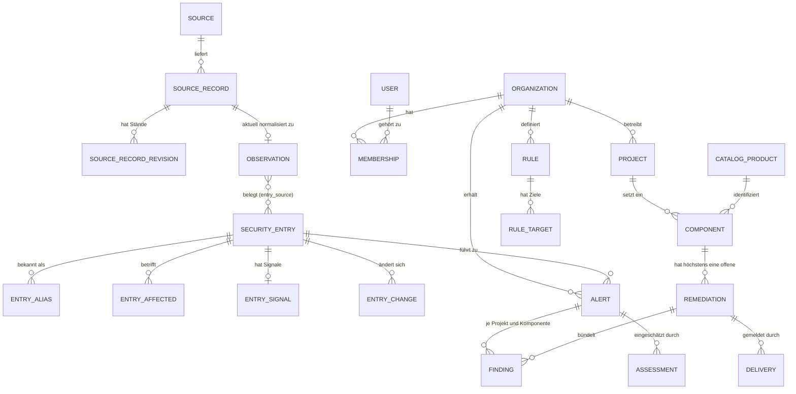

# 4 · Datenmodell

Eine PostgreSQL-Datenbank, ein Schema pro Modul. Tabellen- und Spaltennamen in `snake_case`, Zeitstempel als `timestamptz` in UTC, Primärschlüssel als UUID Version 7.

## 4.1 Drei Arten von Daten

Jede Tabelle gehört zu genau einer Art. Die Art bestimmt, wer sie lesen darf und welche Schutzregel in der Datenbank gilt (Kapitel 9.2).

| Art | Tabellen | Merkmal |
|---|---|---|
| **Global** | `intel.*`, `catalog.*`, `platform.job`, `platform.schedule`, `platform.setting` | Für alle Organisationen gleich. Die grosse Menge (Rohdaten, Einträge) liegt genau einmal vor. |
| **Organisation** | `iam.organization`, `iam.membership`, `iam.invitation`, `assets.*`, `assess.*`, `notify.rule`, `notify.rule_target`, `notify.endpoint`, `notify.delivery`, `notify.recipient_state`, `notify.digest_item`, `platform.audit_event` | Jede Zeile trägt `organization_id`, auch Kindtabellen. Im Audit-Protokoll ist die Spalte leer für Ereignisse der Instanz. |
| **Benutzer** | `iam.user` und die Identity-Tabellen, `notify.notification`, `notify.push_subscription`, `notify.user_preference` | Gehören einem Benutzer; lesbar nur für ihn. `notification` trägt zusätzlich die Organisation. |

Fremdschlüssel von Organisations- auf globale Tabellen sind erlaubt (etwa `assess.alert.entry_id → intel.security_entry.id`): Sie sichern die Integrität, ohne Module im Code zu koppeln. Navigations-Eigenschaften über Modulgrenzen gibt es nicht.

## 4.2 Überblick

## 4.3 Die zentrale Modellentscheidung: Beobachtungen und Projektion

Ein konsolidierter Eintrag wird nicht fortgeschrieben, sondern **berechnet**. Jede Quelle liefert Rohdatensätze. Aus jedem Rohdatensatz entsteht eine *Beobachtung*: die normalisierten Aussagen dieser einen Quelle. Der Eintrag ist die Zusammenführung aller Beobachtungen nach festen Vorrangregeln.

- **Deduplizierung** ist eine Frage der Identität, nicht des Überschreibens: Aussagen mit gemeinsamer Kennung gehören zum selben Eintrag.
- **Herkunft** bleibt pro Feld erhalten.
- **Korrekturen** an Parsern oder Vorrangregeln wirken rückwirkend: Die Projektion lässt sich neu berechnen.

Ein Eintrag hat eine von zwei Arten. `vulnerability` ist eine Schwachstelle mit Kennung und wird über Quellen hinweg zusammengeführt. `warning` ist eine Warnung ohne Schwachstellenkennung, etwa eine Phishing-Warnung des BACS; sie bleibt an ihre Quelle gebunden.

Ein Hersteller-Advisory, das zwölf CVEs nennt, erzeugt keinen eigenen Eintrag. Seine Beobachtung enthält zwölf Aussagenblöcke, je einen pro Kennung, und wird Beleg von zwölf Einträgen.

## 4.4 Schema `intel` (global)

| Tabelle | Zweck | Wichtige Spalten |
|---|---|---|
| `source` | Stammdaten und Abrufzustand | `key`, `kind` (record, advisory, signal), `adapter`, `enabled`, `interval`, `config jsonb`, `attribution`, `terms_mode` (full, metadata_only); Zustand: `next_sync_at`, `cursor jsonb`, `last_success_at`, `consecutive_failures`, `health`, `lease_until` |
| `source_run` | Protokoll jedes Abrufs | `source_id`, `started_at`, `finished_at`, `outcome`, `fetched`, `changed`, `quarantined`, `error` |
| `source_record` | Aktueller Rohdatensatz je externer ID | `source_id`, `external_id` (zusammen eindeutig), `url`, `content_hash`, `payload`, `revision`, `source_published_at`, `source_modified_at`, `first_seen_at`, `last_seen_at`, `parse_status` |
| `source_record_revision` | Frühere Rohstände | `source_record_id`, `revision`, `content_hash`, `payload`, `fetched_at` |
| `observation` | Normalisierte Aussagen des aktuellen Rohdatensatzes, genau eine je Rohdatensatz | `source_record_id`, `record_revision`, `kind`, `title`, `description`, `language`, `claims jsonb` (Liste von Aussagenblöcken, je einer pro Kennung: Aliasse, Zustand, Metriken, betroffene Produkte, Ausnutzung, Abhilfe, Verweise), `origin` (parsed, extracted), `parser_version` |
| `security_entry` | Der konsolidierte Eintrag | `kind`, `primary_key` (eindeutig, z. B. `CVE-2026-115731`), `title`, `summary`, `description`, `state`, `published_at`, `changed_at`, `revision`, `material_fingerprint`, `remediation_fingerprint`, `cvss_score`, `cvss_version`, `cvss_vector`, `fix_available`, `cwe_ids`, `authority_warning`, `provenance jsonb`, `search tsvector` |
| `entry_alias` | Alle Kennungen eines Eintrags | `entry_id`, `scheme`, `value`; (`scheme`, `value`) eindeutig |
| `entry_affected` | Betroffene Produkte und Versionsbereiche | `entry_id`, `vendor`, `product`, `product_key`, `cpe_vendor`, `cpe_product`, `purl_type`, `purl_name`, `version_scheme`, `introduced`, `fixed`, `last_affected`, `exact`, `status`, `source_id` |
| `entry_signal` | Signale je Kennung, getrennt vom Eintrag fortgeschrieben | `scheme`, `value` (zusammen eindeutig), `exploitation` (none, poc, active), `kev_listed_on`, `epss_score`, `epss_percentile`, `epss_class`, `updated_at` |
| `entry_reference` | Verweise | `entry_id`, `url`, `tags`, `source_id` |
| `entry_source` | Welche Rohdatensätze einen Eintrag belegen | `entry_id`, `source_record_id`, `relation` (describes, mentions) |
| `entry_change` | Änderungshistorie | `entry_id`, `revision`, `changed_at`, `change_kinds`, `is_material`, `diff jsonb`, `triggered_by` |

**Signale haben einen eigenen Weg.** EPSS liefert täglich rund 400 000 Werte, KEV eine Liste von knapp 1 800. Sie werden nicht als Rohdatensätze mit Revisionen abgelegt, sondern direkt in `entry_signal` fortgeschrieben. Ein Eintrag wird nur dann neu berechnet, wenn sich seine Signalklasse ändert (Kapitel 6.4).

Indizes, die das Verhalten tragen: `entry_affected (product_key)`, `(cpe_vendor, cpe_product)` und `(purl_type, purl_name)` für die Kandidatensuche; `security_entry (changed_at desc)`; GIN auf `search`; `source (next_sync_at) WHERE enabled`.

Das Verschmelzen zweier Einträge, die eine später entdeckte Kennung verbindet, kommt mit den Quellen des MVP nicht vor: Alle führen die CVE-ID. Es wird mit der ersten Quellenwelle eingeführt (Kapitel 6.2).

## 4.5 Schemata `catalog` und `assets`

| Tabelle | Zweck | Wichtige Spalten |
|---|---|---|
| `catalog.product` (global) | Kuratierter Technologie-Katalog | `key`, `name`, `vendor`, `kind`, `cpe_pairs text[]`, `purl_types`, `aliases jsonb` (Namensmuster je Hersteller-Schreibweise), `version_scheme`, `platform_key` (bei Plugins: zugehörige Plattform), `related_keys` (verwandte, eigenständige Produkte) |
| `assets.project` | Projekt oder System einer Organisation | `organization_id`, `name`, `description`, `criticality` (low, normal, high), `exposure` (internet, internal, isolated), `archived_at` |
| `assets.component` | Eingesetzte Technologie eines Projekts | `organization_id`, `project_id`, `product_key` (aus dem Katalog) oder `custom_vendor`, `custom_name`; `kind` (os, runtime, framework, cms, database, messaging, container, network, virtualization, library, plugin, service, other); `version`, `version_scheme`, `packaging` (upstream, distribution, unknown), `parent_component_id`, `exposure`, `criticality`, `protection` (none, effective) mit `protection_note`, `origin` (manual, sbom, lockfile) |
| `assets.component_key` | Suchindex für die Kandidatensuche | `organization_id`, `project_id`, `component_id`, `key_type` (cpe, product, purl), `key_value`, `strength` (strong, weak) |

Der Katalog ist ein eigenes kleines Modul, weil ihn zwei Seiten brauchen: `Intel` zum Bilden der Produktschlüssel, `Assets` für die Eingabe.

Das Organisationsprofil aus den Anforderungen ist kein eigenes Objekt: Der Setup-Wizard legt das erste Projekt an. Damit gibt es genau einen Weg vom Profil zur Meldung. Die Kritikalität eines Geschäftsprozesses wird als Kritikalität des Projekts erfasst, das ihn trägt; die Beschreibung nennt den Prozess.

Komponenten der Art `service` (SaaS, verwaltete Cloud-Dienste) haben keine Version. Sie werden nur über Einträge gefunden, die den Dienst ausdrücklich nennen, und erscheinen sonst als «nicht versionsprüfbar».

## 4.6 Schema `assess`

| Tabelle | Zweck | Wichtige Spalten |
|---|---|---|
| `alert` | Eine Schwachstelle aus Sicht einer Organisation | `organization_id`, `entry_id` (zusammen eindeutig), `number` (fortlaufend je Organisation), `level` (Maximum über die offenen Befunde), `assessed_entry_revision`, `current_assessment_id`, `first_raised_at` |
| `remediation` | Die Massnahme: alle offenen Befunde einer Komponente in einem Projekt | `organization_id`, `project_id`, `component_id`, `number`, `level`, `target_version`, `open_findings`, `exploitation`, `fix_available`, `status` (abgeleitet), `assigned_to`, `due_at`, `opened_at`, `level_changed_at`, `closed_at`; je Komponente höchstens eine offene |
| `finding` | Betroffenheit einer Komponente durch einen Eintrag | `organization_id`, `alert_id`, `remediation_id`, `project_id`, `component_id`, `match_type`, `version_verdict` (in_range, out_of_range, unknown), `verdict` (affected, likely, uncertain, unlikely, not_affected), `verdict_source` (rules, model, human), `level`, `factors jsonb`, `status` (open, in_review, remediated, risk_accepted, not_affected), `status_changed_by`, `status_changed_at`, `status_note`, `is_backfill` |
| `assessment` | Eine unveränderliche Einschätzung | `organization_id`, `alert_id`, `entry_revision`, `input_fingerprint`, `engine` (rules, rules+model), `ruleset_version`, `model`, `prompt_version`, `language`, `output jsonb`, `tokens_in`, `tokens_out`, `duration_ms`, `created_at` |
| `assess_event` | Verlauf von Massnahmen und Befunden | `organization_id`, `remediation_id`, `finding_id`, `at`, `kind`, `actor`, `data jsonb` |
| `assessment_feedback` | Korrekturen durch Benutzer | `organization_id`, `assessment_id`, `user_id`, `kind`, `correction jsonb`, `note` |

Auch Ergebnisse mit Stufe 1 werden gespeichert. Sie beantworten, warum eine Meldung ausgeblieben ist.

## 4.7 Schema `notify`

| Tabelle | Zweck | Wichtige Spalten |
|---|---|---|
| `rule` | Benachrichtigungsregel | `organization_id`, `name`, `enabled`, `project_ids` (leer = alle), `min_level`, `events` |
| `rule_target` | Wer über welchen Kanal und wie | `organization_id`, `rule_id`, `channel`, `recipient_kind` (role, user, address, endpoint), `recipient_ref`, `mode` (immediate, digest), `digest_cron`, `digest_timezone` |
| `endpoint` | Webhook-Ziel | `organization_id`, `name`, `url_enc`, `secret_enc`, `enabled`, `last_status` |
| `external_address` | Bestätigte externe E-Mail-Adresse | `organization_id`, `address`, `confirmed_at`, `token_hash` |
| `recipient_state` | Was ein Empfänger auf einem Kanal schon erfahren hat | `organization_id`, `remediation_id`, `recipient_key`, `channel`, `last_level`, `last_exploitation`, `fix_notified`, `last_notified_at`; eindeutig über die ersten vier |
| `delivery` | Protokoll einer Zustellung | `organization_id`, `remediation_id`, `channel`, `recipient_key`, `transition_key` (eindeutig zusammen mit den dreien davor), `state`, `last_error`, `sent_at` |
| `digest_item` | Vorgemerktes für eine Sammelnachricht | `organization_id`, `rule_target_id`, `remediation_id` oder `entry_id`, `event`, `occurred_at`, `sent_in` |
| `notification` | In-App-Benachrichtigung | `user_id`, `organization_id`, `remediation_id`, `kind`, `title`, `body`, `created_at`, `read_at` |
| `push_subscription` | Web-Push-Abo eines Geräts | `user_id`, `endpoint`, `p256dh`, `auth`, `user_agent`, `failed_count` |
| `user_preference` | Persönliche Einstellungen | `user_id`, `organization_id`, `muted_channels`, `locale` |

## 4.8 Schemata `iam` und `platform`

`iam` enthält die Tabellen von ASP.NET Core Identity sowie `organization` (mit `settings jsonb` für Fristen, KI-Datenrichtlinie, MFA-Pflicht und einem Zähler für Nummern), `membership` und `invitation` (gehashter Token, Ablauf, Rolle).

`platform` enthält `job` und `schedule` (Kapitel 3.4), `audit_event`, `setting` (Instanz-Einstellungen, Geheimnisse verschlüsselt) und die Schlüssel der Data Protection.

## 4.9 Festlegungen, die sonst jemand raten müsste

| Frage | Festlegung |
|---|---|
| Urteil ohne Modell | Version im Bereich → `affected`; unbekannt → `uncertain`; ausserhalb → `not_affected`; schwacher Treffer → `not_affected` |
| Status einer Massnahme | abgeleitet aus ihren Befunden: `open`, solange einer offen ist; sonst `in_review`, solange einer in Prüfung ist; sonst geschlossen mit dem häufigsten Ergebnis |
| Vorgabestatus | jeder neue Befund ist `open` |
| Nummern | je Organisation ein Zähler in `organization.settings`, erhöht unter Zeilensperre; Massnahmen und Meldungen teilen den Nummernkreis |
| Beginn der Frist | Zeitpunkt, zu dem die Massnahme ihre aktuelle Stufe erreicht hat; ein Anstieg startet die Frist neu, ein Absinken nicht |
| Profilstand einer Einschätzung | `input_fingerprint` ist ein Hash über Eintragsrevision, die getroffenen Komponenten mit Version und Kontext, Regelversion und Prompt-Version |
| Regelwerk | Datei im Image; ihre Version steht an jeder Einschätzung und an jedem Befund in `factors` |
| Einstellungen der Organisation | in `organization.settings`; Geheimnisse nie dort, sondern verschlüsselt in eigenen Spalten |
| Herkunft «extrahiert» | eine Beobachtung, deren Aussagen ein Sprachmodell aus Freitext gewonnen hat; im MVP nicht vorhanden |

## 4.10 Mengen und Aufbewahrung

Gemessen am 18.11.2026 für das CVE Program (`prototypes/relevance-funnel/`): im Mittel 590 neue Records und 2 774 Änderungen pro Tag, Record-Grösse im Median 3,6 kB.

| Grösse | Schätzung |
|---|---|
| Neue Rohdaten | rund 2 MB pro Tag |
| Revisionen | rund 10 MB pro Tag unkomprimiert |
| Start mit 180 Tagen Rückblick | gut 100 000 Einträge, 1 bis 2 GB |
| Gesamtbestand CVE | optional; mehrere GB, einmaliger Import eines Archivs von 666 MB |
| Signale | eine Zeile je Kennung, rund 400 000, ohne Revisionen |
| Mandantendaten | hängt von Profil und Patchstand ab: im Spike bis 170 Befunde pro Woche für drei Projekte, bei gepflegten Versionen deutlich weniger |

Vorgaben, alle konfigurierbar: Rückblick beim Erststart 180 Tage; ältere Einträge werden bei Bedarf einzeln nachgeladen. Von jedem Rohdatensatz bleiben der erste und die letzten zehn Stände. `source_run` wird nach 90 Tagen ausgedünnt, erledigte Jobs nach 7 Tagen. Massnahmen, Befunde, Einschätzungen und Verlauf werden nie automatisch gelöscht.

## 4.11 Migrationen

Jedes Modul führt eigene EF-Core-Migrationen mit eigener Historientabelle in seinem Schema. Der Befehl `migrate` wendet sie in fester Reihenfolge an (`platform`, `iam`, `catalog`, `assets`, `intel`, `assess`, `notify`) und spielt danach Stammdaten ein: Quellen, Katalog, Regelwerk. Migrationen sind vorwärtsgerichtet und in zwei Schritten verträglich: erst erweitern, in einer späteren Version entfernen. API und Worker starten, wenn das Schema mindestens ihrem Stand entspricht; ein neueres, verträglich erweitertes Schema ist zulässig.
