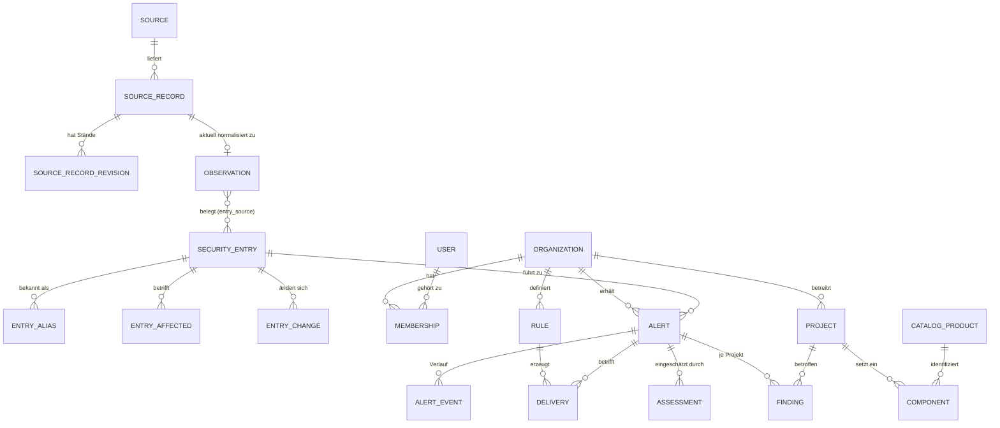

# 4 · Datenmodell

Eine PostgreSQL-Datenbank, ein Schema pro Modul. Tabellen- und Spaltennamen in `snake_case`, Zeitstempel als `timestamptz` in UTC, Primärschlüssel als UUID Version 7.

## 4.1 Zwei Arten von Daten

| Art | Schemata | Merkmal |
|---|---|---|
| **Global** | `intel`, `assets.catalog_product`, `platform` | Für alle Organisationen gleich. Die grosse Menge (Rohdaten, Einträge) liegt genau einmal vor, unabhängig von der Zahl der Mandanten. |
| **Mandantenbezogen** | `iam.organization` und Kinder, `assets.project`, `assets.component`, `assess.*`, `notify.*` | Jede Zeile trägt `organization_id`, auch Kindtabellen. Row-Level Security erzwingt die Trennung (Kapitel 9). |

Fremdschlüssel von mandantenbezogenen auf globale Tabellen sind erlaubt und erwünscht (etwa `assess.alert.entry_id → intel.security_entry.id`): Sie sichern die Integrität, ohne Module im Code zu koppeln. Navigations-Eigenschaften über Modulgrenzen gibt es nicht.

## 4.2 Überblick

## 4.3 Die zentrale Modellentscheidung: Beobachtungen und Projektion

Ein konsolidierter Eintrag wird nicht fortgeschrieben, sondern **berechnet**. Jede Quelle liefert Rohdatensätze. Aus jedem Rohdatensatz entsteht eine *Beobachtung*: die normalisierten Aussagen dieser einen Quelle (Kennungen, Schweregrad, betroffene Produkte, Referenzen, Ausnutzung). Der Eintrag ist die Zusammenführung aller Beobachtungen nach festen Vorrangregeln.

Das hat drei Folgen, die die Anforderungen direkt erfüllen:

- **Deduplizierung** ist eine Frage der Identität, nicht des Überschreibens: Beobachtungen mit gemeinsamer Kennung gehören zum selben Eintrag.
- **Herkunft** bleibt pro Feld erhalten: Der Eintrag merkt sich, aus welcher Quelle jeder Wert stammt.
- **Korrekturen** an Parsern oder Vorrangregeln wirken rückwirkend: Die Projektion lässt sich für alle Einträge neu berechnen.

Ein Eintrag hat eine von zwei Arten. `vulnerability` ist eine Schwachstelle mit Kennung (CVE, GHSA und andere) und wird über Quellen hinweg zusammengeführt. `bulletin` ist eine Warnung ohne Schwachstellenkennung, etwa eine Phishing-Warnung des NCSC; sie bleibt an ihre Quelle gebunden und wird nicht quellenübergreifend verschmolzen. Ein Hersteller-Advisory, das zwölf CVEs nennt, erzeugt keinen eigenen Eintrag, sondern wird Beleg von zwölf Einträgen.

## 4.4 Schema `intel` (global)

| Tabelle | Zweck | Wichtige Spalten |
|---|---|---|
| `source` | Stammdaten und Abrufzustand einer Quelle | `key` (eindeutig), `kind` (primary, enrichment), `adapter`, `enabled`, `interval`, `trust_rank`, `config jsonb`, `attribution`; Zustand: `next_sync_at`, `cursor jsonb`, `last_success_at`, `consecutive_failures`, `health`, `lease_until` |
| `source_run` | Protokoll jedes Abrufs | `source_id`, `started_at`, `finished_at`, `outcome`, `fetched`, `changed`, `quarantined`, `error` |
| `source_record` | Aktueller Rohdatensatz je externer ID | `source_id`, `external_id` (zusammen eindeutig), `url`, `content_hash`, `payload`, `revision`, `source_published_at`, `source_modified_at`, `first_seen_at`, `last_seen_at`, `parse_status` |
| `source_record_revision` | Frühere Rohstände | `source_record_id`, `revision`, `content_hash`, `payload`, `fetched_at` |
| `observation` | Normalisierte Aussagen eines Rohdatensatzes | `source_record_id`, `record_revision`, `aliases jsonb`, `kind`, `title`, `description`, `state`, `claims jsonb` (Metriken, betroffene Produkte, Referenzen, Ausnutzung, Schwächen, Abhilfe), `parser_version` |
| `security_entry` | Der konsolidierte Eintrag | `kind`, `primary_key` (eindeutig, z. B. `CVE-2026-115731`), `title`, `summary`, `description`, `state`, `published_at`, `changed_at`, `revision`, `material_revision`, `material_fingerprint`, `cvss_score`, `cvss_version`, `cvss_vector`, `exploitation` (none, poc, active), `kev_listed_on`, `epss_score`, `epss_percentile`, `fix_available`, `cwe_ids`, `provenance jsonb`, `merged_into_id`, `search tsvector` |
| `entry_alias` | Alle Kennungen eines Eintrags | `entry_id`, `scheme` (cve, ghsa, osv, euvd, …), `value`; (`scheme`, `value`) eindeutig |
| `entry_affected` | Betroffene Produkte und Versionsbereiche | `entry_id`, `vendor`, `product`, `product_key` (normalisiert), `cpe_vendor`, `cpe_product`, `purl_type`, `purl_name`, `version_scheme`, `introduced`, `fixed`, `last_affected`, `exact`, `status`, `source_id` |
| `entry_reference` | Verweise | `entry_id`, `url`, `tags`, `source_id` |
| `entry_source` | Welche Rohdatensätze einen Eintrag belegen | `entry_id`, `source_record_id`, `relation` (describes, mentions) |
| `entry_change` | Änderungshistorie | `entry_id`, `revision`, `changed_at`, `change_kinds`, `is_material`, `diff jsonb`, `triggered_by` |

Indizes, die das Verhalten tragen: `entry_affected (product_key)`, `(cpe_vendor, cpe_product)` und `(purl_type, purl_name)` für die Kandidatensuche; `security_entry (changed_at desc)` für Listen; GIN auf `search`; `source (next_sync_at) WHERE enabled` für die Fälligkeit.

Wird ein Eintrag mit einem anderen verschmolzen, weil eine neue Kennung beide verbindet, bleibt der unterlegene als Verweis bestehen (`merged_into_id`). Meldungen und Links zeigen weiter auf ein gültiges Ziel.

## 4.5 Schema `assets`

| Tabelle | Zweck | Wichtige Spalten |
|---|---|---|
| `catalog_product` (global) | Kuratierter Technologie-Katalog | `key`, `name`, `vendor`, `kind`, `cpe_pairs text[]`, `purl_types`, `aliases jsonb` (Namensmuster je Hersteller-Schreibweise), `version_scheme`, `platform_key` (bei Plugins: zugehörige Plattform) |
| `project` | Projekt oder System einer Organisation | `organization_id`, `name`, `criticality` (low, normal, high), `exposure` (internet, internal, isolated), `profile_version`, `archived_at` |
| `component` | Eingesetzte Technologie eines Projekts | `organization_id`, `project_id`, `catalog_product_id` (oder `custom_vendor`, `custom_name`), `kind`, `version`, `version_scheme`, `parent_component_id` (Plugin einer Plattform), `exposure`, `criticality` (übersteuern das Projekt), `purl`, `cpe`, `origin` (manual, sbom, lockfile) |
| `component_key` | Suchindex für die Kandidatensuche | `organization_id`, `project_id`, `component_id`, `key_type` (cpe, product, purl), `key_value`; Index auf (`key_type`, `key_value`) |

Das Organisationsprofil aus den Anforderungen ist kein eigenes Objekt: Der Setup-Wizard legt das erste Projekt an. Damit gibt es genau einen Weg vom Profil zur Meldung. `profile_version` zählt bei jeder Änderung an Komponenten hoch und macht Einschätzungen einer Profilfassung zuordenbar.

## 4.6 Schema `assess`

| Tabelle | Zweck | Wichtige Spalten |
|---|---|---|
| `alert` | Eine Schwachstelle aus Sicht einer Organisation | `organization_id`, `entry_id` (zusammen eindeutig), `number` (fortlaufend je Organisation), `level` (1–5), `factors jsonb`, `status` (abgeleitet aus den Befunden), `first_raised_at`, `level_changed_at`, `assessed_entry_revision`, `current_assessment_id`, `assigned_to`, `due_at`, `is_backfill` |
| `finding` | Betroffenheit eines Projekts | `organization_id`, `alert_id`, `project_id`, `component_id`, `match_type` (cpe, product, purl, ecosystem), `version_verdict` (in_range, out_of_range, unknown), `verdict` (affected, likely, unlikely, not_affected), `status` (open, in_review, remediated, risk_accepted, not_affected), `status_changed_by`, `status_changed_at`, `status_note` |
| `assessment` | Eine unveränderliche Einschätzung | `organization_id`, `alert_id`, `entry_revision`, `profile_fingerprint`, `engine` (rules, rules+ai), `ruleset_version`, `model`, `prompt_version`, `input_digest`, `output jsonb`, `level`, `factors jsonb`, `tokens_in`, `tokens_out`, `duration_ms`, `created_at` |
| `alert_event` | Bearbeitungs- und Bewertungsverlauf | `organization_id`, `alert_id`, `at`, `kind` (raised, level_changed, status_changed, assigned, note, notified, corrected), `actor`, `data jsonb` |
| `assessment_feedback` | Korrekturen durch Benutzer | `organization_id`, `assessment_id`, `user_id`, `kind`, `correction jsonb`, `note` |

Der Status lebt am Befund, weil eine Lücke in Projekt A behoben und in Projekt B noch offen sein kann. Der Status der Meldung leitet sich ab: offen, solange ein Befund offen ist. Die Oberfläche bietet «für alle Projekte setzen» als Abkürzung.

Auch Einschätzungen mit dem Ergebnis «nicht relevant» werden gespeichert. Sie beantworten die Frage, warum eine Meldung ausgeblieben ist, und sind die Grundlage für Stufe 1 in der Oberfläche.

## 4.7 Schema `notify`

| Tabelle | Zweck | Wichtige Spalten |
|---|---|---|
| `rule` | Benachrichtigungsregel | `organization_id`, `name`, `enabled`, `project_ids` (leer = alle), `min_level`, `events`, `mode` (immediate, digest), `digest_cron`, `digest_timezone` |
| `rule_target` | Wer über welchen Kanal | `rule_id`, `channel` (in_app, email, web_push, webhook), `recipient_kind` (role, user, address, endpoint), `recipient_ref` |
| `endpoint` | Webhook-Ziel | `organization_id`, `name`, `url_enc`, `secret_enc`, `enabled`, `last_status` |
| `push_subscription` | Web-Push-Abo eines Geräts | `user_id`, `endpoint`, `p256dh`, `auth`, `user_agent`, `failed_count` |
| `delivery` | Eine Zustellung, zugleich Ausgangspostfach | `organization_id`, `rule_id`, `alert_id`, `channel`, `recipient_key`, `event_fingerprint`, `dedupe_key` (eindeutig), `state`, `attempts`, `next_attempt_at`, `last_error`, `sent_at` |
| `notification` | In-App-Benachrichtigung | `organization_id`, `user_id`, `alert_id`, `kind`, `title`, `body`, `created_at`, `read_at` |
| `user_preference` | Persönliche Einstellungen | `user_id`, `organization_id`, `muted_channels`, `locale` |

## 4.8 Schemata `iam` und `platform`

`iam` enthält die Tabellen von ASP.NET Core Identity (Benutzer, Anmeldungen, Token, MFA-Schlüssel) sowie `organization`, `membership` (Rolle je Benutzer und Organisation) und `invitation` (gehashter Token, Ablauf, Rolle).

`platform` enthält `job`, `schedule`, `outbox_message` (Kapitel 3.4), `audit_event` (wer hat wann was getan, mit Organisation, Ziel und Herkunft), `setting` (Instanz-Einstellungen, Geheimnisse verschlüsselt) und die Schlüssel der Data Protection.

## 4.9 Mengen und Aufbewahrung

Gemessen am 18.11.2026 für das CVE Program: 590 neue Records pro Tag im Mittel, 2 800 Änderungsereignisse pro Tag, mittlere Record-Grösse 3,6 kB (Kapitel 5).

| Grösse | Schätzung |
|---|---|
| Neue Rohdaten | rund 2 MB pro Tag |
| Revisionen | rund 10 MB pro Tag unkomprimiert, in PostgreSQL etwa ein Drittel |
| Start mit 180 Tagen Rückblick | gut 100 000 Einträge, 1 bis 2 GB |
| Gesamtbestand CVE | optional; mehrere GB, einmaliger Import von 666 MB (gezippt) |
| Mandantendaten | klein: einige tausend Zeilen pro Organisation und Jahr |

Vorgaben, alle konfigurierbar: Rückblick beim Erststart 180 Tage; ältere Einträge werden bei Bedarf einzeln nachgeladen, etwa wenn der KEV-Katalog auf sie verweist. Von jedem Rohdatensatz bleiben der erste und die letzten zehn Stände. `source_run` wird nach 90 Tagen ausgedünnt, erfolgreiche Jobs nach 7 Tagen. Meldungen, Einschätzungen und Verlauf werden nie automatisch gelöscht.

## 4.10 Migrationen

Jedes Modul führt eigene EF-Core-Migrationen mit eigener Historientabelle in seinem Schema. Der Befehl `migrate` wendet sie in fester Reihenfolge an (`platform`, `iam`, `assets`, `intel`, `assess`, `notify`) und spielt danach Stammdaten ein: Quellen, Katalog, Regelwerk. Migrationen sind vorwärtsgerichtet und in zwei Schritten verträglich: erst erweitern, in einer späteren Version entfernen. So überlebt ein Update den Moment, in dem API und Worker kurz unterschiedliche Stände haben.
