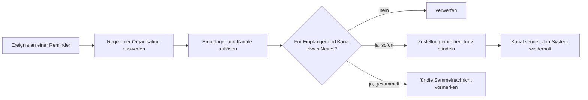

# 8 · Benachrichtigungen und Erinnerungen

## 8.1 Grundsatz

Eine Benachrichtigung ist ein Eingriff in die Arbeit eines Menschen. Das System sendet deshalb nur, wenn sich für den Empfänger etwas ändert, das er wissen oder tun muss, und es sendet dasselbe nie zweimal. Alles andere steht in der Oberfläche und in Sammelnachrichten.

Benachrichtigt wird über **Reminders** (Kapitel 7.4), nicht über einzelne CVEs. Kommen zu einer offenen Reminder zwanzig weitere Befunde hinzu, ohne dass ihre Stufe steigt, erfährt der Empfänger das in der nächsten Sammelnachricht und nicht in zwanzig einzelnen Nachrichten.



## 8.2 Ereignisse

Diese Tabelle ist die einzige Liste der Ereignisse; andere Kapitel verweisen hierher.

| Ereignis | Bedeutung | Vorgabe |
|---|---|---|
| `reminder.raised` | neue Reminder ab Stufe 2 | benachrichtigt nach Regel |
| `reminder.level_raised` | Stufe der Reminder gestiegen | benachrichtigt nach Regel, auch wenn schon einmal gemeldet |
| `reminder.exploitation_escalated` | bei einem ihrer Befunde wird Ausnutzung neu bekannt oder aktiv, ohne dass die Stufe steigt | benachrichtigt nach Regel |
| `reminder.fix_available` | erstmals eine Korrektur verfügbar | nur wenn die Regel es verlangt |
| `reminder.level_lowered`, `reminder.withdrawn` | Entwarnung | In-App; per E-Mail oder Push einmal, wenn zuvor dorthin gemeldet wurde |
| `reminder.done`, `reminder.note_added` | Bearbeitung durch das Team | nur In-App |
| `warning.published` | neue Warnung ohne Schwachstellenkennung, etwa eine Phishing-Warnung des BACS oder ein Advisory des NCSC, dem noch keine CVE zugeordnet ist | In-App und in der wöchentlichen Sammelnachricht; sofort nur, wenn eine Regel es verlangt |
| `notice.raised` | neuer Hinweis «könnte euch betreffen» zu einem Stack-Eintrag; steht auch für einen offenen, unbeantworteten Hinweis, der aktiv ausgenutzt wird (einmal), die einmalige Wiederkehr nach «betrifft uns nicht» und die eine Sammelmeldung einer Rückwärtssuche | In-App an alle Mitglieder und Sammelnachricht; sofort nur bei aktiver Ausnutzung oder KEV. Ein Hinweis hat keine Stufe: ausgenutzt oder in KEV erreicht er jede Schwelle, sonst nur Stufe 2 ([ADR 048](../adr/0048-notice-raised-and-reminders-by-level.md)) |
| `backfill.completed` | Ersteinschätzung eines neuen Projekts oder eines neu verbundenen Repositorys fertig | eine Sammelnachricht statt Einzelalarme |
| `repository.unavailable` | ein verbundenes Repository lässt sich seit 3 Tagen nicht einlesen, oder das Token seines Zugangs läuft in 14 Tagen ab (Kapitel 16.6) | In-App an Owner und Admins; per E-Mail, wenn eine Regel es verlangt; je Verknüpfung und Ursache einmal |

Jedes Ereignis trägt eine eindeutige Kennung, die der Auslöser in derselben Transaktion vergibt wie die Änderung selbst; bei Reminders ist es die Kennung der Verlaufszeile. Sein Gegenstand ist ein Reminder, bei `warning.published` ein Eintrag, bei `notice.raised` ein Hinweis (die Sammelmeldung: ein Projekt), bei `backfill.completed` und `repository.unavailable` ein Projekt. `warning.published` entsteht einmal für die Instanz und wird je Organisation ausgewertet, die eine Regel dafür hat.

Kein Ereignis und damit nie eine Benachrichtigung: weitere Befunde in einer Reminder ohne Anstieg von Stufe oder Ausnutzungsstand, geänderte Beschreibungen, neue Verweise, EPSS-Bewegungen innerhalb einer Klasse, Neubewertungen mit gleichem Ergebnis.

## 8.3 Regeln

Eine Regel verbindet Bedingungen mit Zielen:

| Teil | Möglichkeiten |
|---|---|
| Geltung | alle Projekte oder ausgewählte |
| Schwelle | Mindeststufe 2 bis 5 |
| Ereignisse | Auswahl aus 8.2 |
| Ziele | je Ziel: Empfänger (Rolle, Benutzer, externe E-Mail-Adresse, Webhook), Kanal und Modus |
| Modus je Ziel | sofort, oder gesammelt nach Zeitplan (Cron-Ausdruck in der Zeitzone der Organisation), wahlweise auch dann, wenn nichts vorliegt |

Der Modus hängt am Ziel, nicht an der Regel: Dieselbe Regel kann In-App sofort und per E-Mail gesammelt zustellen.

Jede neue Organisation startet mit drei Regeln:

1. **Critical at once:** Stufe 5, an Owner und Admins, sofort über In-App, E-Mail und Push.
2. **High:** ab Stufe 4, an alle Mitglieder, In-App sofort und E-Mail gesammelt werktags um 08:00.
3. **Weekly summary:** ab Stufe 2 und Warnungen, an alle Mitglieder, per E-Mail montags um 08:00, auch wenn nichts vorliegt. Die leere Sammelnachricht sagt, dass geprüft wurde und nichts anstand.

Alle drei nennen auch `notice.raised` (8.2). Die Regeln überschneiden sich absichtlich; dass daraus keine doppelten Nachrichten werden, regelt 8.4. Ein Hinweis wird je Empfänger und Kanal einmal gemeldet, seine Wiederkehr einmal mehr. Externe E-Mail-Adressen erhalten erst nach Bestätigung durch den Empfänger Nachrichten. Benutzer können für sich einzelne Kanäle stummschalten; für Stufe 5 nur, wenn die Organisation das erlaubt.

## 8.4 Nie zweimal dasselbe

Massgeblich ist nicht, welche Regel auslöst, sondern was ein Empfänger auf einem Kanal schon erfahren hat. Das System führt deshalb je Reminder, Empfänger und Kanal einen **Benachrichtigungsstand**: die zuletzt gemeldete Stufe, den zuletzt gemeldeten Ausnutzungsstand, ob die Korrektur gemeldet wurde, und den Zeitpunkt.

| Ereignis | Sofort gesendet, wenn |
|---|---|
| neue Reminder oder Stufenanstieg | die neue Stufe über der zuletzt gemeldeten liegt und die Schwelle einer Regel erreicht |
| Ausnutzung | der neue Stand über dem zuletzt gemeldeten liegt |
| Korrektur verfügbar | noch nicht gemeldet und von einer Regel verlangt |
| Entwarnung | zuvor auf diesem Kanal gemeldet wurde |

Der Stand wird in zwei Fällen fortgeschrieben: nach jeder Zustellung, und immer dann, wenn die Stufe einer Reminder sinkt. Im zweiten Fall sinkt die zuletzt gemeldete Stufe für jeden Empfänger mit, auch wenn er keine Entwarnung erhält, weil er den Kanal stummgeschaltet hat oder keine Regel sie verlangt. Steigt ein Reminder von 4 auf 5, fällt auf 4 und steigt erneut auf 5, entstehen deshalb zwei Nachrichten über den Anstieg: Der Stand nach dem Absinken ist 4, und die beiden Anstiege sind zwei Ereignisse mit eigener Kennung.

Warnungen ohne Kennung und abgeschlossene Erstbefüllungen haben keinen Benachrichtigungsstand. Für sie genügt die Eindeutigkeit des Ereignisses.

Dazu drei Mechanismen:

- **Technische Eindeutigkeit.** Empfänger, Kanal und Kennung des Ereignisses sind zusammen eindeutig (`delivery_event`). Ein doppelt verarbeitetes Ereignis oder ein wiederholter Job erzeugt keine zweite Nachricht. Die Regel ist bewusst nicht Teil des Schlüssels: Zwei Regeln mit demselben Empfänger und Kanal ergeben eine Nachricht.
- **Bündelung.** Eine Sofortnachricht (`delivery`) wird mit zwei Minuten Vorlauf eingereiht. Jedes weitere Ereignis für denselben Empfänger und Kanal hängt sich an die wartende Nachricht, statt eine neue zu erzeugen. Der Job `Deliver` sendet, was bis dahin zusammengekommen ist. Das fängt Wellen ab, wenn mehrere Quellen kurz nacheinander aktualisieren.
- **Sammelnachricht.** Was ein Ziel gesammelt erhalten soll, wird je Ziel vorgemerkt (`digest_item`). Zum Zeitplan löst der Job das Ziel in Empfänger auf und legt je Empfänger eine Nachricht für die Periode an; Ziel, Empfänger und Periodenende sind zusammen eindeutig. Sie enthält neue Reminders, Anstiege, Zuwachs an Befunden, Erledigtes und Warnungen. Was derselbe Empfänger auf demselben Kanal schon sofort erhalten hat, erscheint als «bereits gemeldet». Eine leere Sammelnachricht ist eine Nachricht ohne Einträge und steht wie jede andere im Protokoll. Der nächste Termin steht am Ziel selbst (`next_digest_at`); ein wiederkehrender Job der Instanz reiht fällige Ziele ein.

**Erstbefüllung.** Befunde aus der Rückwärtssuche tragen eine Markierung und lösen keine Einzelereignisse aus, auch kein `reminder.raised`. Am Ende steht ein `backfill.completed` je Projekt. Der Benachrichtigungsstand der dabei entstandenen Reminders wird für die Empfänger der Sammelnachricht auf die Stufe der Erstbefüllung gesetzt, damit erst ein späterer Anstieg meldet.

## 8.5 Kanäle

Jeder Kanal implementiert dieselbe Schnittstelle: `Send(Zustellung) → Erfolg | vorübergehender Fehler | endgültiger Fehler`. Ein neuer Kanal ist eine Klasse und ein Einstellungsformular.

| Kanal | Umsetzung | Besonderheiten |
|---|---|---|
| In-App | Zeile in `notify.notification`, Live-Zustellung über Server-Sent Events | Zähler im Kopf, Liste mit gelesen und ungelesen |
| E-Mail | SMTP der Instanz; Text- und HTML-Teil | Betreff beginnt mit Stufe und Nummer; `List-Unsubscribe` führt Mitglieder zu ihren Einstellungen und externe Adressen zu einem signierten Abmeldelink ohne Anmeldung. Ohne konfiguriertes SMTP ist der Kanal abgeschaltet; die Oberfläche sagt das bei jeder Regel, die ihn verwendet. |
| Web Push | Standard-Web-Push mit VAPID-Schlüsselpaar der Instanz | Inhalt Ende-zu-Ende verschlüsselt; Dringlichkeit `high` nur für Stufe 5; abgelaufene Abos (404, 410) werden entfernt; Endpunkte nur bei den Push-Diensten der Browserhersteller |
| Webhook | `POST` mit JSON, Schema versioniert | Signatur `HMAC-SHA256` über Zeitstempel und Inhalt; Ziele im privaten Netz nur nach Freigabe durch den Instanz-Administrator (Kapitel 9.5) |

Ausbaustufen: Vorlagen für Microsoft Teams und Slack auf Basis des Webhook-Kanals, ntfy, native Push für die Capacitor-App über ein Relay (Kapitel 11.9).

### Was eine Nachricht sagt

Jede Nachricht beantwortet die drei Fragen in derselben Reihenfolge wie die Oberfläche.

```
Subject:  [Critical] #143 Puppet Enterprise in Platform Ops

Critical. Raised from High.

What happened   CISA lists CVE-2026-115731 as actively exploited since 17 Nov 2026.
Affected        Platform Ops runs Puppet Enterprise 2025.9.0, inside the affected range.
What to do      Upgrade to 2025.12.1 and restart Puppet Server.
Covers          1 vulnerability

Open: https://ardea.example.org/o/example/reminders/143
```

Bei einer Reminder mit vielen Befunden nennt die Nachricht die Anzahl und die drei mit der höchsten Stufe. Eine Push-Nachricht trägt Stufe, Nummer und Titel; der Klick öffnet der Reminder. Die Organisation wählt, wie viel E-Mails enthalten: vollständig wie oben oder nur Stufe, Nummer und Link. E-Mail ist nicht Ende-zu-Ende geschützt.

## 8.6 Zustellung

- Eine Zustellung ist ein Job des Job-Systems (Kapitel 3.4). Wiederholung, Wartezeiten und Aufgabe nach dem letzten Versuch kommen von dort; es gibt keinen zweiten Wiederholungsmechanismus.
- `notify.delivery` ist das Protokoll, eine Zeile je Nachricht: Empfänger, Kanal, Art, Zustand (`pending`, `sent`, `failed`, `dead`, `suppressed`), Fehler, Zeitpunkt. Welche Ereignisse sie abdeckt, steht in `delivery_event` oder `digest_item`.
- Endgültige Fehler (unbekannte Adresse, Abo abgelaufen, Webhook antwortet mit 4xx ausser 429) werden nicht wiederholt.
- Schlägt die Zustellung für Stufe 5 auf allen Kanälen eines Empfängers fehl, erhalten die Owner eine In-App-Warnung.
- Obergrenze je Kanal und Organisation als Schutz vor Fehlkonfiguration: höchstens 60 Sofortnachrichten pro Stunde, darüber wird in die Sammelnachricht verschoben: in die nächste des Empfängers auf diesem Kanal, wenn sie innerhalb einer Stunde kommt, sonst nach einer Stunde in eine Nachricht mit allem Zurückgehaltenen ([ADR 049](../adr/0049-overflow-above-the-hourly-cap.md)).

## 8.7 Erinnerung statt Eskalation

**Eskalation entfällt** (Kapitel 17.5, E24). Ardea plant keine Arbeit: Es gibt keine Zuweisung, keine Frist und keine Eskalationskette. Ein offener Reminder erinnert stattdessen in einem Rhythmus, der von seiner Stufe abhängt: Stufe 5 täglich, Stufe 4 wöchentlich, Stufe 3 monatlich, darunter nur in der Sammelnachricht (Kapitel 7.6, 17.5). Der Rhythmus je Stufe ist je Organisation einstellbar, auch «aus».

Umgesetzt in Aufgabe 5a.6 ([ADR 048](../adr/0048-notice-raised-and-reminders-by-level.md)): ein Lauf je Organisation werktags um 08:00 in ihrer Zeitzone. Fällig ist ein Reminder einen Rhythmus nach dem Erreichen seiner Stufe oder nach seiner letzten Erinnerung. Er erreicht die Empfänger der Regeln, die ihn melden, in der App, per E-Mail und per Push, nicht per Webhook, und jeder erhält je Kanal und Lauf eine Nachricht mit allen fälligen Remindern. Erledigte Reminder erinnern nie; sinkt die Stufe, gilt ihr Rhythmus. Neue Hinweise (Kapitel 17) lösen `notice.raised` aus (8.2).

## 8.8 Abnahmekriterien

- Dasselbe Ereignis dreimal verarbeitet erzeugt pro Empfänger und Kanal genau eine Zustellung.
- Zwei Regeln mit demselben Empfänger und Kanal erzeugen für ein Ereignis eine Nachricht.
- Steigt die Stufe einer bereits gemeldeten Reminder, wird erneut benachrichtigt; kommen nur Befunde hinzu oder ändert sich eine Beschreibung, nicht.
- Anstieg, Absinken und erneuter Anstieg ergeben zwei Nachrichten über den Anstieg, auch für einen Empfänger, der die Entwarnung dazwischen nicht erhalten hat.
- Drei Ereignisse für denselben Empfänger innerhalb von zwei Minuten ergeben eine Nachricht.
- Ein neu angelegtes Projekt mit 40 Treffern im Rückblick erzeugt genau eine Nachricht; ein nachträglich ergänzter Stack-Eintrag mit vielen früheren Hinweisen ebenso.
- Ein Hinweis erscheint bei jedem Mitglied einmal In-App; sofort per E-Mail nur, wenn er aktiv ausgenutzt wird oder in KEV steht.
- Offene Reminder erinnern nach Stufe in einer Nachricht je Empfänger und Kanal; ein erledigter erinnert nicht mehr.
- Eine Warnung ohne Kennung erscheint bei jeder Organisation einmal In-App und einmal in der nächsten Sammelnachricht.
- Sammelnachricht: Sie kommt zur eingestellten Zeit in der Zeitzone der Organisation, enthält alles seit der letzten und kommt auch leer, wenn die Regel das vorsieht.
- E-Mail: Ein nicht erreichbarer SMTP-Server verzögert die Zustellung, verliert sie aber nicht.
- Web Push: Abo anlegen und entfernen funktioniert im automatischen Test in Chromium; ein abgelaufenes Abo verschwindet nach dem ersten Fehlversuch. iOS wird von Hand an einer installierten Web-App geprüft.
- Webhook: Ein Empfänger kann die Echtheit jeder Nachricht mit dem gemeinsamen Geheimnis prüfen; ein Ziel im privaten Netz wird ohne Freigabe abgelehnt.
