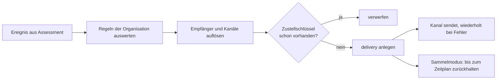

# 8 · Benachrichtigungen und Eskalation

## 8.1 Grundsatz

Eine Benachrichtigung ist ein Eingriff in die Arbeit eines Menschen. Das System sendet deshalb nur, wenn sich für den Empfänger etwas ändert, das er wissen oder tun muss, und es sendet dasselbe nie zweimal. Alles andere steht in der Oberfläche und in Zusammenfassungen.



## 8.2 Ereignisse

| Ereignis | Bedeutung | Vorgabe |
|---|---|---|
| `alert.raised` | neue Meldung ab Stufe 2 | benachrichtigt nach Regel |
| `alert.level_raised` | Stufe gestiegen | benachrichtigt nach Regel, auch wenn schon einmal gemeldet |
| `alert.newly_affected` | weiteres Projekt betroffen | benachrichtigt nach Regel |
| `alert.exploitation_escalated` | Ausnutzung neu bekannt oder von PoC zu aktiv, ohne Stufenwechsel | benachrichtigt nach Regel |
| `alert.fix_available` | erstmals eine Korrektur verfügbar | nur wenn die Regel es verlangt |
| `alert.level_lowered`, `alert.withdrawn` | Entwarnung | nur In-App; per E-Mail oder Push einmal, wenn zuvor dorthin gemeldet wurde |
| `alert.assigned` | Zuweisung | an die zugewiesene Person |
| `alert.status_changed`, `alert.note_added` | Bearbeitung durch das Team | nur In-App |
| `backfill.completed` | Ersteinschätzung eines neuen Projekts fertig | eine Sammelnachricht statt Einzelalarme |

Kein Ereignis und damit nie eine Benachrichtigung: geänderte Beschreibungen, neue Verweise, EPSS-Bewegungen innerhalb einer Klasse, Neubewertungen mit gleichem Ergebnis.

## 8.3 Regeln

Eine Regel verbindet Bedingungen mit Empfängern:

| Teil | Möglichkeiten |
|---|---|
| Geltung | alle Projekte oder ausgewählte |
| Schwelle | Mindeststufe 2 bis 5 |
| Ereignisse | Auswahl aus 8.2 |
| Modus | sofort, oder gesammelt nach Zeitplan (Cron mit Zeitzone der Organisation) |
| Empfänger | Rollen (Owner, Admin, Member), einzelne Benutzer, externe E-Mail-Adressen, Webhook-Ziele |
| Kanäle | In-App, E-Mail, Web Push, Webhook |

Jede neue Organisation startet mit drei Regeln, damit sie ohne Einrichtung sinnvoll alarmiert wird:

1. **Critical at once:** Stufe 5, sofort, an Owner und Admins über In-App, E-Mail und Push.
2. **High, daily:** ab Stufe 4, In-App sofort, E-Mail gesammelt werktags um 08:00.
3. **Weekly summary:** ab Stufe 2, montags um 08:00 per E-Mail, auch wenn nichts vorliegt. Die leere Zusammenfassung sagt, dass geprüft wurde und nichts anstand.

Benutzer können für sich einzelne Kanäle stummschalten. Kanäle, die eine Regel für Stufe 5 vorsieht, lassen sich nur stummschalten, wenn die Organisation das erlaubt.

## 8.4 Nie zweimal dasselbe

Jedes Ereignis trägt einen Fingerabdruck über das, was der Empfänger wahrnehmen würde: Meldung, Art des Ereignisses, Stufe, Menge der betroffenen Projekte, Ausnutzungsstand, Korrektur verfügbar.

```
dedupe_key = hash(Regel, Empfänger, Kanal, Fingerabdruck)
```

Der Schlüssel ist in `notify.delivery` eindeutig. Ein doppelt verarbeitetes Ereignis, ein wiederholter Job oder zwei Regeln mit demselben Empfänger und Kanal erzeugen damit höchstens eine Zustellung. Zusätzlich gilt:

- **Bündelung:** Ereignisse zur selben Meldung innerhalb von fünf Minuten werden zu einer Nachricht zusammengezogen. Das fängt Wellen ab, wenn mehrere Quellen kurz nacheinander aktualisieren.
- **Vorrang:** Löst ein Ereignis für einen Empfänger sowohl eine Sofort- als auch eine Sammelregel aus, gewinnt sofort; die Zusammenfassung führt die Meldung als bereits gemeldet.
- **Erstbefüllung:** Meldungen aus der Rückwärtssuche benachrichtigen nicht einzeln (Kapitel 7.6).

## 8.5 Kanäle

Jeder Kanal implementiert dieselbe Schnittstelle: `Send(delivery) → Erfolg | vorübergehender Fehler | endgültiger Fehler`. Ein neuer Kanal ist eine Klasse und ein Einstellungsformular.

| Kanal | Umsetzung | Besonderheiten |
|---|---|---|
| In-App | Zeile in `notify.notification`, Live-Zustellung über Server-Sent Events | Zähler im Kopf, Liste mit gelesen/ungelesen |
| E-Mail | SMTP der Instanz; Text- und HTML-Teil | Betreff beginnt mit Stufe und Meldungsnummer; `List-Unsubscribe` führt zu den Einstellungen |
| Web Push | Standard-Web-Push mit VAPID-Schlüsselpaar der Instanz | Inhalt Ende-zu-Ende verschlüsselt; Dringlichkeit `high` nur für Stufe 5; abgelaufene Abos (404, 410) werden entfernt |
| Webhook | `POST` mit JSON, Schema versioniert | Signatur `HMAC-SHA256` über Zeitstempel und Inhalt; Ziele im privaten Netz nur nach Freigabe durch den Instanz-Administrator (Kapitel 9) |

Ausbaustufen: Vorlagen für Microsoft Teams und Slack auf Basis des Webhook-Kanals, ntfy, native Push für die Capacitor-App über ein Relay (Kapitel 11).

### Was eine Nachricht sagt

Jede Nachricht beantwortet die drei Fragen in derselben Reihenfolge wie die Oberfläche.

```
Betreff:  [5 Critical] #142 Puppet Enterprise: code execution through crafted reports

Level 5, Critical. Raised from level 4.

What happened   CISA lists the flaw as actively exploited since 17 Nov 2026.
Affected        Platform Ops runs Puppet Enterprise 2025.9.0, inside the affected range.
What to do      1. Upgrade to 2025.12.1 and restart Puppet Server.

Open alert: https://csh.example.org/o/example/alerts/142
```

Eine Push-Nachricht trägt Stufe, Nummer und Titel, der Klick öffnet die Meldung. Die Organisation wählt, wie viel E-Mails enthalten: vollständig wie oben oder nur Stufe, Nummer und Link. E-Mail ist nicht Ende-zu-Ende geschützt; wer keine Infrastrukturdetails per Mail verschicken will, wählt die knappe Form.

## 8.6 Zustellung

`notify.delivery` ist zugleich Protokoll und Ausgangspostfach.

- Zustände: `pending`, `sent`, `failed` (wird wiederholt), `dead` (aufgegeben), `suppressed` (durch Stummschaltung oder Vorrang).
- Wiederholung bei vorübergehenden Fehlern nach 1, 5 und 30 Minuten, 2 und 6 Stunden; danach `dead`.
- Endgültige Fehler (unbekannte Adresse, Abo abgelaufen, Webhook antwortet mit 4xx ausser 429) werden nicht wiederholt.
- Schlägt die Zustellung für Stufe 5 auf allen Kanälen eines Empfängers fehl, erhalten die Owner eine In-App-Warnung; der Zustand ist in den Regeln sichtbar.
- Obergrenzen je Kanal und Organisation schützen vor Fehlkonfiguration: höchstens 60 Sofortnachrichten pro Stunde, darüber wird gebündelt.

## 8.7 Eskalation (Ausbaustufe 1)

Eine Eskalationsregel beschreibt Stufen mit Wartezeit: «Stufe 5, nach 2 Stunden noch offen und niemand zugewiesen: an Owner; nach 8 Stunden: an die Eskalationsadresse». Technisch ist jede Stufe ein Job mit Fälligkeit, eingereiht beim Auslösen der Meldung. Der Job prüft bei Ausführung den Zustand und tut nichts, wenn die Meldung inzwischen bearbeitet wird. Das Datenmodell (Regeln, Ziele, Zustellungen) trägt das bereits; im MVP fehlen nur Oberfläche und Job.

Fristen sind im MVP sichtbar, lösen aber noch nichts aus: Jede Meldung trägt ein Fälligkeitsdatum aus der Vorgabe ihrer Stufe (Kapitel 7.5); Liste und Bulletin zeigen Überfälliges.

## 8.8 Abnahmekriterien

- Dieselbe unveränderte Meldung erzeugt pro Empfänger und Kanal genau eine Zustellung, auch wenn das auslösende Ereignis dreimal verarbeitet wird.
- Steigt die Stufe einer bereits gemeldeten Schwachstelle, wird erneut benachrichtigt; ändert sich nur die Beschreibung, nicht.
- Ein nicht erreichbarer SMTP-Server verzögert die Zustellung, verliert sie aber nicht; nach Wiederkehr gehen alle wartenden Nachrichten in richtiger Reihenfolge hinaus.
- Ein Webhook-Empfänger kann die Echtheit jeder Nachricht mit dem gemeinsamen Geheimnis prüfen.
- Ein neu angelegtes Projekt mit 40 Treffern im Rückblick erzeugt genau eine Nachricht.
