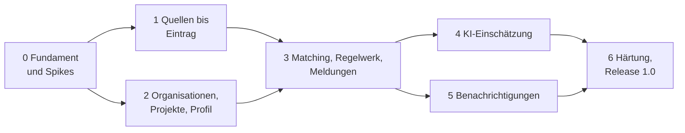

# 14 · Umsetzungsphasen

Sieben Phasen bis Version 1.0. Jede Phase endet mit etwas, das läuft und sich prüfen lässt. Die Aufwände sind Schätzungen für eine erfahrene Person mit KI-Unterstützung; sie dienen der Reihenfolge und der Grössenordnung, nicht als Zusage.

Die Phasen 1 und 2 sind voneinander unabhängig, ebenso 4 und 5. Zu zweit lassen sie sich parallel bearbeiten; allein in der genannten Reihenfolge.

| Phase | Ergebnis | Schätzung |
|---|---|---|
| 0 | Startbare Instanz mit Anmeldung, Job-System und Build-Kette; Risiken geklärt | 2–3 Wochen |
| 1 | Konsolidierte Einträge aus vier Quellen, durchsuchbar | 3–4 Wochen |
| 2 | Organisationen mit Projekten und Technologieprofil; Setup-Wizard | 2–3 Wochen |
| 3 | Meldungen mit Stufe und Begründung; Bulletin, Liste, Detail | 3–4 Wochen |
| 4 | KI-Einschätzung als zuschaltbare Stufe | 2–3 Wochen |
| 5 | Benachrichtigungen über vier Kanäle | 2–3 Wochen |
| 6 | Geprüftes, dokumentiertes Release 1.0 | 2–3 Wochen |
| | **Summe** | **16–23 Wochen** |

## Phase 0 · Fundament und Spikes

Ziel: Alles, worauf jede spätere Phase baut, steht und ist getestet. Die offenen technischen Fragen aus Kapitel 2.8 sind entschieden.

| Nr. | Aufgabe | Abhängig von |
|---|---|---|
| 0.1 | Repository nach Kapitel 13: Solution, Modul-Gerüste, zentrale Paketverwaltung, Analyzer, `.editorconfig` | |
| 0.2 | Build-Kette: Bauen, Tests, Lint, Lizenzabgleich, Image-Bau für zwei Architekturen | 0.1 |
| 0.3 | Host-Programm mit den Befehlen `api`, `worker`, `migrate`, `healthcheck`, `init-env`; Dockerfile; `compose.yaml` | 0.1 |
| 0.4 | Platform: Job-Tabelle mit Leases, Wiederholung, Zusammenfassung, `NOTIFY`; Outbox; Zeitpläne | 0.3 |
| 0.5 | Platform: Mandantenkontext, Audit, Einstellungen, Verschlüsselung der Geheimnisse, Telemetrie | 0.3 |
| 0.6 | **Spike:** Row-Level Security mit EF Core, Npgsql und Verbindungspool unter parallelem Mandantenwechsel | 0.5 |
| 0.7 | **Spike:** Zielimage mit Zeitzonen und Kultur; Health Check ohne Shell | 0.3 |
| 0.8 | Iam: Einrichtungstoken, Registrierung, Anmeldung, Abmeldung, Sitzung, TOTP, CSRF-Schutz, Ratenbegrenzung | 0.5 |
| 0.9 | Web: Arbeitsbereich mit Anwendung und Bibliothek `ui`; Tokens aus den Mockups; Kopfband, Navigation, Anmeldeseiten | 0.1 |
| 0.10 | OpenAPI-Dokument beim Build, Abgleich im Build, erzeugter Client | 0.8, 0.9 |
| 0.11 | Architekturtests für Modulgrenzen | 0.1 |

Abnahme:

- `docker compose up -d` auf einem frischen Host führt in unter 3 Minuten zu einer Instanz, an der man sich mit Einrichtungstoken, Passwort und TOTP anmelden kann.
- 10 000 eingereihte Jobs werden von zwei Workern genau einmal verarbeitet; ein während der Arbeit beendeter Worker verliert keinen Job.
- Ein Job und seine Fachänderung entstehen gemeinsam oder gar nicht (Test mit erzwungenem Abbruch).
- Für die Spikes 0.6 und 0.7 liegt je ein ADR mit Entscheidung vor.
- Ein Pull Request mit einer ausgeschlossenen Bibliothek oder einem Verstoss gegen die Modulgrenzen scheitert im Build.

## Phase 1 · Von der Quelle zum konsolidierten Eintrag

Ziel: Vier Quellen werden zuverlässig abgerufen, normalisiert und zu je einem Eintrag pro Schwachstelle zusammengeführt.

| Nr. | Aufgabe | Abhängig von |
|---|---|---|
| 1.1 | Provider-SDK und Abrufsteuerung: Fälligkeit, Cursor, Rückzug, Health, Abrufprotokoll | 0.4 |
| 1.2 | HTTP-Grundlage für Adapter: Zeitlimit, Wiederholung, Ratenbegrenzung, bedingte Abfragen, Grössenlimits | 1.1 |
| 1.3 | Adapter CVE Program: Deltas, Erstbefüllung mit Rückblick, Einzelabruf | 1.2 |
| 1.4 | Rohdatenablage mit Revisionen; Normalisierung zu Beobachtungen; Quarantäne | 1.3 |
| 1.5 | Identitätsauflösung, Zusammenführung mit Vorrangregeln, Herkunft je Feld | 1.4 |
| 1.6 | Änderungserkennung, Wesentlichkeits-Fingerabdruck, Änderungshistorie, Ereignis `EntryChanged` | 1.5 |
| 1.7 | Produktschlüssel, CPE-Leser, Versionsschemata (SemVer, numerisch, RPM) | 1.4 |
| 1.8 | Adapter CISA KEV und FIRST EPSS als Anreicherung | 1.5 |
| 1.9 | Adapter NCSC/BACS: Warnungen und, nach Klärung mit dem BACS, die öffentlichen Beiträge des Cyber Security Hub | 1.5 |
| 1.10 | API für Einträge; Seiten «Einträge» und «Quellenstatus» | 1.6, 0.10 |
| 1.11 | Befehle zum Neu-Normalisieren und Neuberechnen; Vollständigkeitsprüfung gegen das Änderungsprotokoll | 1.6 |

Abnahme:

- Erstbefüllung mit 180 Tagen Rückblick in unter 60 Minuten.
- Ein neuer oder geänderter CVE-Record ist spätestens 90 Minuten nach Veröffentlichung im System.
- Dasselbe Delta zweimal verarbeitet ändert nichts: keine neue Revision, kein Ereignis.
- Sieben Tage Dauerbetrieb ohne fehlende ID gegenüber dem Änderungsprotokoll der Quelle.
- Eine CVE, die in CVE Program, KEV, EPSS und einer NCSC-Warnung vorkommt, ist ein Eintrag mit vier Belegen; jedes Feld nennt seine Quelle.
- Quarantäne-Anteil für CVE Program unter 0,5 %.
- Ein simulierter Ausfall einer Quelle über 48 Stunden wird ohne Handarbeit und ohne Lücke aufgeholt.

## Phase 2 · Organisationen, Projekte und Profil

Ziel: Eine Organisation kann ihre Umgebung so erfassen, dass sie sich abgleichen lässt.

| Nr. | Aufgabe | Abhängig von |
|---|---|---|
| 2.1 | Organisationen, Mitgliedschaften, Rollen, Einladungen | 0.8 |
| 2.2 | Mandantentrennung nach dem Ergebnis von Spike 0.6; automatischer Fremdzugriffstest für alle Endpunkte | 2.1 |
| 2.3 | Projekte und Komponenten mit Version, Erreichbarkeit, Kritikalität; Profilversion | 2.1 |
| 2.4 | Technologie-Katalog: Startbestand von rund 300 Produkten mit Aliassen und CPE-Zuordnung; Suche | 1.7 |
| 2.5 | Suchindex `component_key` | 2.3, 2.4 |
| 2.6 | Mockups für Setup-Wizard und Projektprofil, Freigabe durch den Eigentümer | |
| 2.7 | Setup-Wizard und Projektseiten | 2.3, 2.4, 2.6 |
| 2.8 | Hinweise zur Abdeckung: fehlende Versionen, Plattformen ohne Komponenten | 2.5 |

Abnahme:

- Der Fremdzugriffstest findet für keinen Endpunkt einen Weg zu Daten einer anderen Organisation.
- Die drei Beispielprojekte aus den Anforderungen lassen sich im Wizard in unter 5 Minuten erfassen.
- Die Katalogsuche liefert für 50 Prüfeingaben einschliesslich Schreibvarianten das richtige Produkt an erster Stelle.
- Jede Änderung am Profil erhöht die Profilversion und steht im Audit-Protokoll.

## Phase 3 · Matching, Regelwerk und Meldungen

Ziel: Der Kern des Produkts. Aus Einträgen und Profilen entstehen Meldungen mit Stufe und Begründung, sichtbar in Bulletin, Liste und Detail.

| Nr. | Aufgabe | Abhängig von |
|---|---|---|
| 3.1 | Kandidatensuche vorwärts (Eintrag geändert) und rückwärts (Profil geändert) | 1.6, 2.5 |
| 3.2 | Versionsprüfung mit den drei Ergebnissen; schwache Treffer als Stufe 1 | 3.1, 1.7 |
| 3.3 | Regelwerk Version 1 als Datei; Faktoren, Untergrenzen, Fristen | 3.2 |
| 3.4 | Meldungen, Befunde, Einschätzungen, Verlauf; Erstbefüllung ohne Einzelalarme | 3.3 |
| 3.5 | Referenzsatz mit mindestens 200 Paaren; Bewertungslauf im Build | 3.3 |
| 3.6 | Bulletin nach Mockup, einschliesslich des ruhigen Zustands | 3.4, 0.9 |
| 3.7 | Meldungsliste mit Leiter als Filter, Suche, Projekt, Status | 3.4 |
| 3.8 | Meldung im Detail: drei Antworten, Faktoren, Projekte, Details, Quellen, Verlauf | 3.4 |
| 3.9 | Status je Projekt, Zuweisung, Notiz, Rücknahme | 3.8 |
| 3.10 | Live-Aktualisierung über Server-Sent Events | 3.6 |

Abnahme:

- Referenzsatz: keine übersehene Betroffenheit bei exaktem Produkt- und Versionstreffer; unbegründete Meldungen ab Stufe 3 unter 20 %.
- Die Beispielfälle aus Kapitel 7.5 ergeben die dort genannten Stufen.
- Gleicher Eintrag, gleiches Profil, gleiche Regelversion ergeben bei erneuter Berechnung dieselbe Stufe und dieselben Faktoren.
- Ein neues Projekt mit 40 Treffern im Rückblick erzeugt 40 Meldungen mit dem Vermerk Erstbefüllung und kein einzelnes Ereignis für Benachrichtigungen.
- Bei 390 × 844 liegen in der Meldung alle drei Antworten über der Aktionsleiste (automatischer Layouttest).
- Automatische Zugänglichkeitsprüfung der drei Seiten ohne Befund.

## Phase 4 · KI-Einschätzung

Ziel: Das Sprachmodell verbessert Urteil, Erklärung und Massnahmen, ohne dass das System von ihm abhängt.

| Nr. | Aufgabe | Abhängig von |
|---|---|---|
| 4.1 | Anbindung über Microsoft.Extensions.AI; Anbieter per Konfiguration; Verbindungstest | 3.4 |
| 4.2 | Prompt, Ausgabeschema, Prüfung der Ausgabe, ein Wiederholungsversuch, Rückfall auf Regeln | 4.1 |
| 4.3 | Datensparsame Eingabe; Datenrichtlinie je Organisation | 4.2 |
| 4.4 | Einfluss auf das Regelwerk nur über den Faktor Betroffenheit; Untergrenzen | 4.2, 3.3 |
| 4.5 | Extraktion von Produkten aus Freitextquellen, einmal je Meldung | 4.2, 1.9 |
| 4.6 | Grenzen: Parallelität, Kontingente, Zeitlimit; Messwerte | 4.1 |
| 4.7 | «Einschätzung korrigieren» in der Oberfläche; Korrekturen als Kontext | 4.2, 3.8 |
| 4.8 | Bewertungslauf je Modell; dokumentierte Ausgangswerte für mindestens ein lokales Modell | 4.2, 3.5 |

Abnahme:

- Mit Anbieter `none` verhält sich das System exakt wie nach Phase 3.
- 20 präparierte Einträge mit eingebetteten Anweisungen senken keine Stufe unter die Untergrenze und erzeugen keine ungültige Ausgabe im Bestand.
- Ein Test, der ausgehende Anfragen mitliest, findet darin keine Komponenten ausserhalb der Treffer und keine Projektnamen.
- Eine Organisation mit der Richtlinie «nur lokal» erzeugt keinen Aufruf an einen als Cloud markierten Endpunkt, auch nicht bei Ausfall des lokalen.
- Für das dokumentierte lokale Modell liegen Messwerte am Referenzsatz vor; die Schwelle für künftige Änderungen ist daraus festgelegt.

## Phase 5 · Benachrichtigungen

Ziel: Die richtigen Menschen erfahren das Richtige einmal.

| Nr. | Aufgabe | Abhängig von |
|---|---|---|
| 5.1 | Ereignisse aus Assessment; Regelauswertung; Empfängerauflösung | 3.4 |
| 5.2 | Zustelltabelle mit Schlüssel, Wiederholung, Bündelung, Vorrang | 5.1 |
| 5.3 | Kanal In-App mit Live-Zustellung | 5.2, 3.10 |
| 5.4 | Kanal E-Mail | 5.2 |
| 5.5 | Kanal Web Push: Schlüsselpaar, Abos, Service Worker, Installationsführung für iOS | 5.2 |
| 5.6 | Kanal Webhook mit Signatur und SSRF-Schutz | 5.2 |
| 5.7 | Vorgaberegeln; Zusammenfassungen nach Zeitplan | 5.1, 0.4 |
| 5.8 | Mockup und Seiten für Regeln, Ziele, Zustellprotokoll, persönliche Einstellungen | 5.1 |

Abnahme: die Kriterien aus Kapitel 8.8.

## Phase 6 · Härtung und Release 1.0

| Nr. | Aufgabe |
|---|---|
| 6.1 | Sicherheitsdurchgang entlang der Bedrohungstabelle aus Kapitel 9.7; Header, Ratenbegrenzung, SSRF- und XSS-Tests |
| 6.2 | Manueller Zugänglichkeitsdurchgang der Kernabläufe mit Tastatur und Screenreader |
| 6.3 | Lasttest: Listen und Suche mit dem gesamten CVE-Bestand; Abruf unter Spitzenlast (2 000 neue Records an einem Tag) |
| 6.4 | Sicherung und Wiederherstellung geübt; Update von der Vorversion geübt |
| 6.5 | `doctor`, Wartungsbefehle, Warnungen des Systems über sich selbst |
| 6.6 | Dokumentation: Installation, Konfiguration, Betrieb, Update, «Eine Quelle hinzufügen» |
| 6.7 | SBOM, Signatur, Lizenzdatei, `SECURITY.md`; Images für beide Architekturen |
| 6.8 | Eigene Instanz des Projekts mit dem eigenen Technologieprofil |

Abnahme: alle Kriterien aus Kapitel 1.6, nachgewiesen auf einer frischen Installation für `amd64` und `arm64`.

## Nach 1.0

In dieser Reihenfolge, weil sie in dieser Reihenfolge Nutzen bringen:

1. **SBOM- und Lockfile-Import.** Der Spike zeigt, dass Plattformen mit Plugins und Paketen ohne Inventar auf Komponentenebene nicht prüfbar sind.
2. **Erste Quellenwelle** mit generischem OSV- und CSAF-Leser: GitHub Advisories, OSV, CERT-Bund, CISA-Advisories, Microsoft, Red Hat, Ubuntu, Debian, Kubernetes; NVD als Anreicherung.
3. **Deutsch** in der Oberfläche und in Nachrichten.
4. **Eskalationsstufen** mit Fristen; Vorlagen für Teams und Slack.
5. **Passkeys und OIDC-Anmeldung;** API-Tokens.
6. **Capacitor-App,** nach Entscheidung über das Push-Relay.
7. **Ausbau auf 30 bis 50 Quellen;** Berichte und Export; Rechte je Projekt.
