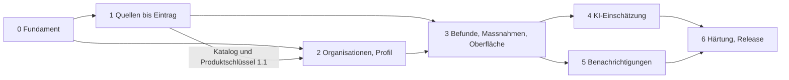

# 14 · Umsetzungsphasen

Sieben Phasen bis Version 1.0. Jede endet mit etwas, das läuft und sich prüfen lässt. Enthalten ist nur, was in Kapitel 1.5 in der Spalte MVP steht.

## 14.1 Aufwand

| Phase | Ergebnis | Schätzung |
|---|---|---|
| 0 | Startbare Instanz mit Anmeldung, Job-System, Build-Kette; technische Risiken geklärt | 4–5 Wochen |
| 1 | Konsolidierte Einträge aus vier Quellen, durchsuchbar | 5–7 Wochen |
| 2 | Organisationen mit Projekten und Technologieprofil; Setup-Wizard | 4–5 Wochen |
| 3 | Befunde, Massnahmen und Meldungen mit Stufe und Begründung; Bulletin, Liste, Detail | 6–8 Wochen |
| 4 | KI-Einschätzung als zuschaltbarer Schritt | 2–3 Wochen |
| 5 | Benachrichtigungen über vier Kanäle | 3–4 Wochen |
| 6 | Geprüftes, dokumentiertes Release 1.0 | 3–4 Wochen |
| | **Summe** | **27–36 Wochen** |

Die Zahlen gelten für eine erfahrene Person mit KI-Unterstützung und sind Schätzungen, keine Zusage. Drei Posten treiben sie und sind schwer zu verkürzen, weil sie Handarbeit an Daten sind: der Katalog mit rund 300 Produkten samt Aliassen, der Referenzsatz mit 200 von Hand beschrifteten Paaren und die 15 bis 20 Oberflächenkomponenten mit allen Zuständen. Nicht enthalten sind Wartezeiten auf Dritte (Antwort des BACS, eine externe Sicherheitsprüfung) und die Mockups, die vor einzelnen Phasen freizugeben sind.

Eine erste Fassung dieses Plans nannte 16 bis 23 Wochen. Die unabhängige Durchsicht hat das als unrealistisch beanstandet; der Umfang wurde daraufhin gekürzt und der Rest neu geschätzt.

Phase 2 braucht aus Phase 1 nur die Aufgabe 1.1; danach laufen beide unabhängig. Phase 4 und 5 sind voneinander unabhängig.

## Phase 0 · Fundament

| Nr. | Aufgabe | Abhängig von |
|---|---|---|
| 0.1 | Repository nach Kapitel 13: Solution, Modul-Gerüste, zentrale Paketverwaltung, Analyzer | |
| 0.2 | Build-Kette: Bauen, Tests, Lint, Lizenzabgleich, Image für zwei Architekturen | 0.1 |
| 0.3 | Host-Programm mit `api`, `worker`, `migrate`, `healthcheck`, `init-env`, `doctor`; Dockerfile; Compose mit TLS-Proxy | 0.1 |
| 0.4 | Job-System im Umfang von Kapitel 3.4; Tests mit erzwungenen Abbrüchen | 0.3 |
| 0.5 | Mandantenkontext und Arbeitseinheit über mehrere Module; Audit; Einstellungen; Verschlüsselung der Geheimnisse; Telemetrie | 0.3 |
| 0.6 | **Versuch:** Row-Level Security mit EF Core, Npgsql, Verbindungspool und der gemeinsamen Transaktion; Entscheidung als ADR | 0.5 |
| 0.7 | **Versuch:** Zielimage mit Zeitzonen und Kultur; Health Check ohne Shell | 0.3 |
| 0.8 | Anmeldung: Einrichtungstoken, Registrierung, Sitzung, TOTP, Passwortregeln mit Liste häufiger Passwörter, CSRF-Schutz, Ratenbegrenzung | 0.5 |
| 0.9 | E-Mail-Versand in einfacher Form, für Bestätigung, Passwort-Reset und Einladungen | 0.3 |
| 0.10 | Web: Arbeitsbereich mit Anwendung und Bibliothek `ui`; Tokens aus den Mockups; Kopfband, Navigation, Anmeldeseiten; Übersetzungsgerüst mit Englisch | 0.1 |
| 0.11 | OpenAPI-Dokument beim Build, Abgleich im Build, erzeugter Client | 0.8, 0.10 |
| 0.12 | Architekturtests für Modulgrenzen | 0.1 |

Abnahme:

- Mit der Beispielkonfiguration entsteht in unter 3 Minuten nach dem Laden der Images eine Instanz, an der man sich über HTTPS mit Einrichtungstoken, Passwort und TOTP anmelden kann.
- 10 000 eingereihte Jobs werden von zwei Workern vollständig verarbeitet. Wird ein Worker mitten in der Arbeit beendet, läuft jeder seiner Jobs erneut, und die Wirkung jedes Jobs tritt genau einmal ein.
- Ein Job und seine Fachänderung entstehen gemeinsam oder gar nicht (Test mit erzwungenem Abbruch).
- Für die Versuche 0.6 und 0.7 liegt je ein ADR vor.
- Ein Pull Request mit einer ausgeschlossenen Bibliothek oder einem Verstoss gegen die Modulgrenzen scheitert im Build.

## Phase 1 · Von der Quelle zum konsolidierten Eintrag

| Nr. | Aufgabe | Abhängig von |
|---|---|---|
| 1.1 | Modul Catalog: Produktschlüssel, CPE-Leser, Versionsschemata (SemVer, numerisch, RPM), Format des Katalogs | 0.1 |
| 1.2 | Provider-SDK mit Haltepunkten; Abrufsteuerung: Fälligkeit, Cursor, Wartezeit nach Fehlern, Zustand, Abrufprotokoll | 0.4 |
| 1.3 | HTTP-Grundlage für Adapter: Zeitlimit, Wiederholung, Ratenbegrenzung, bedingte Abfragen, Grössenlimits | 1.2 |
| 1.4 | Adapter CVE Program: Deltas, Erstbefüllung mit Rückblick, Einzelabruf | 1.3 |
| 1.5 | Rohdatenablage mit Revisionen; Normalisierung zu Beobachtungen; Quarantäne | 1.4, 1.1 |
| 1.6 | Zusammenführung über die CVE-ID mit festen Vorrangregeln und Herkunft je Feld | 1.5 |
| 1.7 | Änderungserkennung mit beiden Fingerabdrücken; Änderungshistorie; Folgejob bei wesentlicher Änderung | 1.6 |
| 1.8 | Signale: KEV und EPSS in `entry_signal`, Klassenwechsel mit Schwelle | 1.6 |
| 1.9 | Adapter BACS auf den öffentlichen Daten der Website: Titel, Kurztext, Verweis, CVE-IDs aus dem Text; Vertragstest im Betrieb | 1.6 |
| 1.10 | API für Einträge; Seiten «Entries» und «Sources» mit Quarantäne-Liste; Mockup der Quellenseite | 1.7, 0.11 |
| 1.11 | Befehle zum Neu-Normalisieren und Neuberechnen; Vollständigkeitsprüfung gegen das Änderungsprotokoll | 1.7 |

Abnahme:

- Erstbefüllung mit 180 Tagen Rückblick in unter 60 Minuten auf der Referenzmaschine (2 vCPU, 4 GB).
- Ein neuer oder geänderter CVE-Record ist spätestens 90 Minuten nach Veröffentlichung im System.
- Dasselbe Delta zweimal verarbeitet ändert nichts: keine neue Revision, kein Folgejob.
- Sieben Tage Dauerbetrieb ohne fehlende ID gegenüber dem Änderungsprotokoll der Quelle.
- Eine CVE, die in CVE Program, KEV und EPSS vorkommt, ist ein Eintrag; jedes Feld nennt seine Quelle. Nennt eine BACS-Warnung die CVE, erscheint sie als weiterer Beleg und setzt das Merkmal «Warnung einer nationalen Stelle».
- Quarantäne-Anteil für CVE Program unter 0,5 %.
- Ein simulierter Ausfall einer Quelle über 48 Stunden wird ohne Handarbeit und ohne Lücke aufgeholt.
- Der tägliche EPSS-Lauf berührt nur Einträge, deren Klasse wechselt.

## Phase 2 · Organisationen, Projekte und Profil

| Nr. | Aufgabe | Abhängig von |
|---|---|---|
| 2.1 | Organisationen, Mitgliedschaften, Rollen, Einladungen, MFA-Pflicht je Organisation; Seite «Team» | 0.8, 0.9 |
| 2.2 | Mandantentrennung nach dem Ergebnis von 0.6; Fremdzugriffstest für alle Endpunkte einschliesslich Kennungen im Anfragekörper | 2.1 |
| 2.3 | Projekte und Komponenten mit Version, Herkunft, Erreichbarkeit, Kritikalität, Schutzmassnahme | 2.1 |
| 2.4 | Katalog füllen: rund 300 Produkte mit Aliassen, CPE-Zuordnung, verwandten Produkten; Suche | 1.1 |
| 2.5 | Suchindex `component_key` mit Trefferstärke | 2.3, 2.4 |
| 2.6 | Mockups für Setup-Wizard und Projektprofil; Freigabe durch den Eigentümer | |
| 2.7 | Setup-Wizard und Projektseiten; Einstellungen der Organisation | 2.3, 2.4, 2.6 |
| 2.8 | Hinweise zur Abdeckung: fehlende Versionen, Plattformen ohne Komponenten, Pakete aus Distributionen | 2.5 |

Abnahme:

- Der Fremdzugriffstest findet für keinen Endpunkt einen Weg zu Daten einer anderen Organisation.
- Eine Testperson, die das System nicht kennt, erfasst die drei Beispielprojekte aus den Anforderungen im Wizard in unter 10 Minuten.
- Die Katalogsuche liefert für 50 vorab festgelegte Prüfeingaben einschliesslich Schreibvarianten das richtige Produkt an erster Stelle.
- Jede Änderung am Profil steht im Audit-Protokoll und löst die Rückwärtssuche für das Projekt aus.

## Phase 3 · Befunde, Massnahmen und die Oberfläche dazu

| Nr. | Aufgabe | Abhängig von |
|---|---|---|
| 3.1 | Mockups: Liste und Bulletin mit Massnahmen, Detail einer Massnahme, Fassung ohne Sprachmodell, ruhiges Bulletin; Freigabe durch den Eigentümer | |
| 3.2 | Kandidatensuche vorwärts und rückwärts; Trefferstärke; schwache Treffer als Stufe 1 | 1.7, 2.5 |
| 3.3 | Versionsprüfung mit den drei Ergebnissen; Pakete aus Distributionen als unbekannt | 3.2, 1.1 |
| 3.4 | Regelwerk Version 1 als Datei; Faktoren, Ober- und Untergrenzen, Fristen | 3.3 |
| 3.5 | Befunde, Massnahmen, Meldungen, Verlauf; Abschluss durch Anheben der Version im Profil; Erstbefüllung ohne Einzelereignisse | 3.4 |
| 3.6 | Antworten aus Vorlagen ohne Sprachmodell | 3.5 |
| 3.7 | Referenzsatz mit mindestens 200 beschrifteten Paaren; Bewertungslauf im Build; Kalibrierung der Gewichte | 3.4 |
| 3.8 | Bulletin mit Warnungen ohne Kennung und ruhigem Zustand | 3.5, 3.1 |
| 3.9 | Liste der Massnahmen mit Leiter als Filter, Suche, Projekt, Status | 3.5, 3.1 |
| 3.10 | Massnahme und Schwachstelle im Detail; Status, Zuweisung, Frist, Notiz, Rücknahme | 3.5, 3.1 |
| 3.11 | Live-Aktualisierung über Server-Sent Events; Befehl zum Neuberechnen der Stufen | 3.8 |

Abnahme:

- Referenzsatz: kein übersehenes Paar unter den exakten Treffern, höchstens 2 % übersehene insgesamt, höchstens 20 % unbegründete ab Stufe 3 (Begriffe nach Kapitel 7.9).
- Die Beispielfälle aus Kapitel 7.6 ergeben die dort genannten Stufen.
- Gleiche gespeicherte Eingabe ergibt bei erneuter Berechnung dieselbe Stufe und dieselben Faktoren.
- Die Daten des Spikes (eine Woche, drei Projekte) ergeben höchstens 8 offene Massnahmen.
- Ein neues Projekt mit 40 Treffern im Rückblick erzeugt Befunde mit dem Vermerk Erstbefüllung und kein Einzelereignis für Benachrichtigungen.
- Wird im Profil eine Version angehoben, schliessen sich die Befunde, die sie nicht mehr betreffen.
- Mit den Beispieldaten liegen bei 390 × 844 Punkten alle drei Antworten über der Aktionsleiste (automatischer Layouttest).
- Ohne Sprachmodell zeigen Bulletin, Massnahme und Meldung alle drei Antworten aus strukturierten Daten.
- Automatische Zugänglichkeitsprüfung der Seiten ohne Befund.

## Phase 4 · KI-Einschätzung

| Nr. | Aufgabe | Abhängig von |
|---|---|---|
| 4.1 | Anbindung über Microsoft.Extensions.AI; benannte Anbieter mit Kennzeichnung lokal oder nicht; Verbindungstest | 3.5 |
| 4.2 | Prompt, Ausgabeschema, Prüfung der Ausgabe, ein Wiederholungsversuch, Rückfall auf Regeln | 4.1 |
| 4.3 | Auslösung nach Schwelle und Obergrenze je Massnahme; auf Anforderung in der Oberfläche | 4.2 |
| 4.4 | Datensparsame Eingabe; Datenrichtlinie je Organisation | 4.2 |
| 4.5 | Urteil des Modells als Faktor nur bei unbekannter Version; «nicht betroffen» als Vorschlag zum Bestätigen | 4.2, 3.4 |
| 4.6 | Grenzen: Parallelität, Kontingente, Zeitlimit; Messwerte | 4.1 |
| 4.7 | «Einschätzung korrigieren» mit Neubewertung | 4.2, 3.10 |
| 4.8 | Bewertungslauf je Modell; dokumentierte Ausgangswerte für mindestens ein lokales Modell | 4.2, 3.7 |

Abnahme:

- Ohne Anbieter verhält sich das System exakt wie nach Phase 3.
- 20 präparierte Einträge mit eingebetteten Anweisungen, je zur Hälfte mit Version im Bereich und mit unbekannter Version: Keiner erreicht ohne menschliche Bestätigung Stufe 1, keiner fällt unter die Untergrenzen, keine ungültige Ausgabe gelangt in den Bestand.
- Ein Test, der ausgehende Anfragen mitliest, findet darin keine Komponenten ausserhalb der Treffer und keine Projektnamen.
- Eine Organisation mit der Richtlinie «nur lokal» erzeugt keinen Aufruf an einen nicht lokalen Anbieter, auch nicht bei Ausfall des lokalen.
- Die Daten des Spikes lösen höchstens 40 Aufrufe aus.
- Für das dokumentierte lokale Modell liegen Messwerte am Referenzsatz vor.

## Phase 5 · Benachrichtigungen

| Nr. | Aufgabe | Abhängig von |
|---|---|---|
| 5.1 | Ereignisse nach Kapitel 8.2; Regelauswertung; Empfängerauflösung; Bestätigung externer Adressen | 3.5 |
| 5.2 | Benachrichtigungsstand, Zustellschlüssel, Bündelung, Vormerkliste für Sammelnachrichten | 5.1 |
| 5.3 | Kanal In-App mit Live-Zustellung | 5.2, 3.11 |
| 5.4 | Kanal E-Mail mit Vorlagen für Sofort- und Sammelnachricht | 5.2, 0.9 |
| 5.5 | Kanal Web Push: Schlüsselpaar, Abos, Service Worker, Manifest, Installationsführung für iOS | 5.2 |
| 5.6 | Kanal Webhook mit Signatur und Schutz vor internen Zielen | 5.2 |
| 5.7 | Vorgaberegeln; Sammelnachrichten nach Zeitplan; persönliche Stummschaltung | 5.1, 0.4 |
| 5.8 | Mockup und Seiten für Regeln, Ziele, Zustellprotokoll, persönliche Einstellungen; Freigabe des Mockups | 5.1 |

Abnahme: die Kriterien aus Kapitel 8.8.

## Phase 6 · Härtung und Release 1.0

Keine neuen Funktionen.

| Nr. | Aufgabe |
|---|---|
| 6.1 | Sicherheitsdurchgang entlang der Bedrohungstabelle aus Kapitel 9.7; Header, Ratenbegrenzung, Tests gegen interne Ziele und eingeschleuste Inhalte |
| 6.2 | Unabhängige Sicherheitsprüfung durch eine Person ausserhalb der Entwicklung, mindestens für Anmeldung, Mandantentrennung und ausgehende Verbindungen |
| 6.3 | Manueller Zugänglichkeitsdurchgang der Kernabläufe mit Tastatur und Screenreader |
| 6.4 | Lasttest: Listen und Suche mit dem gesamten CVE-Bestand; Abruf unter Spitzenlast (2 000 neue Records an einem Tag); Messung des Speicherbedarfs |
| 6.5 | Sicherung und Wiederherstellung geübt; Update von einem Vorabstand auf 1.0 geübt, einschliesslich Rückweg über den Dump |
| 6.6 | Wartungsbefehle: Zugang wiederherstellen, Gesamtbestand einspielen, Organisation exportieren und löschen; Warnungen des Systems über sich selbst |
| 6.7 | Dokumentation: Installation, Konfiguration, Betrieb, Update, «Eine Quelle hinzufügen»; `SECURITY.md` mit Meldeweg und Hinweis, wie Betreiber von Sicherheitsupdates des Projekts erfahren |
| 6.8 | SBOM, Lizenzdatei, Images für beide Architekturen; eigene Instanz des Projekts mit dem eigenen Technologieprofil |

Abnahme: alle Kriterien aus Kapitel 1.6, nachgewiesen auf einer frischen Installation für `amd64` und `arm64`; keine offenen Befunde der Stufe hoch aus 6.1 und 6.2.

## Nach 1.0

In dieser Reihenfolge, weil sie in dieser Reihenfolge Nutzen bringen:

1. **SBOM- und Lockfile-Import.** Plattformen mit Plugins und Paketen sind ohne Inventar auf Komponentenebene nicht prüfbar.
2. **Erste Quellenwelle** mit generischem OSV- und CSAF-Leser, einschliesslich der Daten der Distributionen und des Verschmelzens von Einträgen mit später entdeckter gemeinsamer Kennung.
3. **Deutsch** in der Oberfläche und in Nachrichten.
4. **Eskalation** in Schritten; Vorlagen für Teams und Slack.
5. **Passkeys und OIDC-Anmeldung;** API-Tokens.
6. **Produkte aus Freitext** durch ein Sprachmodell; Korrekturen als Kontext; Gewichte je Organisation.
7. **Capacitor-App,** nach Entscheidung über das Push-Relay.
8. **Ausbau auf 30 bis 50 Quellen;** Berichte und Export; Rechte je Projekt; signierte Images; Wechsel des Hauptschlüssels; Anhalten bei auffälligen Massenänderungen einer Quelle.
