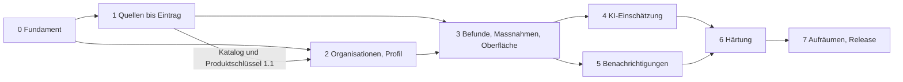

# 14 · Umsetzungsphasen

Acht Phasen bis Version 1.0. Jede endet mit etwas, das läuft und sich prüfen lässt. Enthalten ist nur, was in Kapitel 1.5 in der Spalte MVP steht. Abnahmekriterien werden als schnelle Tests in der Pipeline geprüft; wo das nicht geht, einmal in der Entwicklung beobachtet. Langläufer und zeitgesteuerte Tests gibt es nicht, und jede Pipeline bleibt unter 25 Minuten (Kapitel 13.6 und 13.7).

## 14.1 Aufwand

| Phase | Ergebnis | Schätzung |
|---|---|---|
| 0 | Startbare Instanz mit Anmeldung, Job-System, Build-Kette, Administration in erster Form; technische Risiken geklärt | 5–6 Wochen |
| 1 | Konsolidierte Einträge aus fünf Quellen einschliesslich OSV für Pakete, mit Verschmelzen; durchsuchbar | 7–10 Wochen |
| 2 | Organisationen mit Projekten und Technologieprofil; Profil aus GitHub-Repositories; Setup-Wizard | 7–9 Wochen |
| 3 | Befunde, Massnahmen und Meldungen mit Stufe und Begründung; Übersicht, Liste, Detail | 6–8 Wochen |
| 4 | KI-Einschätzung als zuschaltbarer Schritt; Katalog, der selbst wächst | 3–4 Wochen |
| 5 | Benachrichtigungen über vier Kanäle | 3–4 Wochen |
| 6 | Gehärtete, geprüfte und dokumentierte Instanz | 3–4 Wochen |
| 7 | Aufgeräumtes Repository unter dem Namen Ardea; Release 1.0 mit automatisch gebauten, signierten Images; Demo-Befehl; englisches README und Website mit Dokumentation auf GitHub Pages; Abnahme aller Phasen; Masterplan gelöscht | 4–5 Wochen |
| | **Summe** | **38–50 Wochen** |

Die Zahlen gelten für eine erfahrene Person mit KI-Unterstützung und sind Schätzungen, keine Zusage. Drei Posten treiben sie und sind schwer zu verkürzen, weil sie Handarbeit an Daten sind: der Katalog mit rund 300 Produkten samt Aliassen, der Referenzsatz mit 200 von Hand beschrifteten Paaren und die 15 bis 20 Oberflächenkomponenten mit allen Zuständen. Nicht enthalten sind Wartezeiten auf Dritte (eine externe Sicherheitsprüfung). Die Mockups halten nichts auf: Die Umsetzung entwirft sie selbst, der Eigentümer prüft sie im Nachhinein (Kapitel 15, E15).

Eine erste Fassung dieses Plans nannte 16 bis 23 Wochen. Die unabhängige Durchsicht hat das als unrealistisch beanstandet; der Umfang wurde daraufhin gekürzt und der Rest neu geschätzt. Die zweite Durchsicht fand die Oberfläche für den Instanz-Administrator in keiner Aufgabe; sie ist jetzt Aufgabe 0.13 und mit einer Woche in Phase 0 eingerechnet. Am 18.11.2026 kamen das Profil aus GitHub-Repositories und mit ihm OSV, zwei weitere Versionsschemata und das Verschmelzen von Einträgen ins MVP (Kapitel 16); das sind 5 bis 7 Wochen mehr, 2 bis 3 in Phase 1 und 3 bis 4 in Phase 2. Am 19.11.2026 kam Phase 7 dazu: Aufräumen und Release, getrennt von der Härtung in Phase 6, mit signierten Images, die bisher eine Ausbaustufe waren, einem Demo-Befehl und einer Website; das sind 4 bis 5 Wochen mehr.

Phase 2 braucht aus Phase 1 nur die Aufgabe 1.1; danach laufen beide unabhängig. Phase 4 und 5 sind voneinander unabhängig.

## Phase 0 · Fundament

| Nr. | Aufgabe | Abhängig von |
|---|---|---|
| 0.1 | Repository nach Kapitel 13: Solution, Modul-Gerüste, zentrale Paketverwaltung, Analyzer | |
| 0.2 | Build-Kette nach Kapitel 13.7: Bauen, Tests, Lint, Lizenzabgleich, Image für zwei Architekturen durch Cross-Kompilieren; Messung der Dauer | 0.1 |
| 0.3 | Host-Programm mit `api`, `worker`, `migrate` (mit Sicherung vor einer Migration, nach dem Ergebnis von 0.7), `healthcheck`, `init-env`, `doctor`; Dockerfile; Compose mit TLS-Proxy | 0.1 |
| 0.4 | Job-System im Umfang von Kapitel 3.4; Tests mit erzwungenen Abbrüchen | 0.3 |
| 0.5 | Mandantenkontext und Arbeitseinheit über mehrere Module; Audit; Einstellungen; Verschlüsselung der Geheimnisse; Telemetrie | 0.3 |
| 0.6 | **Versuch:** Row-Level Security mit EF Core, Npgsql, Verbindungspool und der gemeinsamen Transaktion; Entscheidung als ADR | 0.5 |
| 0.7 | **Versuch:** Zielimage mit Zeitzonen und Kultur; Health Check ohne Shell; Dump vor einer Migration über den Datenbankserver; Arbeitsvolume für grosse Archive | 0.3 |
| 0.8 | Anmeldung: Einrichtungstoken, Registrierung, serverseitige Sitzungen mit Liste und Widerruf, TOTP, Passwortregeln mit Liste häufiger Passwörter, CSRF-Schutz, Ratenbegrenzung | 0.5 |
| 0.9 | E-Mail-Versand in einfacher Form, für Bestätigung, Passwort-Reset und Einladungen; Verhalten ohne SMTP (Kapitel 12.4) | 0.3 |
| 0.10 | Web: Arbeitsbereich mit Anwendung und Bibliothek `ui`; Tokens aus den Mockups; Kopfband, Navigation, Anmeldeseiten; Übersetzungsgerüst mit Englisch; Seiten der Komponenten mit Bildvergleich | 0.1 |
| 0.11 | OpenAPI-Dokument beim Build, Abgleich im Build, erzeugter Client | 0.8, 0.10 |
| 0.12 | Architekturtests für Modulgrenzen | 0.1 |
| 0.13 | Administration in erster Form: Einstellungen der Instanz (Registrierung, SMTP mit Testversand), aufgegebene Jobs mit Wiederholen, installierte Version | 0.4, 0.8, 0.10 |

Abnahme:

- Mit der Beispielkonfiguration entsteht in unter 3 Minuten nach dem Laden der Images eine Instanz, an der man sich über HTTPS mit Einrichtungstoken, Passwort und TOTP anmelden kann.
- 10 000 eingereihte Jobs werden von zwei Workern vollständig verarbeitet. Wird ein Worker mitten in der Arbeit beendet, läuft jeder seiner Jobs erneut, und die Wirkung jedes Jobs tritt genau einmal ein.
- Ein Job und seine Fachänderung entstehen gemeinsam oder gar nicht (Test mit erzwungenem Abbruch).
- Für die Versuche 0.6 und 0.7 liegt je ein ADR vor.
- Ein Pull Request mit einer ausgeschlossenen Bibliothek oder einem Verstoss gegen die Modulgrenzen scheitert im Build.
- Die Pipeline eines Pull Requests läuft in unter 15 Minuten.

## Phase 1 · Von der Quelle zum konsolidierten Eintrag

| Nr. | Aufgabe | Abhängig von |
|---|---|---|
| 1.1 | Modul Catalog: Produktschlüssel, CPE-Leser, Versionsschemata (SemVer, NuGet, PEP 440, Maven, RPM, numerisch), Format des Katalogs | 0.1 |
| 1.2 | Provider-SDK mit Haltepunkten und der Schnittstelle für Signale; Abrufsteuerung: Fälligkeit, Cursor, Wartezeit nach Fehlern, Zustand, Abrufprotokoll | 0.4 |
| 1.3 | HTTP-Grundlage für Adapter: Zeitlimit, Wiederholung, Ratenbegrenzung, bedingte Abfragen, Grössenlimits | 1.2 |
| 1.4 | Adapter CVE Program: Deltas, Erstbefüllung und lange Pausen über das Gesamtarchiv, Einzelabruf | 1.3 |
| 1.5 | Rohdatenablage mit Revisionen; Normalisierung zu Beobachtungen; Quarantäne | 1.4, 1.1 |
| 1.6 | Zusammenführung über die CVE-ID mit festen Vorrangregeln und Herkunft je Feld | 1.5 |
| 1.7 | Änderungserkennung mit beiden Fingerabdrücken; Änderungshistorie; Folgejob bei wesentlicher Änderung | 1.6 |
| 1.8 | Signale: KEV und EPSS in `entry_signal`, Klassenwechsel mit Schwelle | 1.6 |
| 1.9 | Adapter NCSC mit zwei Lesern: öffentliche Schnittstelle des Cyber Security Hub (Liste, Einzelbeitrag, Änderungsverlauf) und Warnungen der Website des BACS; Titel, Kurztext, Volltext, Verweis, CVE-IDs aus Titel und Text; Zustand `degraded` bei auffälligen Abrufen | 1.6 |
| 1.10 | API für Einträge; Seiten «Entries» und «Sources» mit Quarantäne-Liste und Kennzahlen je Quelle; Mockup der Quellenseite | 1.7, 0.11 |
| 1.11 | Befehle zum Neu-Normalisieren und Neuberechnen; Vollständigkeitsprüfung gegen das Änderungsprotokoll | 1.7 |
| 1.12 | Adapter OSV für npm, NuGet, Packagist, PyPI, Maven und Go: `modified_id.csv` je Ökosystem, Erstbefüllung über das Archiv des Ökosystems, Paketkoordinaten und Bereiche je Ökosystem; Bedingungen der Datenquellen vorher geprüft | 1.3, 1.5 |
| 1.13 | Verschmelzen von Einträgen über eine später auftauchende gemeinsame Kennung, mit Weiterleitung und Prüfliste für Fälle mit zwei CVE-IDs (Kapitel 6.2) | 1.6, 1.12 |

Abnahme:

- Erstbefüllung mit 180 Tagen Rückblick läuft ohne Handarbeit durch; ihre Dauer auf der Referenzmaschine (2 vCPU, 4 GB) wird einmal beobachtet und dokumentiert, Ziel unter 60 Minuten.
- Ein neuer oder geänderter CVE-Record ist spätestens 90 Minuten nach Veröffentlichung im System.
- Dasselbe Delta zweimal verarbeitet ändert nichts: keine neue Revision, kein Folgejob.
- Gegen ein aufgezeichnetes Änderungsprotokoll mit Lücken und Doppellieferungen fehlt nach dem Abgleich keine ID (schneller Test).
- Eine CVE, die in CVE Program, KEV und EPSS vorkommt, ist ein Eintrag; jedes Feld nennt seine Quelle. Nennt ein Advisory des NCSC die CVE, erscheint es als weiterer Beleg und setzt das Merkmal «Warnung einer nationalen Stelle». Wird die CVE erst nachträglich in ein Advisory eingetragen, geschieht dasselbe beim nächsten Abruf.
- Quarantäne-Anteil für CVE Program unter 0,5 %.
- Ein simulierter Ausfall einer Quelle über 48 Stunden wird ohne Handarbeit und ohne Lücke aufgeholt. Der Weg für Pausen über 30 Tage (Gesamtarchiv) hat einen eigenen Test mit einem verkleinerten Archiv.
- Der tägliche EPSS-Lauf berührt nur Einträge, deren Klasse wechselt.
- Ein OSV-Record, der zuerst nur mit GHSA-Kennung kommt und dessen CVE-Record schon einen Eintrag erzeugt hat, ergibt nach Eintreffen der CVE-ID genau einen Eintrag; der andere Schlüssel leitet weiter (schneller Test mit aufgezeichneten Records).
- Für die sechs Ökosysteme liefert die Versionsprüfung an je zehn aufgezeichneten Records das erwartete Ergebnis.

## Phase 2 · Organisationen, Projekte und Profil

| Nr. | Aufgabe | Abhängig von |
|---|---|---|
| 2.1 | Organisationen, Mitgliedschaften, Rollen, Einladungen, MFA-Pflicht je Organisation; Seite «Team» | 0.8, 0.9 |
| 2.2 | Mandantentrennung nach dem Ergebnis von 0.6; Mitgliederverzeichnis; Datenbankfunktionen der Systemoperationen, jeweils mit dem Ablauf, der sie braucht (Kapitel 9.2); Fremdzugriffstest für alle Endpunkte einschliesslich Kennungen im Anfragekörper | 2.1 |
| 2.3 | Projekte und Komponenten mit Version, Herkunft, Erreichbarkeit, Kritikalität, Schutzmassnahme; Ersetzen eines Profils als Abgleich, der Kennungen erhält | 2.1 |
| 2.4 | Katalog füllen: rund 300 Produkte mit Aliassen, CPE-Zuordnung, verwandten Produkten; Suche | 1.1 |
| 2.5 | Suchindex `component_key` mit Trefferstärke | 2.3, 2.4 |
| 2.6 | Mockups für Setup-Wizard mit Repository und Vorschlägen und für das Projektprofil mit Paketen; Durchsicht durch den Eigentümer im Nachhinein | |
| 2.7 | Setup-Wizard mit den Schritten Repository, Betrieb und Technologien in drei Gruppen (Kapitel 11.6); Projektseiten mit Verknüpfungen, Paketen je Ökosystem und Vorschlägen; Einstellungen der Organisation mit Zugängen und Ansicht des Audit-Protokolls | 2.3, 2.4, 2.6, 2.13 |
| 2.8 | Hinweise zur Abdeckung: fehlende Versionen, Plattformen ohne Komponenten, Pakete aus Distributionen, Pakete ohne Lockdatei, noch nicht prüfbare Ökosysteme | 2.5 |
| 2.9 | **Versuch:** asynchroner SBOM-Export mit einem öffentlichen und einem privaten Repository und einem feingranularen Token; offene Punkte aus Kapitel 16.10; Ergebnis als ADR | |
| 2.10 | Zugänge zu GitHub mit verschlüsseltem Token, Prüfung, Ablaufdatum, Liste der lesbaren Repositories; Hosts für GitHub Enterprise Server in der Administration | 2.3, 2.9 |
| 2.11 | Anbindung über `IRepositoryHost`: Zweigkopf mit ETag, SBOM anfordern und abholen, Dateibaum, Dateien mit Grenzen; Leser für SPDX, `packages.lock.json` und `package-lock.json` | 2.10 |
| 2.12 | Erkennungsregeln für Dockerfile, Compose, `global.json`, Projektdateien, `engines` und `.nvmrc`, `composer.json`, `go.mod`; Image-Namen im Katalog; Vorschläge mit Beleg | 2.4, 2.11 |
| 2.13 | Job `IndexRepository` mit Fälligkeit und Systemoperation; Abgleich nach Kapitel 16.5 mit Zurückhalten deutlich kleinerer Stände; Zustand, Ereignis `repository.unavailable`; Audit mit Commit als Herkunft | 2.5, 2.11, 2.12 |

Abnahme:

- Der Fremdzugriffstest findet für keinen Endpunkt einen Weg zu Daten einer anderen Organisation.
- Eine Testperson, die das System nicht kennt, erfasst die drei Beispielprojekte aus den Anforderungen im Wizard in unter 10 Minuten.
- Die Katalogsuche liefert für 50 vorab festgelegte Prüfeingaben einschliesslich Schreibvarianten das richtige Produkt an erster Stelle.
- Jede Änderung am Profil steht im Audit-Protokoll und reiht den Job der Rückwärtssuche für das Projekt ein. Was der Job tut, liefert Phase 3.
- Wird ein Profil als Ganzes ersetzt und ändert sich dabei nur eine Version, behalten alle Komponenten ihre Kennung.
- Ein Repository, dessen neuer Commit nur eine Paketversion anhebt, ändert genau diese Komponente; alle Kennungen bleiben (schneller Test mit aufgezeichneten SBOMs).
- Eine leere oder um mehr als die Hälfte geschrumpfte SBOM entfernt keine Komponente, sondern wird zur Bestätigung zurückgehalten; ein fehlgeschlagenes Einlesen ändert das Profil nicht.
- Während des Einlesens wird kein Prozess gestartet und keine Datei ausserhalb der Grenzen gelesen (Test mit präpariertem Repository: übergrosse Datei, Lockdatei mit Skript-Einträgen, XML mit externer Entität).
- Die Testperson erfasst die drei Beispielprojekte auch dann in unter 10 Minuten, wenn eines davon über ein Repository angelegt wird.
- Ardeas eigenes Repository und zwei weitere werden eingelesen; Zahl der Komponenten, Anteil «Version unbekannt» und Dauer werden einmal beobachtet und festgehalten (Kapitel 16.8).

## Phase 3 · Befunde, Massnahmen und die Oberfläche dazu

| Nr. | Aufgabe | Abhängig von |
|---|---|---|
| 3.1 | Mockups: ruhige Übersicht, Massnahme mit mehreren Befunden, Fassung mit KI-Einschätzung; Durchsicht durch den Eigentümer im Nachhinein | |
| 3.2 | Kandidatensuche vorwärts und rückwärts, auch über Paketkoordinaten aus OSV; Trefferstärke; schwache Treffer als Stufe 1 | 1.7, 1.12, 2.5 |
| 3.3 | Versionsprüfung mit den drei Ergebnissen einschliesslich Vorgabezustand der Records (Kapitel 6.6); Pakete aus Distributionen als unbekannt | 3.2, 1.1 |
| 3.4 | Regelwerk Version 1 als Datei; Faktoren, Ober- und Untergrenzen, Fristen | 3.3 |
| 3.5 | Befunde, Massnahmen, Meldungen, Verlauf; die Ereignisse aus Kapitel 8.2 als Verlaufszeilen mit Kennung; Abschluss durch Anheben der Version im Profil; Erstbefüllung ohne Einzelereignisse | 3.4 |
| 3.6 | Antworten aus Vorlagen ohne Sprachmodell | 3.5 |
| 3.7 | Referenzsatz mit mindestens 200 beschrifteten Paaren; die Wochendaten des Spikes als Testdatensatz; Bewertungslauf im Build; Kalibrierung der Gewichte | 3.4 |
| 3.8 | Übersicht mit Warnungen ohne Kennung und ruhigem Zustand | 3.5, 3.1 |
| 3.9 | Liste der Massnahmen mit Filter nach Priorität und Projekt, Suche, offen und abgeschlossen | 3.5, 3.1 |
| 3.10 | Massnahme und Schwachstelle im Detail; Status, Zuweisung, Frist, Notiz, Rücknahme | 3.5, 3.1 |
| 3.11 | Live-Aktualisierung über Server-Sent Events; Befehl zum Neuberechnen der Stufen | 3.8 |

Abnahme:

- Referenzsatz: kein übersehenes Paar unter den exakten Treffern, höchstens 2 % übersehene insgesamt, höchstens 20 % unbegründete ab Stufe 3 (Begriffe nach Kapitel 7.9).
- Die Beispielfälle aus Kapitel 7.6 ergeben die dort genannten Stufen.
- Gleiche gespeicherte Eingabe ergibt bei erneuter Berechnung dieselbe Stufe und dieselben Faktoren.
- Die Daten des Spikes (eine Woche, drei Projekte) ergeben höchstens 8 offene Massnahmen.
- Ein neues Projekt mit 40 Treffern im Rückblick erzeugt Befunde mit dem Vermerk Erstbefüllung, im Verlauf kein `action.raised` und genau ein `backfill.completed`.
- Wird im Profil eine Version angehoben, von Hand oder durch einen neuen Commit im Repository, schliessen sich die Befunde, die sie nicht mehr betreffen.
- Ein Befund an einer Komponente mit dem Merkmal «nur Entwicklung» erhält höchstens Stufe 2, ausser eine Untergrenze greift.
- Die drei eingelesenen Repositories aus Phase 2 ergeben eine Zahl offener Massnahmen, die festgehalten wird; liegt sie deutlich über der des Spikes, entscheidet der Eigentümer vor der Abnahme über das Bündeln transitiver Pakete (Kapitel 16.8).
- Mit den Beispieldaten liegen bei 390 × 844 Punkten alle drei Antworten über der Aktionsleiste (automatischer Layouttest).
- Ohne Sprachmodell zeigen Übersicht, Massnahme und Meldung alle drei Antworten aus strukturierten Daten.
- Automatische Zugänglichkeitsprüfung der Seiten ohne Befund.

## Phase 4 · KI-Einschätzung

| Nr. | Aufgabe | Abhängig von |
|---|---|---|
| 4.1 | Anbindung über Microsoft.Extensions.AI; benannte Anbieter mit Kennzeichnung lokal oder nicht; Verbindungstest; Einstellungen dazu in der Administration | 3.5 |
| 4.2 | Prompt, Ausgabeschema, Prüfung der Ausgabe, ein Wiederholungsversuch, Rückfall auf Regeln | 4.1 |
| 4.3 | Auslösung als eigener Job nach Schwelle und Kontingent je Massnahme; auf Anforderung in der Oberfläche | 4.2 |
| 4.4 | Datensparsame Eingabe; Datenrichtlinie je Organisation | 4.2 |
| 4.5 | Urteil des Modells als Faktor nur bei unbekannter Version; «nicht betroffen» als Vorschlag zum Bestätigen | 4.2, 3.4 |
| 4.6 | Grenzen: Parallelität, Kontingente, Zeitlimit; Messwerte | 4.1 |
| 4.7 | «Einschätzung korrigieren» mit Neubewertung | 4.2, 3.10 |
| 4.8 | Tests der Einbindung mit aufgezeichneten Antworten des Modells, auch ungültigen und manipulierten; Empfehlung für ein lokales Modell in der Anleitung | 4.2 |
| 4.9 | Katalog lernt (Kapitel 6.9): unbekannte Produkte mit Häufigkeit sammeln, Zuordnung ohne Modell (läuft auch ohne Anbieter), Job `GrowCatalog` mit Modell, Prüfung, Übernahme nach Sicherheit, Prüfliste, Neuberechnung | 4.2, 1.11, 2.4 |
| 4.10 | Gelernte Einträge zurücknehmen; Hinweis am Treffer; Vorschläge für freie Einträge der Organisationen; Export im Format des Grundstocks; Messgrössen in der Administration | 4.9, 3.10 |

Abnahme:

- Ohne Anbieter verhält sich das System exakt wie nach Phase 3.
- 20 präparierte Einträge mit eingebetteten Anweisungen, je zur Hälfte mit Version im Bereich und mit unbekannter Version: Keiner erreicht ohne menschliche Bestätigung Stufe 1, keiner fällt unter die Untergrenzen, keiner liegt mehr als eine Stufe unter dem Ergebnis ohne Modell, keine ungültige Ausgabe gelangt in den Bestand.
- Ein Test, der ausgehende Anfragen mitliest, findet darin keine Komponenten ausserhalb der Treffer und keine Projektnamen.
- Eine Organisation mit der Richtlinie «nur lokal» erzeugt keinen Aufruf an einen nicht lokalen Anbieter, auch nicht bei Ausfall des lokalen.
- Die Daten des Spikes (eine Woche, acht Massnahmen) lösen höchstens 40 Aufrufe aus.
- Ein gelernter Katalogeintrag ändert keinen kuratierten Eintrag und entfernt keinen bestehenden Treffer (schneller Test).
- Produktnamen mit eingebetteten Anweisungen führen zu keiner ungültigen Übernahme (aufgezeichnete Antworten).
- Ohne Anbieter läuft die Zuordnung ohne Modell, sonst nichts.
- Einmal in der Entwicklung mit einem lokalen Modell an 50 unbekannten Schlüsseln aus echten Records beobachtet und dokumentiert: keine falsche Zuordnung wird sofort wirksam, mindestens die Hälfte wird sofort übernommen.

## Phase 5 · Benachrichtigungen

| Nr. | Aufgabe | Abhängig von |
|---|---|---|
| 5.1 | Regelauswertung für die Ereignisse aus 3.5; Verteilung von Warnungen ohne Kennung an die Organisationen; Empfängerauflösung; Bestätigung und Abmeldung externer Adressen | 3.5 |
| 5.2 | Benachrichtigungsstand, Eindeutigkeit je Empfänger, Kanal und Ereignis, Bündelung, Vormerkliste für Sammelnachrichten | 5.1 |
| 5.3 | Kanal In-App mit Live-Zustellung | 5.2, 3.11 |
| 5.4 | Kanal E-Mail mit Vorlagen für Sofort- und Sammelnachricht | 5.2, 0.9 |
| 5.5 | Kanal Web Push: Schlüsselpaar, Abos, Service Worker, Manifest, Installationsführung für iOS | 5.2 |
| 5.6 | Kanal Webhook mit Signatur und Schutz vor internen Zielen | 5.2 |
| 5.7 | Vorgaberegeln; Sammelnachrichten nach Zeitplan; persönliche Stummschaltung | 5.2, 5.4 |
| 5.8 | Mockup und Seiten für Regeln, Ziele, Zustellprotokoll, persönliche Einstellungen; Durchsicht des Mockups im Nachhinein | 5.1 |

Abnahme: die Kriterien aus Kapitel 8.8.

## Phase 6 · Härtung

Keine neuen Funktionen für Benutzer. Hinzu kommen nur Werkzeuge für den Betrieb.

| Nr. | Aufgabe |
|---|---|
| 6.1 | Sicherheitsdurchgang entlang der Bedrohungstabelle aus Kapitel 9.7; Header, Ratenbegrenzung, Tests gegen interne Ziele und eingeschleuste Inhalte |
| 6.2 | Unabhängige Sicherheitsprüfung durch eine Person ausserhalb der Entwicklung, mindestens für Anmeldung, Mandantentrennung und ausgehende Verbindungen |
| 6.3 | Manueller Zugänglichkeitsdurchgang der Kernabläufe mit Tastatur und Screenreader |
| 6.4 | Indizes für Listen und Suche anhand der Abfragepläne geprüft; Speicherbedarf und Antwortzeiten an der eigenen Instanz des Projekts (6.8) beobachtet, ohne eigenen Lasttest |
| 6.5 | Ein schneller Integrationstest spielt einen kleinen Dump des Vorabstands ein, migriert auf 1.0 und stellt wieder her |
| 6.6 | Wartungsbefehle: Zugang wiederherstellen, Gesamtbestand einspielen, Organisation exportieren und löschen; Warnungen des Systems über sich selbst; Kennzahlen des Betriebs in der Administration |
| 6.7 | Dokumentation: Installation, Konfiguration, Betrieb, Update, «Eine Quelle hinzufügen»; `SECURITY.md` mit Meldeweg und Hinweis, wie Betreiber von Sicherheitsupdates des Projekts erfahren |
| 6.8 | SBOM und Lizenzdatei im Build; eigene Instanz des Projekts, gespeist aus dem eigenen Repository. Die Images des Release baut 7.3. |

Abnahme: jede Pipeline läuft mit dem vollen Umfang in höchstens 25 Minuten; keine offenen Feststellungen mit hohem Schweregrad aus 6.1 und 6.2. Den Nachweis der Kriterien aus Kapitel 1.6 auf einer frischen Installation erbringt Phase 7 mit den Images des Release.

## Phase 7 · Aufräumen und Release 1.0

Keine neuen Funktionen für Benutzer. Hinzu kommen nur der Demo-Befehl, die Werkzeuge für das Release und die Website. Das Repository wird so aufgeräumt, dass eine fremde Person es versteht, und Version 1.0 entsteht ohne Handarbeit aus dem Zusammenführen eines Release-Pull-Requests. Am Ende wird dieser Masterplan gelöscht (E20).

| Nr. | Aufgabe | Abhängig von |
|---|---|---|
| 7.1 | Öffentlicher Auftritt: Repository von `CSH-Alert` in `ardea` umbenennen, nach der Markenrecherche aus E1 und vor dem ersten Image, damit der Pfad `ghcr.io/<owner>/ardea` und die Adresse der Website von Anfang an stimmen; Beschreibung, Themen, Social-Preview-Bild aus dem Logo; Vorlagen für Issues und Pull Requests; Schutz des Hauptzweigs mit den Pflicht-Checks; Dependabot für NuGet, npm, GitHub Actions und Basis-Images; CodeQL für C# und TypeScript als eigener Job, der nebenher läuft und die Obergrenze aus Kapitel 13.7 einhält | |
| 7.2 | Versionierung mit release-please: Aus den Conventional Commits entsteht laufend ein Release-Pull-Request mit Versionsnummer und `CHANGELOG.md`; sein Zusammenführen setzt das Tag und erstellt das GitHub Release mit den Notizen. Eine Prüfung im Pull Request lässt nur Commits nach Conventional Commits zu. Version in Image, `doctor` und Administration (0.13); Stände `0.x` als Vorabversion markiert | 7.1 |
| 7.3 | Release-Pipeline nach Kapitel 13.7, im selben Workflow wie 7.2, weil ein mit dem `GITHUB_TOKEN` gesetztes Tag keinen weiteren Workflow auslöst: Images für `amd64` und `arm64` aus dem geprüften Stand in die Registry des Repositories mit den Tags aus Kapitel 12; Signatur mit cosign ohne eigenen Schlüssel (über die OIDC-Identität des Workflows) und Herkunftsnachweis (Build Provenance); SBOM, `compose.yaml` und Beispielkonfiguration als Anhang des Release; Befehl zum Prüfen von Signatur und Herkunft in der Installationsanleitung | 6.8, 7.2 |
| 7.4 | Repository aufräumen: Inventar aller Dateien ausserhalb von `src`, `tests`, `web`, `deploy` und `build`; Arbeitsstände aus Planung und Design (`.impeccable/`, `prototypes/`, Mockups, Review-Bilder, Recherchen) löschen, mit der Entscheidung je Datei als Liste im Pull Request; verwaiste Skripte, Konfigurationen und Fixtures löschen; Git-Verlauf auf Geheimnisse und grosse Dateien prüfen | 6.7 |
| 7.5 | Code aufräumen: Kommentare entfernen. Es bleiben nur die, ohne die etwas nicht funktioniert oder geprüft wird: XML-Dokumentation, aus der das OpenAPI-Dokument seine Beschreibungen bezieht; Begründungen an unterdrückten Analyzer- und Lint-Warnungen; Direktiven für Werkzeuge. Ein Prüfskript im Build verhindert neue. Dazu ungenutzter Code, Pakete, Übersetzungsschlüssel, Einstellungen und Testhilfen entfernen (Analyzer, `knip` für die Web-App); offene `TODO` gelöst oder als Issue erfasst | 6.1 |
| 7.6 | Befehl `seed-demo`: spielt die Beispieldaten (Organisation, drei Projekte, Einträge, Befunde, Massnahmen, Benachrichtigungen) in eine leere Instanz ein, ohne GitHub-Token, ohne Erstbefüllung und ohne Abruf der Quellen; verweigert die Arbeit auf einer Datenbank mit Daten. Anleitung «Try it» für Interessierte | 6.6 |
| 7.7 | Screenshots automatisch: Ein Playwright-Lauf gegen eine Instanz aus `seed-demo` erzeugt die Bilder für README und Website (Übersicht, Massnahme, Meldung, Wizard, Telefonbreite), damit sie mit der Oberfläche aktuell bleiben | 7.5, 7.6 |
| 7.8 | README auf Englisch: Logo aus `docs/design/brand/` in heller und dunkler Fassung; Zweck in zwei Sätzen; Screenshots aus 7.7; Funktionen; Schnellstart in drei Befehlen und «Try it» mit `seed-demo`; Systemanforderungen; Quellen mit ihren Nutzungsbedingungen; Verweise auf Website und Dokumentation; Mitwirken, Sicherheit, Lizenz. Die Roadmap schrumpft auf die Ausbaustufen nach 1.0 | 7.4, 7.7 |
| 7.9 | Website auf GitHub Pages mit Produktseite und Dokumentation: Startseite im Designsystem aus `DESIGN.md` mit Logo, Zweck, Screenshots aus 7.7, Funktionen, Schnellstart und Verweis auf das neueste Release; darunter die Dokumentation (Installation, Konfiguration, Betrieb, Update, «Add a source», Architektur, API aus dem OpenAPI-Dokument, ADR), gelesen aus den Markdown-Dateien in `docs/` als einziger Quelle. Gebaut mit einem statischen Generator (Empfehlung: Astro mit Starlight, MIT), Lizenzprüfung wie für die Web-App; Bau und Veröffentlichung bei jedem Release und bei Änderungen an `docs/` im Hauptzweig; Linkprüfung und Zugänglichkeitsprüfung im Build | 7.1, 7.7, 7.8 |
| 7.10 | Abdeckung messen, ohne Quote; Lücken in Anmeldung, Mandantentrennung, Versionsprüfung, Regelwerk und Benachrichtigung mit schnellen Tests schliessen, innerhalb des Zeitbudgets aus Kapitel 13.7 | 7.5 |
| 7.11 | Abnahme aller Phasen: Die Kriterien der Phasen 0 bis 5 und aus Kapitel 1.6 auf einer frischen Installation aus den Release-Images für `amd64` und `arm64` durchgehen; Update vom letzten Stand `0.x` auf 1.0; die zwei Handdurchgänge aus Kapitel 13.6; Ergebnis als `docs/acceptance/release-1.0.md` | 7.3, 7.10 |
| 7.12 | Masterplan löschen (E20): Was nach 1.0 noch gilt, vorher auf Englisch in die Dokumentation übernehmen: Architektur und Modulgrenzen, Datenmodell in Kürze, Regelwerk und Stufen, Sicherheitsmodell, Richtlinien aus Kapitel 13 in `CONTRIBUTING.md`, Ausbaustufen nach 1.0 als Roadmap; dann `docs/masterplan/` löschen und alle Verweise darauf in ADR, Abnahmen, README, `CONTRIBUTING.md` und Code anpassen | 7.9, 7.11 |

Abnahme:

- Das Zusammenführen des Release-Pull-Requests für 1.0.0 erzeugt ohne Handarbeit Tag, `CHANGELOG.md`, signierte Images für beide Architekturen in der Registry und ein GitHub Release mit Notizen, SBOM und Compose-Datei, in höchstens 25 Minuten.
- Signatur und Herkunftsnachweis lassen sich mit dem dokumentierten Befehl für beide Architekturen prüfen.
- Ein Commit, der nicht Conventional Commits folgt, lässt den Pull Request scheitern.
- `seed-demo` auf einer frischen Instanz ergibt in unter 2 Minuten eine Instanz mit Daten, ohne Zugang zu GitHub oder den Quellen; auf einer Datenbank mit Daten bricht der Befehl ohne Änderung ab.
- Eine Person, die das Projekt nicht kennt, installiert Ardea nur mit dem README oder der Website in unter 15 Minuten und meldet sich an.
- Die Website wird bei einem Release ohne Handarbeit neu veröffentlicht; Linkprüfung und Zugänglichkeitsprüfung finden nichts.
- Alle Kriterien aus Kapitel 1.6 und der Phasen 0 bis 5 sind auf der frischen Installation für beide Architekturen nachgewiesen; `docs/acceptance/release-1.0.md` hat keinen offenen Punkt.
- Build und Lint laufen ohne Warnung; das Prüfskript findet keinen Kommentar ausserhalb der Ausnahmen aus 7.5; das OpenAPI-Dokument ist unverändert.
- Nach 7.12 verweist keine Datei mehr auf `docs/masterplan/`, und jede Datei im Repository ist Teil des Produkts, seines Builds, seiner Tests, seiner Dokumentation oder der Website.

## Nach 1.0

In dieser Reihenfolge, weil sie in dieser Reihenfolge Nutzen bringen:

1. **Erste Quellenwelle** mit generischem CSAF-Leser und OSV für Distributionen und weitere Ökosysteme; damit werden auch Pakete aus RubyGems, crates.io und GitHub Actions prüfbar.
2. **Mehr Wege ins Profil:** GitHub App mit Webhooks, Hochladen von SBOM-Dateien (CycloneDX, SPDX), weitere Lockdateien; danach GitLab und Azure DevOps.
3. **Deutsch** in der Oberfläche und in Nachrichten.
4. **Eskalation** in Schritten; Vorlagen für Teams und Slack.
5. **Passkeys und OIDC-Anmeldung;** API-Tokens.
6. **Produkte aus Freitext** durch ein Sprachmodell; Korrekturen als Kontext; Gewichte je Organisation.
7. **Capacitor-App,** nach Entscheidung über das Push-Relay.
8. **Ausbau auf 30 bis 50 Quellen;** Berichte und Export; Rechte je Projekt; Wechsel des Hauptschlüssels; Anhalten bei auffälligen Massenänderungen einer Quelle.
