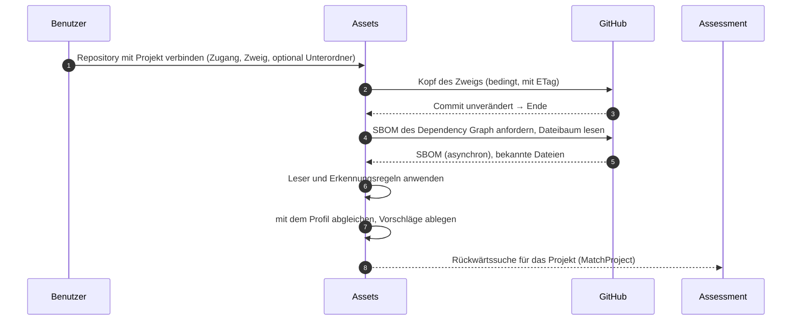

# 16 · Profil aus dem Repository

Ein Projekt lässt sich mit einem oder mehreren GitHub-Repositories verbinden. Ardea liest daraus alle Abhängigkeiten ein, hält sie aktuell und gleicht sie wie jede andere Komponente gegen die Einträge ab. Was das Repository nicht zeigen kann, ergänzt der Mensch im Wizard (Kapitel 11.6).

Entschieden am 18.11.2026 auf Rückfrage: Der Import gehört zum MVP, und mit ihm OSV als Paketquelle (Kapitel 5.6). Ohne OSV blieben die meisten Pakete ungeprüft, weil nur 12,9 % der CVE-Records Paketkoordinaten tragen (`prototypes/relevance-funnel/`). Wer ein Repository verbindet und «812 Pakete» sieht, aber keine Meldung erhält, hielte das für Entwarnung.

## 16.1 Ziel und Grenze

Das Repository beantwortet zuverlässig, **welche Pakete in welcher Version ausgeliefert werden**. Es beantwortet nicht zuverlässig, **was in Produktion läuft**: Die Datenbank im Compose-File ist oft nur die der Entwicklung, ein Docker-Tag wie `postgres:18` nennt nur eine Versionslinie, und Plugins, die jemand in der Administrationsoberfläche eines CMS installiert hat, stehen in keinem Repository.

Daraus folgt die Grundregel dieses Kapitels:

| Was | Wie es ins Profil kommt |
|---|---|
| Pakete aus Manifest- und Lockdateien | direkt als Komponenten, ohne Rückfrage |
| Plattformen, die sich aus Dateien ableiten lassen (Laufzeit, Datenbank, Webserver, Basis-Image) | als **Vorschlag** mit Beleg; Komponente erst nach Bestätigung |
| Was das Repository nicht zeigt (Hosting, Betriebssystem des Hosts, verwaltete Dienste, nachträglich installierte Plugins) | gezielte Fragen im Wizard, Suche im Katalog wie bisher |

Ardea liest Dateien, es baut und installiert nichts. Kein `npm install`, kein `dotnet restore`, kein Build, kein Skript aus dem Repository wird ausgeführt.

## 16.2 Ablauf

| Schritt | Job | Auslöser | Idempotenz über |
|---|---|---|---|
| Fälligkeit | Zeitplan der Instanz ermittelt fällige Verknüpfungen (Systemoperation, Kapitel 9.2) | alle 5 Minuten | `next_check_at` an der Verknüpfung |
| Einlesen | `IndexRepository(linkId)` | fällig, neu verbunden, «Jetzt einlesen» | Commit-SHA: derselbe Commit ergibt dasselbe Profil; ein wartender Job je Verknüpfung |
| Abgleich | Teil desselben Jobs, im schreibenden Schritt | neuer Commit | Identität der Komponenten (16.5) |
| Rückwärtssuche | `MatchProject(projectId)` (Kapitel 3.3) | Profil geändert | wie bisher |

`IndexRepository` ist ein Job mit Aussenkontakt und besteht aus den drei Schritten aus Kapitel 9.2: kurz lesen, ohne offene Transaktion mit GitHub sprechen, Ergebnis und Folgejobs in einer Transaktion schreiben. GitHub erzeugt die SBOM asynchron. Ist sie noch nicht fertig, reiht sich der Job mit 30 Sekunden Verzögerung neu ein, statt zu warten; nach 10 Minuten gilt der Lauf als fehlgeschlagen.

## 16.3 Was eingelesen wird

| Herkunft | Liefert | Wird zu |
|---|---|---|
| **SBOM des Dependency Graph** (SPDX JSON) | Pakete mit Paket-URL (purl) und Version aus allen Manifest- und Lockdateien, die GitHub auswertet. Die Unterscheidung direkt oder transitiv liefert GitHub nur für npm, Maven, pnpm und Yarn. | Komponenten der Art `library`, Herkunft `repository` |
| **Eigene Leser für Lockdateien**, wo der Dependency Graph Lücken hat | `packages.lock.json` von NuGet: GitHub liest bei NuGet nur die Projektdateien und keine transitiven Pakete. `package-lock.json` von npm für das Merkmal «nur Entwicklung», das die SBOM nicht sicher trägt. | ergänzt dieselben Komponenten |
| **Erkennungsregeln für Plattformdateien** | `FROM` in Dockerfiles, `image` in Compose-Dateien, `global.json`, `TargetFramework` in Projektdateien, `engines` und `.nvmrc`, `require.php` in `composer.json`, die `go`-Direktive in `go.mod` | Vorschläge mit Datei und Zeile als Beleg |

Gelesen wird der Dateibaum des Commits einmal; daraus werden die bekannten Dateien ausgewählt, höchstens 50 je Lauf und je Datei höchstens 1 MB. Bei einem Monorepo begrenzt ein Unterordner an der Verknüpfung, was zählt.

**Versionen.** Aus einer Lockdatei kommt die exakte Version. Steht ein Paket nur im Manifest (`"express": "^4.17.1"`), ist das ein Bereich und keine Version: Die Komponente erhält «Version unbekannt», die Abdeckung rät, die Lockdatei einzuchecken. Ein Image-Tag wie `18` oder `10.0` wird als Versionslinie vorgeschlagen. Der Wizard sagt, dass die laufende Version vom letzten Pull abhängt; bleibt es bei der Linie, ist die Versionsprüfung *unbekannt*.

**Prüfbar im MVP** sind die Ökosysteme, für die OSV im MVP abgefragt wird und für die ein Versionsvergleich existiert: npm, NuGet, Packagist, PyPI, Maven und Go (Kapitel 5.6, 6.6). Pakete anderer Ökosysteme (RubyGems, crates.io, GitHub Actions und weitere) werden eingelesen und angezeigt, erzeugen aber keine Befunde. Die Abdeckung führt sie als «noch nicht prüfbar» mit Anzahl. Sie werden prüfbar, sobald ihre Quelle und ihr Versionsschema dazukommen, ohne dass das Projekt neu verbunden werden muss.

**Katalog.** Erkennungsregeln bilden Images und Dateiangaben über den Katalog auf Produkte ab: `mcr.microsoft.com/dotnet/aspnet` auf ASP.NET Core, `postgres` auf PostgreSQL, `php:8.4-fpm` auf PHP. Der Katalog erhält dafür eine Spalte mit Image-Namen (Kapitel 4.5). Pakete brauchen keinen Katalogeintrag; sie werden über ihre purl abgeglichen. Führt der Katalog ein Produkt mit Paketkoordinaten (Umbraco CMS als `pkg:nuget/Umbraco.Cms`), trifft zusätzlich jeder CVE-Record zu diesem Produkt.

## 16.4 Zugang zu GitHub

| Fall | Zugang | Bemerkung |
|---|---|---|
| Öffentliches Repository | ohne Token | GitHub erlaubt ohne Token 60 Anfragen pro Stunde je Adresse der Instanz; ein Einlesen braucht je nach Repository 5 bis 60. Taugt zum Ausprobieren, nicht für viele Repositories. |
| Privates Repository, MVP | **Zugang der Organisation**: ein feingranulares Personal Access Token, nur lesend, nur für ausgewählte Repositories | Owner oder Admin hinterlegen es einmal; danach wählt jedes Mitglied mit Schreibrecht daraus Repositories aus. |
| Ausbaustufe | GitHub App der Instanz | kurzlebige Tokens, nicht an eine Person gebunden; Webhooks für sofortiges Einlesen, wo die Instanz erreichbar ist |
| GitHub Enterprise Server | Adresse der API, vom Instanz-Administrator eingetragen | ob der SBOM-Export dort verfügbar ist, hängt von der Version ab und ist ungeprüft (Kapitel 2.8) |
| GitLab, Azure DevOps, Bitbucket | später, hinter derselben Schnittstelle `IRepositoryHost` | |

Ein Token wird verschlüsselt gespeichert wie die übrigen Geheimnisse (Kapitel 9.4) und nach dem Speichern nie mehr angezeigt, nur seine letzten vier Zeichen und sein Ablaufdatum. GitHub meldet das Ablaufdatum eines Tokens in jeder Antwort. Ab 14 Tagen vor Ablauf zeigen Projekt und Einstellungen einen Hinweis. Ein klassisches Token mit breiten Rechten wird angenommen, aber mit einer Warnung, welche Rechte es mitbringt.

## 16.5 Abgleich mit dem Profil

Ein Einlesen ersetzt nicht das Profil, es gleicht ab. Die Regeln aus Kapitel 4.9 gelten weiter; dazu kommen diese:

| Frage | Festlegung |
|---|---|
| Wem gehört eine Komponente | Komponenten mit der Herkunft `repository` gehören ihrer Verknüpfung. Ob es sie gibt und welche Version sie hat, bestimmt das Repository. Erreichbarkeit, Kritikalität und Schutzmassnahme setzt der Mensch; sie überstehen jedes Einlesen. Manuelle Komponenten berührt ein Einlesen nie. |
| Version von Hand ändern | Bei Komponenten aus dem Repository nicht möglich. Wer abweichen will, löst die Komponente von der Verknüpfung; sie wird manuell und vom Einlesen nicht mehr verändert. |
| Identität | Zuerst über Verknüpfung, Paket und Version. Was so nicht zugeordnet wird, wird je Paket mit den übrigen Ständen desselben Pakets gepaart. Ein Versionswechsel ist damit eine Änderung derselben Komponente und kein Entfernen mit Neuanlage. |
| Version angehoben | Befunde, deren Bereich die neue Version nicht mehr enthält, schliessen mit «behoben durch Update» (Kapitel 7.4). Wer einen Pull Request von Dependabot oder Renovate zusammenführt, sieht der Reminder in Ardea nach dem nächsten Einlesen geschlossen. |
| Paket fehlt im neuen Stand | Die Komponente wird entfernt, ihre Reminder schliesst mit «Komponente entfernt». |
| Plötzlich viel weniger | Schrumpft die Paketliste einer Verknüpfung um mehr als die Hälfte, wird der neue Stand nicht übernommen, sondern zur Bestätigung angezeigt. So löscht ein abgeschalteter Dependency Graph oder eine leere SBOM kein Profil. |
| Einlesen schlägt fehl | Das Profil bleibt auf dem letzten guten Stand. Ein Fehler entfernt nie etwas. |
| Doppelt erfasst | Ein manuelles Produkt, das das Repository ebenfalls liefert (von Hand «Angular 22», im Repository `@angular/core` 22.2.1), bietet der Wizard zum Zusammenlegen an. Die Komponente übernimmt dann die Version aus dem Repository und gehört fortan der Verknüpfung. |
| Vorschläge | Bestätigte Vorschläge werden zu Komponenten mit Herkunft `repository` und Beleg. Abgelehnte merkt sich Ardea mit Datei und Wert und schlägt sie nicht erneut vor, solange sich die Angabe in der Datei nicht ändert. |
| Erstbefüllung | Das erste Einlesen einer Verknüpfung ist eine Erstbefüllung wie ein neues Projekt (Kapitel 7.7): keine Einzelalarme, eine Sammelnachricht `backfill.completed`. Jedes weitere Einlesen ist eine gewöhnliche Profiländerung; ein neu hinzugefügtes, verwundbares Paket meldet sich also wie jede neue Reminder. |

**Nur für die Entwicklung.** Pakete, die nur beim Bauen und Testen gebraucht werden (`devDependencies` bei npm), werden nicht ausgeliefert. Sie tragen das Merkmal `development`, und das Regelwerk begrenzt ihre Stufe auf 2, solange kein Mensch sie anders einstuft (Kapitel 7.6). Die Untergrenzen für aktiv ausgenutzte Lücken gelten trotzdem: Ein kompromittiertes Werkzeug auf dem Build-Server ist ein echtes Risiko. Fehlt die Angabe, gilt ein Paket als ausgeliefert.

**Transitive Pakete.** Auch ein Reminder zu einem transitiven Paket gehört zu genau einer Komponente. Wo die SBOM den Pfad kennt, nennt der Reminder das direkte Paket, über das es kommt («über `@angular/build` 22.2.0»). Oft ist dessen Update der eigentliche Schritt; das Ziel nennt deshalb beide.

## 16.6 Aktualität und Zustand

| Thema | Festlegung |
|---|---|
| Intervall | Vorgabe 60 Minuten je Verknüpfung, mit Versatz. Die Prüfung des Zweigkopfs ist eine bedingte Anfrage; eine unveränderte Antwort zählt bei GitHub nicht gegen das Kontingent des Tokens. |
| Sofort | «Jetzt einlesen» an Projekt und Verknüpfung. Webhooks kommen mit der GitHub App (16.4). |
| Zustand | `ok`; `partial`, wenn die SBOM fehlt und nur die eigenen Leser und Erkennungsregeln gelaufen sind (etwa weil der Dependency Graph abgeschaltet ist); `failing` mit Grund (Zugriff verweigert, Repository oder Zweig nicht gefunden, Token abgelaufen, SBOM nicht erhalten) und Beginn. |
| Veraltet | Jede Verknüpfung zeigt Commit und Zeitpunkt des letzten erfolgreichen Einlesens. Ist sie seit 3 Tagen `failing`, entsteht das Ereignis `repository.unavailable` (Kapitel 8.2) und die Übersicht zeigt einen Hinweis wie bei einer veralteten Quelle. |
| Kontingent | Ein Einlesen braucht 5 bis 60 Anfragen: Zweigkopf, SBOM anfordern und abholen, Dateibaum, ausgewählte Dateien. Mit Token stehen 5 000 Anfragen pro Stunde zur Verfügung. Antwortet GitHub mit einem Limit, verschiebt sich die Fälligkeit nach `Retry-After`. |

## 16.7 Ergänzen im Wizard

Das Repository ist im Wizard ein optionaler Schritt vor den Technologien (Kapitel 11.6). Während Ardea einliest, beantwortet der Benutzer die Fragen zum Betrieb. Danach zeigt der Schritt «Technologien» drei Gruppen:

1. **Aus dem Repository:** Pakete als Zusammenfassung je Ökosystem («1 042 npm-Pakete, davon 38 direkt; 142 NuGet-Pakete»), aufklappbar und durchsuchbar, nicht als lange Liste. Dazu, was nicht prüfbar ist und warum.
2. **Vorschläge zur Bestätigung:** jede abgeleitete Plattform mit Beleg («Dockerfile, Zeile 1: `FROM mcr.microsoft.com/dotnet/aspnet:10.0`»), vorbelegter Version und den Knöpfen Bestätigen, Ändern und Ablehnen.
3. **Was das Repository nicht zeigt:** gezielte Fragen, abgeleitet aus dem Gefundenen. Bei einer Datenbank im Compose-File: «Läuft in Produktion dieselbe Datenbank, oder ein verwalteter Dienst?» Bei WordPress: «Welche Plugins sind installiert?» Bei einem Dockerfile ohne Tag: «Welche Version des Images läuft?» Darunter die Katalogsuche wie bisher. Was schon im Schritt «Betrieb» beantwortet ist, fragt diese Gruppe nicht noch einmal.

Alles ist überspringbar. Einmal Bestätigtes oder Abgelehntes fragt der Wizard nicht erneut (Kapitel 11.8).

## 16.8 Mengen

Schätzung, nicht gemessen: Eine Angular-Anwendung bringt mit ihren Werkzeugen 900 bis 1 300 npm-Pakete mit, ein .NET-Dienst 100 bis 250 NuGet-Pakete. Eine Organisation mit 20 Repositories hält damit rund 20 000 Komponenten, je unter 1 kB, mit je einem Suchschlüssel. Für Datenbank und Kandidatensuche ist das unerheblich.

Für die Menge der Reminders ist es nicht unerheblich. Phase 2 beobachtet sie an Ardeas eigenem Repository und an zwei weiteren Repositories (Kapitel 14). Liegt die Zahl offener Reminders dort deutlich über der des Spikes, wird vor Phase 3 entschieden, ob transitive Pakete einer Verknüpfung zu einer Reminder je direktem Paket gebündelt werden. Das Datenmodell lässt beides zu, weil jede Komponente ihre übergeordnete kennt.

## 16.9 Sicherheit

| Risiko | Massnahme |
|---|---|
| Schadhafte Inhalte im Repository | Nur Lesen, nie Ausführen. Grössen- und Zahlgrenzen je Lauf; JSON- und XML-Leser ohne DTD und externe Entitäten; Pfade werden nicht aufgelöst, nur verglichen. |
| Abgezogenes Token | Lesezugriff auf Quellcode. Empfohlen und im Wizard vorbelegt: feingranular, nur lesend, nur ausgewählte Repositories, mit Ablauf. Verschlüsselt gespeichert, nie angezeigt, nie geloggt; Widerruf durch Löschen des Zugangs. |
| Ardea als Sprungbrett (SSRF) | Ziele sind fest: `api.github.com` und die Download-Hosts der SBOM. Eine Adresse für GitHub Enterprise Server setzt nur der Instanz-Administrator, geprüft wie ein Webhook-Ziel (Kapitel 9.5). Weiterleitungen nur auf die deklarierten Download-Hosts. |
| Abhängigkeitsliste als Angriffskarte | Sie ist Teil des Technologieprofils und gleich geschützt (Kapitel 9.4). Gespeichert werden Commit, Pfade der gelesenen Dateien, die letzte SBOM und die Ergebnisse, kein Quellcode. Nichts davon geht an ein Sprachmodell; dort landen wie bisher nur getroffene Komponenten. |
| Verfälschtes Profil | Wer in das Repository schreiben kann, kann das Profil ändern. Das ist gewollt, weil das Repository die Wahrheit über den Code ist. Jede Änderung durch ein Einlesen steht im Audit-Protokoll mit Commit als Herkunft. |

## 16.10 Was noch zu prüfen ist

> **Geklärt am 19.11.2026** durch den Versuch 2.9, siehe [ADR 032](../adr/0032-github-sbom-export.md): Rechte «Contents: read», öffentliche Repositories auch ohne Token, SPDX 2.3, Entwicklungsabhängigkeiten nicht gekennzeichnet, Pfad nur mit Lockdatei, abgeschalteter Graph antwortet 404, NuGet mit zentraler Paketverwaltung nicht aufgelöst, Download über `dgpproduction.blob.core.windows.net`.

Die Punkte stehen auch in Kapitel 2.8 und werden in Phase 2 mit dem Versuch 2.9 geklärt, bevor der Rest gebaut wird:

- Rechte, die ein feingranulares Token und eine GitHub App für den asynchronen SBOM-Export brauchen; ob er für öffentliche Repositories ohne Token antwortet; die SPDX-Version.
- Ob die SBOM Entwicklungsabhängigkeiten und den Abhängigkeitspfad kennzeichnet.
- Ob der Dependency Graph für private Repositories ohne Zutun eingeschaltet ist, und wie sich ein abgeschalteter in der Antwort zeigt.
- Ob NuGet mit zentraler Paketverwaltung (`Directory.Packages.props`) gelesen wird.
- Die Download-Hosts, auf die die fertige SBOM weiterleitet.

Die Schnittstelle ist in Bewegung: Der synchrone Export (`GET /repos/{owner}/{repo}/dependency-graph/sbom`) ist laut Dokumentation seit dem 13.11.2026 abgeschaltet; geplant wird deshalb nur mit dem asynchronen (`…/sbom/generate-report`, `…/sbom/fetch-report/{uuid}`). Fällt auch er weg, bleiben die eigenen Leser für Lockdateien als Rückfall; der Zustand ist dann `partial`.
